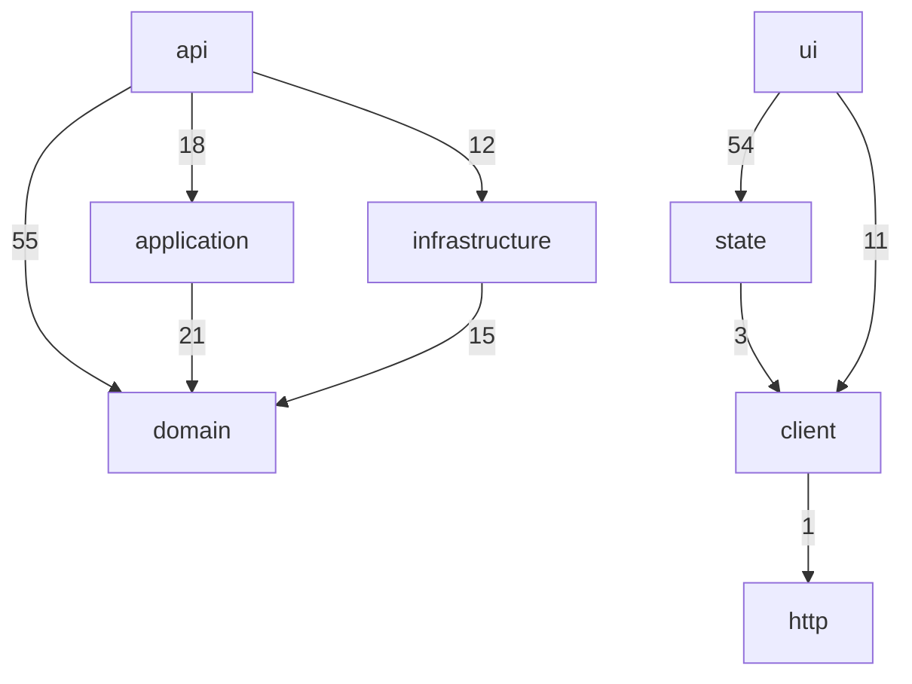

<!-- generated by docwizz: edits are overwritten -->
# Architecture description

Organised after the concepts of ISO/IEC/IEEE 42010. Sections marked _derived_ are generated from the code; _human-authored_ sections live in `architecture/` next to these pages and are never overwritten. This is a documentation structure, not a claim of conformance with the standard.

## Human-authored sections

| Section | Status |
|---|---|
| stakeholders | missing |
| concerns | missing |
| decisions | missing |
| deployment | missing |
| security | missing |

## Stakeholders and concerns

_Human-authored, missing:_ Who has an interest in the system — write `architecture/stakeholders.md`.

_Human-authored, missing:_ What they need the architecture to address — write `architecture/concerns.md`.

## Viewpoints and views

| Viewpoint | Addresses | View |
|---|---|---|
| System context | scope, external actors and systems | [System context](views/context.md) |
| Containers | deployable units and how they communicate | [Containers](views/containers.md) |
| Components | building blocks per layer and their dependencies | [Components](views/components.md) |
| Dependencies | layering rules, violations, cycles | [Dependencies](architecture.md) |
| API | interfaces offered to clients | [API](api.md) |
| Data | persisted entities and state | [Data](views/data.md) |
| Deployment | where the units run | [Deployment](views/deployment.md) |
| Packages | declared third-party packages, versions and manifests | [Packages](views/packages.md) |

## Architecture _(derived)_

| Layer | Files | May depend on |
|---|---|---|
| ui | 29 | state, client |
| state | 8 | client |
| client | 1 | http |
| api | 18 | application, domain, infrastructure |
| application | 14 | domain |
| domain | 24 | nothing |
| infrastructure | 40 | application, domain |

## Components _(derived)_

api: 64, application: 32, domain: 30, infrastructure: 22, no layer: 2, state: 5, ui: 39 — see [components](views/components.md).

## Interfaces _(derived)_

- 60 HTTP endpoints — see [API](api.md)
- 16 code interfaces: `Absence`, `Assignment`, `Contract`, `Coverage`, `DragPayload`, `DragState`, `Employee`, `HelpBlock`, `HelpTopic`, `PublicHoliday`, `Schedule`, `ShiftType`, `Team`, `Toast`, `ValidationIssue`, `ValidationResult`
- 7 frontend routes — see [frontend](frontend.md)

## Dependencies _(derived)_

12 layer dependencies (3 not allowed), 63 violations, 2 module cycles, 31 external packages — see [dependencies](architecture.md) and [context](views/context.md).

## Data flow _(derived)_

Allowed dependencies actually used, i.e. the paths requests and data take through the layers.

## Deployment

_Derived:_ [deployment view](views/deployment.md).

_Human-authored, missing:_ Environments, hosting and operations — write `architecture/deployment.md`.

## Security

_Derived:_ endpoint authorization as declared in code — authorization required: 57, none declared: 3.

Endpoints without declared authorization: `GET /health`, `POST /api/v1/auth/login`, `POST /api/v1/auth/refresh`

_Human-authored, missing:_ Threat model, authentication scheme, data protection — write `architecture/security.md`.

## Architecture decisions

_Human-authored, missing:_ Decisions and their rationale (or keep ADRs in docs/adr/) — write `architecture/decisions.md`.

