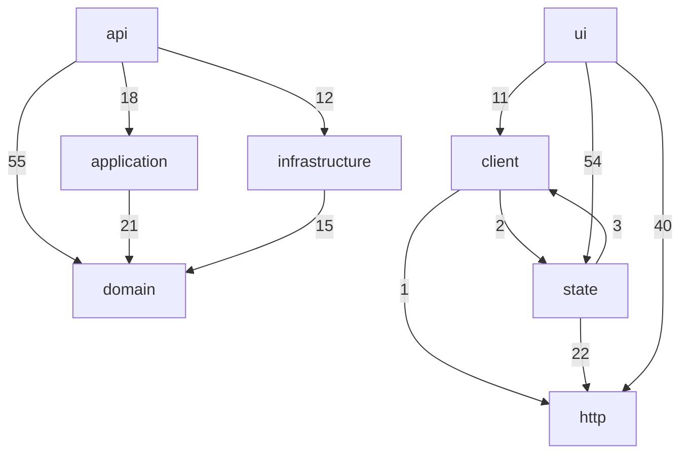
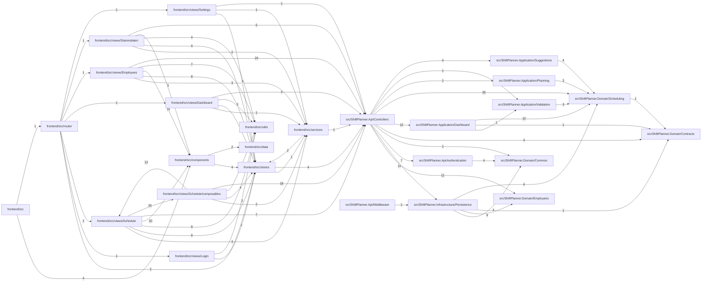

<!-- generated by docwizz: edits are overwritten -->
# Architecture

Views: [System context](views/context.md) · [Containers](views/containers.md) · [Components](views/components.md) · [Data](views/data.md) · [Deployment](views/deployment.md) · [Packages](views/packages.md)

## Layers

Actual dependencies between layers (edge label = number of references). Allowed per config: 
`ui → state/client`, `state → client`, `client → http`, `api → application/domain/infrastructure`, `application → domain`, `domain → ∅`, `infrastructure → application/domain`.

## Modules

## Violations (63)

| Rule | Layers | Severity | From | To | Example |
|---|---|---|---|---|---|
| ARCH-001 | client → state | high | [frontend/src/services/api.ts](../frontend/src/services/api.ts) | `frontend/src/stores/auth.ts` | frontend/src/services/api.ts imports frontend/src/stores/auth.ts |
| ARCH-002 | state → http | medium | [frontend/src/stores/auth.ts](../frontend/src/stores/auth.ts) | `POST /api/v1/auth/login` | useAuthStore calls HTTP directly |
| ARCH-002 | state → http | medium | [frontend/src/stores/auth.ts](../frontend/src/stores/auth.ts) | `POST /api/v1/auth/logout` | useAuthStore calls HTTP directly |
| ARCH-002 | state → http | medium | [frontend/src/stores/auth.ts](../frontend/src/stores/auth.ts) | `POST /api/v1/auth/logout-all` | useAuthStore calls HTTP directly |
| ARCH-002 | state → http | medium | [frontend/src/stores/auth.ts](../frontend/src/stores/auth.ts) | `POST /api/v1/auth/refresh` | useAuthStore calls HTTP directly |
| ARCH-002 | ui → http | medium | [frontend/src/views/Dashboard/DashboardView.vue](../frontend/src/views/Dashboard/DashboardView.vue) | `GET /api/dashboard` | DashboardView calls HTTP directly |
| ARCH-002 | ui → http | medium | [frontend/src/views/Dashboard/DashboardView.vue](../frontend/src/views/Dashboard/DashboardView.vue) | `GET /api/teams` | DashboardView calls HTTP directly |
| ARCH-002 | ui → http | medium | [frontend/src/views/Dashboard/DashboardView.vue](../frontend/src/views/Dashboard/DashboardView.vue) | `GET /api/shift-types` | DashboardView calls HTTP directly |
| ARCH-002 | ui → http | medium | [frontend/src/views/Employees/EmployeeDetailModal.vue](../frontend/src/views/Employees/EmployeeDetailModal.vue) | `PUT /api/employees/{id:guid}` | EmployeeDetailModal calls HTTP directly |
| ARCH-002 | ui → http | medium | [frontend/src/views/Employees/EmployeeDetailModal.vue](../frontend/src/views/Employees/EmployeeDetailModal.vue) | `GET /api/shift-types` | EmployeeDetailModal calls HTTP directly |
| ARCH-002 | ui → http | medium | [frontend/src/views/Employees/EmployeeDetailModal.vue](../frontend/src/views/Employees/EmployeeDetailModal.vue) | `GET /api/employees/{id:guid}/eligible-shift-types` | EmployeeDetailModal calls HTTP directly |
| ARCH-002 | ui → http | medium | [frontend/src/views/Employees/EmployeeDetailModal.vue](../frontend/src/views/Employees/EmployeeDetailModal.vue) | `PUT /api/employees/{id:guid}/eligible-shift-types` | EmployeeDetailModal calls HTTP directly |
| ARCH-002 | ui → http | medium | [frontend/src/views/Employees/EmployeeDetailModal.vue](../frontend/src/views/Employees/EmployeeDetailModal.vue) | `GET /api/employees/{id:guid}/shift-type-preferences` | EmployeeDetailModal calls HTTP directly |
| ARCH-002 | ui → http | medium | [frontend/src/views/Employees/EmployeeDetailModal.vue](../frontend/src/views/Employees/EmployeeDetailModal.vue) | `GET /api/employees/{id:guid}/weekday-preferences` | EmployeeDetailModal calls HTTP directly |
| ARCH-002 | ui → http | medium | [frontend/src/views/Employees/EmployeeDetailModal.vue](../frontend/src/views/Employees/EmployeeDetailModal.vue) | `PUT /api/employees/{id:guid}/shift-type-preferences` | EmployeeDetailModal calls HTTP directly |
| ARCH-002 | ui → http | medium | [frontend/src/views/Employees/EmployeeDetailModal.vue](../frontend/src/views/Employees/EmployeeDetailModal.vue) | `PUT /api/employees/{id:guid}/weekday-preferences` | EmployeeDetailModal calls HTTP directly |
| ARCH-002 | ui → http | medium | [frontend/src/views/Employees/EmployeeDetailModal.vue](../frontend/src/views/Employees/EmployeeDetailModal.vue) | `GET /api/employees/{employeeId:guid}/contracts` | EmployeeDetailModal calls HTTP directly |
| ARCH-002 | ui → http | medium | [frontend/src/views/Employees/EmployeeDetailModal.vue](../frontend/src/views/Employees/EmployeeDetailModal.vue) | `PUT /api/contracts/{id:guid}` | EmployeeDetailModal calls HTTP directly |
| ARCH-002 | ui → http | medium | [frontend/src/views/Employees/EmployeeDetailModal.vue](../frontend/src/views/Employees/EmployeeDetailModal.vue) | `POST /api/employees/{employeeId:guid}/contracts` | EmployeeDetailModal calls HTTP directly |
| ARCH-002 | ui → http | medium | [frontend/src/views/Employees/EmployeeDetailModal.vue](../frontend/src/views/Employees/EmployeeDetailModal.vue) | `DELETE /api/contracts/{id:guid}` | EmployeeDetailModal calls HTTP directly |
| ARCH-002 | ui → http | medium | [frontend/src/views/Employees/EmployeeDetailModal.vue](../frontend/src/views/Employees/EmployeeDetailModal.vue) | `GET /api/employees/{employeeId:guid}/absences` | EmployeeDetailModal calls HTTP directly |
| ARCH-002 | ui → http | medium | [frontend/src/views/Employees/EmployeeDetailModal.vue](../frontend/src/views/Employees/EmployeeDetailModal.vue) | `POST /api/employees/{employeeId:guid}/absences` | EmployeeDetailModal calls HTTP directly |
| ARCH-002 | ui → http | medium | [frontend/src/views/Employees/EmployeeDetailModal.vue](../frontend/src/views/Employees/EmployeeDetailModal.vue) | `DELETE /api/absences/{id:guid}` | EmployeeDetailModal calls HTTP directly |
| ARCH-002 | ui → http | medium | [frontend/src/views/Employees/EmployeeDetailModal.vue](../frontend/src/views/Employees/EmployeeDetailModal.vue) | `GET /api/employees/{employeeId:guid}/hours-adjustments` | EmployeeDetailModal calls HTTP directly |
| ARCH-002 | ui → http | medium | [frontend/src/views/Employees/EmployeeDetailModal.vue](../frontend/src/views/Employees/EmployeeDetailModal.vue) | `POST /api/employees/{employeeId:guid}/hours-adjustments` | EmployeeDetailModal calls HTTP directly |
| ARCH-002 | ui → http | medium | [frontend/src/views/Employees/EmployeeDetailModal.vue](../frontend/src/views/Employees/EmployeeDetailModal.vue) | `DELETE /api/hours-adjustments/{id:guid}` | EmployeeDetailModal calls HTTP directly |
| ARCH-002 | ui → http | medium | [frontend/src/views/Employees/EmployeesView.vue](../frontend/src/views/Employees/EmployeesView.vue) | `GET /api/employees` | EmployeesView calls HTTP directly |
| ARCH-002 | ui → http | medium | [frontend/src/views/Employees/EmployeesView.vue](../frontend/src/views/Employees/EmployeesView.vue) | `GET /api/teams` | EmployeesView calls HTTP directly |
| ARCH-002 | ui → http | medium | [frontend/src/views/Employees/EmployeesView.vue](../frontend/src/views/Employees/EmployeesView.vue) | `POST /api/employees` | EmployeesView calls HTTP directly |
| ARCH-002 | ui → http | medium | [frontend/src/views/Employees/EmployeesView.vue](../frontend/src/views/Employees/EmployeesView.vue) | `DELETE /api/employees/{id:guid}` | EmployeesView calls HTTP directly |
| ARCH-002 | ui → http | medium | [frontend/src/views/Employees/HoursReportModal.vue](../frontend/src/views/Employees/HoursReportModal.vue) | `GET /api/shift-types` | HoursReportModal calls HTTP directly |
| ARCH-002 | ui → http | medium | [frontend/src/views/Employees/HoursReportModal.vue](../frontend/src/views/Employees/HoursReportModal.vue) | `GET /api/employees/{id:guid}/hours-report` | HoursReportModal calls HTTP directly |
| ARCH-002 | ui → http | medium | [frontend/src/views/Schedule/AutoFillModal.vue](../frontend/src/views/Schedule/AutoFillModal.vue) | `GET /api/schedules/{id:guid}/auto-fill-preview` | AutoFillModal calls HTTP directly |
| ARCH-002 | ui → http | medium | [frontend/src/views/Schedule/AutoFillModal.vue](../frontend/src/views/Schedule/AutoFillModal.vue) | `POST /api/schedules/{id:guid}/auto-fill` | AutoFillModal calls HTTP directly |
| ARCH-002 | ui → http | medium | [frontend/src/views/Schedule/ScheduleView.vue](../frontend/src/views/Schedule/ScheduleView.vue) | `DELETE /api/assignments/{id:guid}` | ScheduleView calls HTTP directly |
| ARCH-002 | ui → http | medium | [frontend/src/views/Schedule/ShiftAssignmentModal.vue](../frontend/src/views/Schedule/ShiftAssignmentModal.vue) | `PUT /api/assignments/{id:guid}` | ShiftAssignmentModal calls HTTP directly |
| ARCH-002 | ui → http | medium | [frontend/src/views/Schedule/ShiftAssignmentModal.vue](../frontend/src/views/Schedule/ShiftAssignmentModal.vue) | `DELETE /api/assignments/{id:guid}` | ShiftAssignmentModal calls HTTP directly |
| ARCH-002 | ui → http | medium | [frontend/src/views/Schedule/ShiftSuggestionModal.vue](../frontend/src/views/Schedule/ShiftSuggestionModal.vue) | `GET /api/schedules/{id:guid}/suggestions` | ShiftSuggestionModal calls HTTP directly |
| ARCH-002 | ui → http | medium | [frontend/src/views/Schedule/ShiftSuggestionModal.vue](../frontend/src/views/Schedule/ShiftSuggestionModal.vue) | `POST /api/schedules/{id:guid}/assignments` | ShiftSuggestionModal calls HTTP directly |
| ARCH-002 | state → http | medium | [frontend/src/views/Schedule/composables/usePlanningActions.ts](../frontend/src/views/Schedule/composables/usePlanningActions.ts) | `POST /api/schedules` | usePlanningActions calls HTTP directly |
| ARCH-002 | state → http | medium | [frontend/src/views/Schedule/composables/usePlanningActions.ts](../frontend/src/views/Schedule/composables/usePlanningActions.ts) | `GET /api/schedules` | usePlanningActions calls HTTP directly |
| ARCH-002 | state → http | medium | [frontend/src/views/Schedule/composables/usePlanningActions.ts](../frontend/src/views/Schedule/composables/usePlanningActions.ts) | `POST /api/schedules/{id:guid}/publish` | usePlanningActions calls HTTP directly |
| ARCH-002 | state → http | medium | [frontend/src/views/Schedule/composables/usePlanningActions.ts](../frontend/src/views/Schedule/composables/usePlanningActions.ts) | `POST /api/schedules/{id:guid}/archive` | usePlanningActions calls HTTP directly |
| ARCH-002 | state → http | medium | [frontend/src/views/Schedule/composables/usePlanningActions.ts](../frontend/src/views/Schedule/composables/usePlanningActions.ts) | `POST /api/schedules/{id:guid}/copy` | usePlanningActions calls HTTP directly |
| ARCH-002 | state → http | medium | [frontend/src/views/Schedule/composables/usePlanningActions.ts](../frontend/src/views/Schedule/composables/usePlanningActions.ts) | `POST /api/schedules/{id:guid}/assignments` | usePlanningActions calls HTTP directly |
| ARCH-002 | state → http | medium | [frontend/src/views/Schedule/composables/usePlanningActions.ts](../frontend/src/views/Schedule/composables/usePlanningActions.ts) | `PUT /api/assignments/{id:guid}` | usePlanningActions calls HTTP directly |
| ARCH-002 | state → http | medium | [frontend/src/views/Schedule/composables/usePlanningBoard.ts](../frontend/src/views/Schedule/composables/usePlanningBoard.ts) | `GET /api/public-holidays` | usePlanningBoard calls HTTP directly |
| ARCH-002 | state → http | medium | [frontend/src/views/Schedule/composables/usePlanningBoard.ts](../frontend/src/views/Schedule/composables/usePlanningBoard.ts) | `GET /api/employees/{id:guid}/hours-balance` | usePlanningBoard calls HTTP directly |
| ARCH-002 | state → http | medium | [frontend/src/views/Schedule/composables/usePlanningBoard.ts](../frontend/src/views/Schedule/composables/usePlanningBoard.ts) | `GET /api/employees/{id:guid}/eligible-shift-types` | usePlanningBoard calls HTTP directly |
| ARCH-002 | state → http | medium | [frontend/src/views/Schedule/composables/usePlanningBoard.ts](../frontend/src/views/Schedule/composables/usePlanningBoard.ts) | `GET /api/schedules/{id:guid}` | usePlanningBoard calls HTTP directly |
| ARCH-002 | state → http | medium | [frontend/src/views/Schedule/composables/usePlanningBoard.ts](../frontend/src/views/Schedule/composables/usePlanningBoard.ts) | `GET /api/schedules/{id:guid}/validate` | usePlanningBoard calls HTTP directly |
| ARCH-002 | state → http | medium | [frontend/src/views/Schedule/composables/usePlanningBoard.ts](../frontend/src/views/Schedule/composables/usePlanningBoard.ts) | `GET /api/schedules` | usePlanningBoard calls HTTP directly |
| ARCH-002 | state → http | medium | [frontend/src/views/Schedule/composables/usePlanningBoard.ts](../frontend/src/views/Schedule/composables/usePlanningBoard.ts) | `GET /api/employees` | usePlanningBoard calls HTTP directly |
| ARCH-002 | state → http | medium | [frontend/src/views/Schedule/composables/usePlanningBoard.ts](../frontend/src/views/Schedule/composables/usePlanningBoard.ts) | `GET /api/shift-types` | usePlanningBoard calls HTTP directly |
| ARCH-002 | state → http | medium | [frontend/src/views/Schedule/composables/usePlanningBoard.ts](../frontend/src/views/Schedule/composables/usePlanningBoard.ts) | `GET /api/teams` | usePlanningBoard calls HTTP directly |
| ARCH-002 | state → http | medium | [frontend/src/views/Schedule/composables/usePlanningBoard.ts](../frontend/src/views/Schedule/composables/usePlanningBoard.ts) | `GET /api/employees/{employeeId:guid}/contracts` | usePlanningBoard calls HTTP directly |
| ARCH-002 | state → http | medium | [frontend/src/views/Schedule/composables/usePlanningBoard.ts](../frontend/src/views/Schedule/composables/usePlanningBoard.ts) | `GET /api/employees/{employeeId:guid}/absences` | usePlanningBoard calls HTTP directly |
| ARCH-002 | ui → http | medium | [frontend/src/views/Settings/SettingsView.vue](../frontend/src/views/Settings/SettingsView.vue) | `GET /api/teams` | SettingsView calls HTTP directly |
| ARCH-002 | ui → http | medium | [frontend/src/views/Stammdaten/ShiftTypeDetailModal.vue](../frontend/src/views/Stammdaten/ShiftTypeDetailModal.vue) | `PUT /api/shift-types/{id:guid}` | ShiftTypeDetailModal calls HTTP directly |
| ARCH-002 | ui → http | medium | [frontend/src/views/Stammdaten/StammdatenView.vue](../frontend/src/views/Stammdaten/StammdatenView.vue) | `GET /api/teams` | StammdatenView calls HTTP directly |
| ARCH-002 | ui → http | medium | [frontend/src/views/Stammdaten/StammdatenView.vue](../frontend/src/views/Stammdaten/StammdatenView.vue) | `GET /api/shift-types` | StammdatenView calls HTTP directly |
| ARCH-002 | ui → http | medium | [frontend/src/views/Stammdaten/StammdatenView.vue](../frontend/src/views/Stammdaten/StammdatenView.vue) | `POST /api/teams` | StammdatenView calls HTTP directly |
| ARCH-002 | ui → http | medium | [frontend/src/views/Stammdaten/StammdatenView.vue](../frontend/src/views/Stammdaten/StammdatenView.vue) | `POST /api/shift-types` | StammdatenView calls HTTP directly |

## Cycles (2)

- [frontend/src/services](modules/frontend-src-services.md) ↔ [frontend/src/stores](modules/frontend-src-stores.md)
- [frontend/src/views/Schedule](modules/frontend-src-views-Schedule.md) ↔ [frontend/src/views/Schedule/composables](modules/frontend-src-views-Schedule-composables.md)

## Coupling

Fan-in: modules that depend on this one. Fan-out: modules it depends on. Instability = fan-out / (fan-in + fan-out); stable modules (near 0) are costly to change, so they should not depend on unstable ones.

| Module | Layer | Fan-in | Fan-out | Instability |
|---|---|---|---|---|
| [src/ShiftPlanner.Api/Controllers](modules/src-ShiftPlanner.Api-Controllers.md) | api | 8 | 10 | 0.56 |
| [frontend/src/stores](modules/frontend-src-stores.md) | state | 10 | 2 | 0.17 |
| [frontend/src/services](modules/frontend-src-services.md) | client | 7 | 2 | 0.22 |
| [frontend/src/router](modules/frontend-src-router.md) | — | 1 | 7 | 0.88 |
| [frontend/src/views/Schedule](modules/frontend-src-views-Schedule.md) | ui | 2 | 6 | 0.75 |
| [src/ShiftPlanner.Domain/Scheduling](modules/src-ShiftPlanner.Domain-Scheduling.md) | domain | 6 | 1 | 0.14 |
| [frontend/src/components](modules/frontend-src-components.md) | ui | 4 | 2 | 0.33 |
| [frontend/src/utils](modules/frontend-src-utils.md) | — | 6 | 0 | 0.00 |
| [frontend/src/views/Employees](modules/frontend-src-views-Employees.md) | ui | 1 | 5 | 0.83 |
| [frontend/src/views/Schedule/composables](modules/frontend-src-views-Schedule-composables.md) | state | 1 | 5 | 0.83 |
| [frontend/src/views/Stammdaten](modules/frontend-src-views-Stammdaten.md) | ui | 1 | 5 | 0.83 |
| [src/ShiftPlanner.Infrastructure/Persistence](modules/src-ShiftPlanner.Infrastructure-Persistence.md) | infrastructure | 2 | 4 | 0.67 |
| [frontend/src/views/Dashboard](modules/frontend-src-views-Dashboard.md) | ui | 1 | 4 | 0.80 |
| [frontend/src/views/Settings](modules/frontend-src-views-Settings.md) | ui | 1 | 3 | 0.75 |
| [src/ShiftPlanner.Application/Dashboard](modules/src-ShiftPlanner.Application-Dashboard.md) | application | 1 | 3 | 0.75 |
| [src/ShiftPlanner.Domain/Contracts](modules/src-ShiftPlanner.Domain-Contracts.md) | domain | 4 | 0 | 0.00 |

_… 10 more modules._

## Risks (11)

- Logic in the API layer: `DashboardController.Get(DateOnly?, DateOnly?, Guid?, Guid?, CancellationToken)` has complexity 22 — move the decisions into the application layer ([DashboardController.cs](../src/ShiftPlanner.Api/Controllers/DashboardController.cs#L27))
- Logic in the API layer: `PlanningBoardController.Get(DateOnly, DateOnly, Guid?)` has complexity 14 — move the decisions into the application layer ([PlanningBoardController.cs](../src/ShiftPlanner.Api/Controllers/PlanningBoardController.cs#L34))
- Logic in the API layer: `EmployeesController.HoursReport(Guid, DateOnly, DateOnly)` has complexity 13 — move the decisions into the application layer ([EmployeesController.cs](../src/ShiftPlanner.Api/Controllers/EmployeesController.cs#L103))
- Logic in the API layer: `SchedulesController.CreateAssignment(Guid, CreateAssignmentRequest)` has complexity 13 — move the decisions into the application layer ([SchedulesController.cs](../src/ShiftPlanner.Api/Controllers/SchedulesController.cs#L547))
- Logic in the API layer: `SchedulesController.AutoFillPreview(Guid, DateOnly?, DateOnly?, CancellationToken)` has complexity 11 — move the decisions into the application layer ([SchedulesController.cs](../src/ShiftPlanner.Api/Controllers/SchedulesController.cs#L435))
- Logic in the API layer: `SchedulesController.UpdateAssignment(Guid, UpdateAssignmentRequest)` has complexity 10 — move the decisions into the application layer ([SchedulesController.cs](../src/ShiftPlanner.Api/Controllers/SchedulesController.cs#L605))
- Logic in the API layer: `SchedulesController.CopyMonth(Guid, CopyMonthRequest)` has complexity 9 — move the decisions into the application layer ([SchedulesController.cs](../src/ShiftPlanner.Api/Controllers/SchedulesController.cs#L315))
- Logic in the API layer: `SchedulesController.Suggest(Guid, DateOnly, Guid)` has complexity 9 — move the decisions into the application layer ([SchedulesController.cs](../src/ShiftPlanner.Api/Controllers/SchedulesController.cs#L385))
- Logic in the API layer: `SchedulesController.AutoFillCommit(Guid, AutoFillCommitRequest)` has complexity 9 — move the decisions into the application layer ([SchedulesController.cs](../src/ShiftPlanner.Api/Controllers/SchedulesController.cs#L486))
- Logic in the API layer: `StaffingRequirementsController.Update(Guid, UpdateStaffingRequirementRequest)` has complexity 9 — move the decisions into the application layer ([StaffingRequirementsController.cs](../src/ShiftPlanner.Api/Controllers/StaffingRequirementsController.cs#L72))
- Logic in the API layer: `ContractsController.Update(Guid, UpdateContractRequest)` has complexity 8 — move the decisions into the application layer ([ContractsController.cs](../src/ShiftPlanner.Api/Controllers/ContractsController.cs#L99))
