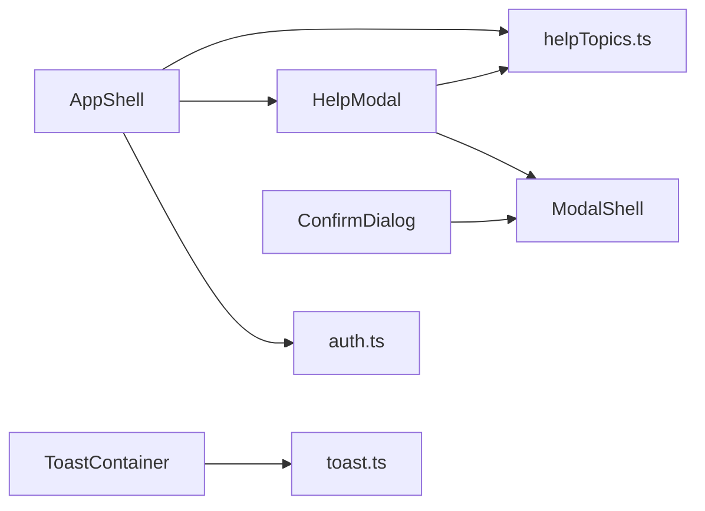

<!-- generated by docwizz: edits are overwritten -->
# frontend/src/components

Layer **ui** · project `frontend` · UI components: 5

Project navigation: [frontend](../projects/frontend-da6498268e99.md)

## Overview 🤖

Contains reusable Vue.js components for the frontend application.

**Responsibilities.** Provides UI components for various functionalities such as displaying help, confirming actions, and managing modals.

**Usage.** Used across different views and pages in the frontend application to enhance user interaction and provide consistent UI elements.

_AI draft from the facts on this page; review it, then write the module's documentation yourself._

## Key components

| Component | Kind | Used by | Summary |
|---|---|---|---|
| [ModalShell](#modalshell) | component | 8 | A tap that opens this modal (e.g. an assignment chip on a touch device) is followed by the browser's synthetic "click" compatibility event at the same coordinates — which, once the backdrop exists, lands squarely on it and would immediately close what the tap just opened. Ignore backdrop clicks in the brief window right after mount so only a real outside tap closes the modal. |
| [ConfirmDialog](#confirmdialog) | component | 4 |  |
| [AppShell](#appshell) | component | 1 | Global "Hilfe" entry point (stakeholder-facing German explanations, data/helpTopics.ts) — reachable from every page, not just the Dienstplan's own separate keyboard-shortcuts panel. Opens pre-selected to the topic matching the page it was opened from. |
| [HelpModal](#helpmodal) | component | 1 | 🤖 _Displays help topics in a modal, allowing users to select and view different topics._ |
| [ToastContainer](#toastcontainer) | component | 1 |  |

## Flows through this module

- `/` → MonthOverviewView → AutoFillModal, parseIso, startOfWeek, toIso, usePlanningActions, usePlanningBoard, +1 more → addDays, addMonths, extractErrorMessage, firstOfMonth, GET /api/employees, GET /api/employees/{employeeId:guid}/absences, +21 more
- `/dienstplan/woche/:date` → ScheduleView → addDays, ConfirmDialog, DELETE /api/assignments/{id:guid}, EmployeeSidebar, extractErrorMessage, ModalShell, +17 more → addMonths, EmployeeScheduleRow, firstOfMonth, GET /api/employees, GET /api/employees/{employeeId:guid}/absences, GET /api/employees/{employeeId:guid}/contracts, +18 more
- `/employees` → EmployeesView → ConfirmDialog, DELETE /api/employees/{id:guid}, EmployeeDetailModal, extractErrorMessage, GET /api/employees, GET /api/teams, +3 more → DELETE /api/absences/{id:guid}, DELETE /api/contracts/{id:guid}, DELETE /api/hours-adjustments/{id:guid}, GET /api/employees/{employeeId:guid}/absences, GET /api/employees/{employeeId:guid}/contracts, GET /api/employees/{employeeId:guid}/hours-adjustments, +16 more → POST /api/v1/auth/login, POST /api/v1/auth/logout, POST /api/v1/auth/logout-all, POST /api/v1/auth/refresh
- `/stammdaten` → StammdatenView → extractErrorMessage, GET /api/shift-types, GET /api/teams, POST /api/shift-types, POST /api/teams, ShiftTypeDetailModal, +1 more → ModalShell, PUT /api/shift-types/{id:guid}

## Documentation gaps

1 items need documentation (0 critical):

- medium: `frontend/src/components/vue` — missing summary, param (public; complexity 11)

## Dependencies

Depends on: [frontend/src/data](frontend-src-data.md), [frontend/src/stores](frontend-src-stores.md)

Used by: [frontend/src](frontend-src.md), [frontend/src/views/Employees](frontend-src-views-Employees.md), [frontend/src/views/Schedule](frontend-src-views-Schedule.md), [frontend/src/views/Stammdaten](frontend-src-views-Stammdaten.md)

## Components

### AppShell

_component_ · [AppShell.vue](../../frontend/src/components/AppShell.vue#L1)

Global "Hilfe" entry point (stakeholder-facing German explanations, data/helpTopics.ts) — reachable from every page, not just the Dienstplan's own separate keyboard-shortcuts panel. Opens pre-selected to the topic matching the page it was opened from.

- **dependencies** _(fact)_: auth.ts, HelpModal, helpTopics.ts
- **state** _(fact)_: showHelp, mobileOpen, watch mobileOpen

_Evidence:_ [frontend/src/components/AppShell.vue:1-143](../../frontend/src/components/AppShell.vue#L1), [frontend/src/stores/auth.ts:1](../../frontend/src/stores/auth.ts#L1), [frontend/src/components/HelpModal.vue:1-61](../../frontend/src/components/HelpModal.vue#L1), [frontend/src/data/helpTopics.ts:1](../../frontend/src/data/helpTopics.ts#L1)

### ConfirmDialog

_component_ · [ConfirmDialog.vue](../../frontend/src/components/ConfirmDialog.vue#L1)

Props: title: string, message: string, confirmLabel: string

Emits: confirm, close

_Reached from:_ [`/dienstplan/woche/:date`](../frontend.md#flows), [`/employees`](../frontend.md#flows)

### HelpModal

_component_ · [HelpModal.vue](../../frontend/src/components/HelpModal.vue#L1) ⚠

🤖 _Displays help topics in a modal, allowing users to select and view different topics._

Props: initialTopicId: string

Emits: close

- **dependencies** _(fact)_: ModalShell, helpTopics.ts
- **events** _(fact)_: close
- **state** _(fact)_: activeTopicId
- **responsibilities** _(🤖 draft)_: Manages the active help topic and renders the help modal with the selected topic's content.
- **behaviour** _(🤖 draft)_: Initializes with an optional initial topic ID; renders a modal with a dropdown for selecting topics and displays the selected topic's content.
- **usage** _(🤖 draft)_: Used in the app shell to provide help functionality.

_Evidence:_ [frontend/src/components/HelpModal.vue:1-61](../../frontend/src/components/HelpModal.vue#L1), [frontend/src/components/ModalShell.vue:1-53](../../frontend/src/components/ModalShell.vue#L1), [frontend/src/data/helpTopics.ts:1](../../frontend/src/data/helpTopics.ts#L1)

### ModalShell

_component_ · [ModalShell.vue](../../frontend/src/components/ModalShell.vue#L1)

A tap that opens this modal (e.g. an assignment chip on a touch device) is followed by the browser's synthetic "click" compatibility event at the same coordinates — which, once the backdrop exists, lands squarely on it and would immediately close what the tap just opened. Ignore backdrop clicks in the brief window right after mount so only a real outside tap closes the modal.

Props: title: string, wide: boolean

Emits: close

_Reached from:_ [`/`](../frontend.md#flows), [`/dienstplan/woche/:date`](../frontend.md#flows), [`/employees`](../frontend.md#flows), [`/stammdaten`](../frontend.md#flows)

### ToastContainer

_component_ · [ToastContainer.vue](../../frontend/src/components/ToastContainer.vue#L1)

---
_Generated from 5 symbols in [frontend/src/components/AppShell.vue](../../frontend/src/components/AppShell.vue), [frontend/src/components/ConfirmDialog.vue](../../frontend/src/components/ConfirmDialog.vue), [frontend/src/components/HelpModal.vue](../../frontend/src/components/HelpModal.vue), [frontend/src/components/ModalShell.vue](../../frontend/src/components/ModalShell.vue), [frontend/src/components/ToastContainer.vue](../../frontend/src/components/ToastContainer.vue) (commit `11abf0b`, profile `default`). Sections marked _fact_ are read from the code, _inferred_ come from heuristics, 🤖 marks AI drafts._
