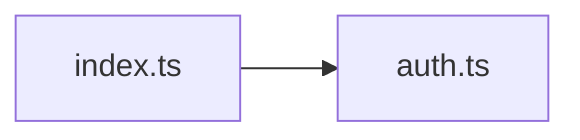

<!-- generated by docwizz: edits are overwritten -->
# frontend/src/router

project `frontend`

Project navigation: [frontend](../projects/frontend-da6498268e99.md)

## Flows through this module

- `/` → MonthOverviewView → AutoFillModal, parseIso, startOfWeek, toIso, usePlanningActions, usePlanningBoard, +1 more → addDays, addMonths, extractErrorMessage, firstOfMonth, GET /api/employees, GET /api/employees/{employeeId:guid}/absences, +21 more
- `/dashboard` → DashboardView → extractErrorMessage, GET /api/dashboard, GET /api/shift-types, GET /api/teams, useSettingsStore
- `/dienstplan/woche/:date` → ScheduleView → addDays, ConfirmDialog, DELETE /api/assignments/{id:guid}, EmployeeSidebar, extractErrorMessage, ModalShell, +17 more → addMonths, EmployeeScheduleRow, firstOfMonth, GET /api/employees, GET /api/employees/{employeeId:guid}/absences, GET /api/employees/{employeeId:guid}/contracts, +18 more
- `/employees` → EmployeesView → ConfirmDialog, DELETE /api/employees/{id:guid}, EmployeeDetailModal, extractErrorMessage, GET /api/employees, GET /api/teams, +3 more → DELETE /api/absences/{id:guid}, DELETE /api/contracts/{id:guid}, DELETE /api/hours-adjustments/{id:guid}, GET /api/employees/{employeeId:guid}/absences, GET /api/employees/{employeeId:guid}/contracts, GET /api/employees/{employeeId:guid}/hours-adjustments, +16 more → POST /api/v1/auth/login, POST /api/v1/auth/logout, POST /api/v1/auth/logout-all, POST /api/v1/auth/refresh
- `/login` → LoginView → extractErrorMessage, useAuthStore → POST /api/v1/auth/login, POST /api/v1/auth/logout, POST /api/v1/auth/logout-all, POST /api/v1/auth/refresh
- `/settings` → SettingsView → GET /api/teams, useAuthStore, useSettingsStore, useToastStore → POST /api/v1/auth/login, POST /api/v1/auth/logout, POST /api/v1/auth/logout-all, POST /api/v1/auth/refresh
- `/stammdaten` → StammdatenView → extractErrorMessage, GET /api/shift-types, GET /api/teams, POST /api/shift-types, POST /api/teams, ShiftTypeDetailModal, +1 more → ModalShell, PUT /api/shift-types/{id:guid}

## Dependencies

Depends on: [frontend/src/stores](frontend-src-stores.md)

Used by: [frontend/src](frontend-src.md)

## Components

### index.ts

_module_ · [index.ts](../../frontend/src/router/index.ts#L1)

---
_Generated from 1 symbols in [frontend/src/router/index.ts](../../frontend/src/router/index.ts) (commit `534b8b5`, profile `default`). Sections marked _fact_ are read from the code, _inferred_ come from heuristics, 🤖 marks AI drafts._
