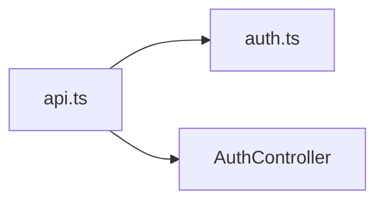

<!-- generated by docwizz: edits are overwritten -->
# frontend/src/services

Layer **client** · project `frontend`

Project navigation: [frontend](../projects/frontend-da6498268e99.md)

## Architecture observations

- ARCH-001 (high): client → state is not allowed — frontend/src/services/api.ts imports frontend/src/stores/auth.ts ([api.ts](../../frontend/src/services/api.ts))
- ARCH-003: part of a dependency cycle [frontend/src/services](frontend-src-services.md) ↔ [frontend/src/stores](frontend-src-stores.md) — these modules can't be understood or changed independently

## Dependencies

Depends on: [frontend/src/stores](frontend-src-stores.md), [src/ShiftPlanner.Api/Controllers](src-ShiftPlanner.Api-Controllers.md)

Used by: [frontend/src/stores](frontend-src-stores.md), [frontend/src/views/Dashboard](frontend-src-views-Dashboard.md), [frontend/src/views/Employees](frontend-src-views-Employees.md), [frontend/src/views/Schedule](frontend-src-views-Schedule.md), [frontend/src/views/Schedule/composables](frontend-src-views-Schedule-composables.md), [frontend/src/views/Settings](frontend-src-views-Settings.md), [frontend/src/views/Stammdaten](frontend-src-views-Stammdaten.md)

## Components

### api.ts

_module_ · [api.ts](../../frontend/src/services/api.ts#L1)

---
_Generated from 1 symbols in [frontend/src/services/api.ts](../../frontend/src/services/api.ts) (commit `11abf0b`, profile `default`). Sections marked _fact_ are read from the code, _inferred_ come from heuristics, 🤖 marks AI drafts._
