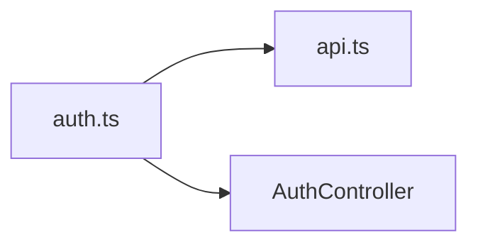

<!-- generated by docwizz: edits are overwritten -->
# frontend/src/stores

Layer **state** · project `frontend`

Project navigation: [frontend](../projects/frontend-da6498268e99.md)

## Overview 🤖

Manages the state and logic for various parts of the frontend application, including authentication, settings, and toasts.

**Responsibilities.** Provides reactive stores for managing authentication state, application settings, and toast notifications.

**Usage.** Used by various components, views, and services throughout the frontend to manage and interact with application state.

_AI draft from the facts on this page; review it, then write the module's documentation yourself._

## Key components

| Component | Kind | Used by | Summary |
|---|---|---|---|
| [Toast](#toast) | interface | 0 |  |
| [ToastKind](#toastkind) | type | 0 |  |

## Flows through this module

- `/` → MonthOverviewView → AutoFillModal, parseIso, startOfWeek, toIso, usePlanningActions, usePlanningBoard, +1 more → addDays, addMonths, extractErrorMessage, firstOfMonth, GET /api/employees, GET /api/employees/{employeeId:guid}/absences, +21 more
- `/dashboard` → DashboardView → extractErrorMessage, GET /api/dashboard, GET /api/shift-types, GET /api/teams, useSettingsStore
- `/dienstplan/woche/:date` → ScheduleView → addDays, ConfirmDialog, DELETE /api/assignments/{id:guid}, EmployeeSidebar, extractErrorMessage, ModalShell, +17 more → addMonths, EmployeeScheduleRow, firstOfMonth, GET /api/employees, GET /api/employees/{employeeId:guid}/absences, GET /api/employees/{employeeId:guid}/contracts, +18 more
- `/employees` → EmployeesView → ConfirmDialog, DELETE /api/employees/{id:guid}, EmployeeDetailModal, extractErrorMessage, GET /api/employees, GET /api/teams, +3 more → DELETE /api/absences/{id:guid}, DELETE /api/contracts/{id:guid}, DELETE /api/hours-adjustments/{id:guid}, GET /api/employees/{employeeId:guid}/absences, GET /api/employees/{employeeId:guid}/contracts, GET /api/employees/{employeeId:guid}/hours-adjustments, +16 more → POST /api/v1/auth/login, POST /api/v1/auth/logout, POST /api/v1/auth/logout-all, POST /api/v1/auth/refresh
- `/login` → LoginView → extractErrorMessage, useAuthStore → POST /api/v1/auth/login, POST /api/v1/auth/logout, POST /api/v1/auth/logout-all, POST /api/v1/auth/refresh
- `/settings` → SettingsView → GET /api/teams, useAuthStore, useSettingsStore, useToastStore → POST /api/v1/auth/login, POST /api/v1/auth/logout, POST /api/v1/auth/logout-all, POST /api/v1/auth/refresh
- `/stammdaten` → StammdatenView → extractErrorMessage, GET /api/shift-types, GET /api/teams, POST /api/shift-types, POST /api/teams, ShiftTypeDetailModal, +1 more → ModalShell, PUT /api/shift-types/{id:guid}

## Documentation gaps

1 items need documentation (0 critical):

- medium: `auth.ts.useAuthStore` — missing summary (public; complexity 5; 6 callers; side effects: http)

## Architecture observations

- ARCH-001 (high): client → state is not allowed — frontend/src/services/api.ts imports frontend/src/stores/auth.ts ([api.ts](../../frontend/src/services/api.ts))
- ARCH-002 (medium): state → http is not allowed — useAuthStore calls HTTP directly ([auth.ts](../../frontend/src/stores/auth.ts))
- ARCH-002 (medium): state → http is not allowed — useAuthStore calls HTTP directly ([auth.ts](../../frontend/src/stores/auth.ts))
- ARCH-002 (medium): state → http is not allowed — useAuthStore calls HTTP directly ([auth.ts](../../frontend/src/stores/auth.ts))
- ARCH-002 (medium): state → http is not allowed — useAuthStore calls HTTP directly ([auth.ts](../../frontend/src/stores/auth.ts))
- ARCH-003: part of a dependency cycle [frontend/src/services](frontend-src-services.md) ↔ [frontend/src/stores](frontend-src-stores.md) — these modules can't be understood or changed independently

## Dependencies

Depends on: [frontend/src/services](frontend-src-services.md), [src/ShiftPlanner.Api/Controllers](src-ShiftPlanner.Api-Controllers.md)

Used by: [frontend/src/components](frontend-src-components.md), [frontend/src/router](frontend-src-router.md), [frontend/src/services](frontend-src-services.md), [frontend/src/views/Dashboard](frontend-src-views-Dashboard.md), [frontend/src/views/Employees](frontend-src-views-Employees.md), [frontend/src/views/Login](frontend-src-views-Login.md), [frontend/src/views/Schedule](frontend-src-views-Schedule.md), [frontend/src/views/Schedule/composables](frontend-src-views-Schedule-composables.md), [frontend/src/views/Settings](frontend-src-views-Settings.md), [frontend/src/views/Stammdaten](frontend-src-views-Stammdaten.md)

## Components

### auth.ts

_module_ · [auth.ts](../../frontend/src/stores/auth.ts#L1)

### settings.ts

_module_ · [settings.ts](../../frontend/src/stores/settings.ts#L1)

### Toast

_interface_ · [toast.ts](../../frontend/src/stores/toast.ts#L5)

### toast.ts

_module_ · [toast.ts](../../frontend/src/stores/toast.ts#L1)

### ToastKind

_type_ · [toast.ts](../../frontend/src/stores/toast.ts#L3)

---
_Generated from 8 symbols in [frontend/src/stores/auth.ts](../../frontend/src/stores/auth.ts), [frontend/src/stores/settings.ts](../../frontend/src/stores/settings.ts), [frontend/src/stores/toast.ts](../../frontend/src/stores/toast.ts) (commit `11abf0b`, profile `default`). Sections marked _fact_ are read from the code, _inferred_ come from heuristics, 🤖 marks AI drafts._
