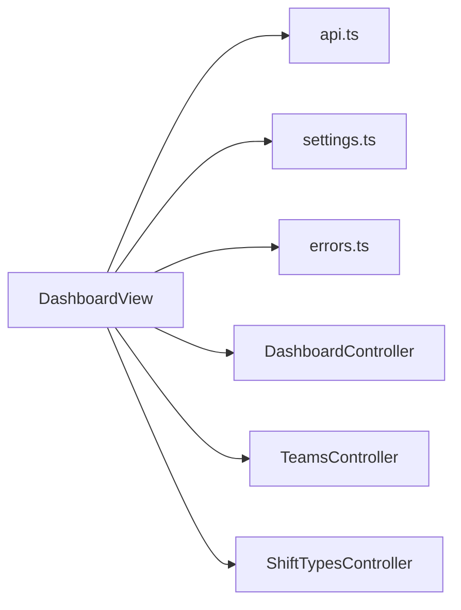

<!-- generated by docwizz: edits are overwritten -->
# frontend/src/views/Dashboard

Layer **ui** · project `frontend` · UI components: 1, Views: 1

Project navigation: [frontend](../projects/frontend-da6498268e99.md)

## Flows through this module

- `/dashboard` → DashboardView → extractErrorMessage, GET /api/dashboard, GET /api/shift-types, GET /api/teams, useSettingsStore

## Architecture observations

- ARCH-002 (medium): ui → http is not allowed — DashboardView calls HTTP directly ([DashboardView.vue](../../frontend/src/views/Dashboard/DashboardView.vue))
- ARCH-002 (medium): ui → http is not allowed — DashboardView calls HTTP directly ([DashboardView.vue](../../frontend/src/views/Dashboard/DashboardView.vue))
- ARCH-002 (medium): ui → http is not allowed — DashboardView calls HTTP directly ([DashboardView.vue](../../frontend/src/views/Dashboard/DashboardView.vue))

## Dependencies

Depends on: [frontend/src/services](frontend-src-services.md), [frontend/src/stores](frontend-src-stores.md), [frontend/src/utils](frontend-src-utils.md), [src/ShiftPlanner.Api/Controllers](src-ShiftPlanner.Api-Controllers.md)

Used by: [frontend/src/router](frontend-src-router.md)

## Components

### DashboardView

_component_ · [DashboardView.vue](../../frontend/src/views/Dashboard/DashboardView.vue#L1)

issue #56: regular/night/Sunday/holiday cost breakdown restored from the dashboard mockup's trimmed scope — mapped onto WageCalculator's actual surcharge types rather than a literal "overtime" cost bucket, since there's no separate overtime pay rate anywhere in this app.

- **dependencies** _(fact)_: api.ts, settings.ts, errors.ts, DashboardController, TeamsController, ShiftTypesController
- **state** _(fact)_: teams, shiftTypes, dashboard, loading, error, fromDate, toDate, teamFilter, shiftTypeFilter, ready, newPainPointKeys, watch [fromDate, toDate, teamFilter, shiftTypeFilter], costSegments (computed), actionFeed (computed)

_Reached from:_ [`/dashboard`](../frontend.md#flows)

_Evidence:_ [frontend/src/views/Dashboard/DashboardView.vue:1-625](../../frontend/src/views/Dashboard/DashboardView.vue#L1), [frontend/src/services/api.ts:1](../../frontend/src/services/api.ts#L1), [frontend/src/stores/settings.ts:1](../../frontend/src/stores/settings.ts#L1), [frontend/src/utils/errors.ts:1](../../frontend/src/utils/errors.ts#L1), [src/ShiftPlanner.Api/Controllers/DashboardController.cs:22-150](../../src/ShiftPlanner.Api/Controllers/DashboardController.cs#L22), [src/ShiftPlanner.Api/Controllers/TeamsController.cs:17-58](../../src/ShiftPlanner.Api/Controllers/TeamsController.cs#L17), [src/ShiftPlanner.Api/Controllers/ShiftTypesController.cs:35-120](../../src/ShiftPlanner.Api/Controllers/ShiftTypesController.cs#L35)

---
_Generated from 1 symbols in [frontend/src/views/Dashboard/DashboardView.vue](../../frontend/src/views/Dashboard/DashboardView.vue) (commit `534b8b5`, profile `default`). Sections marked _fact_ are read from the code, _inferred_ come from heuristics, 🤖 marks AI drafts._
