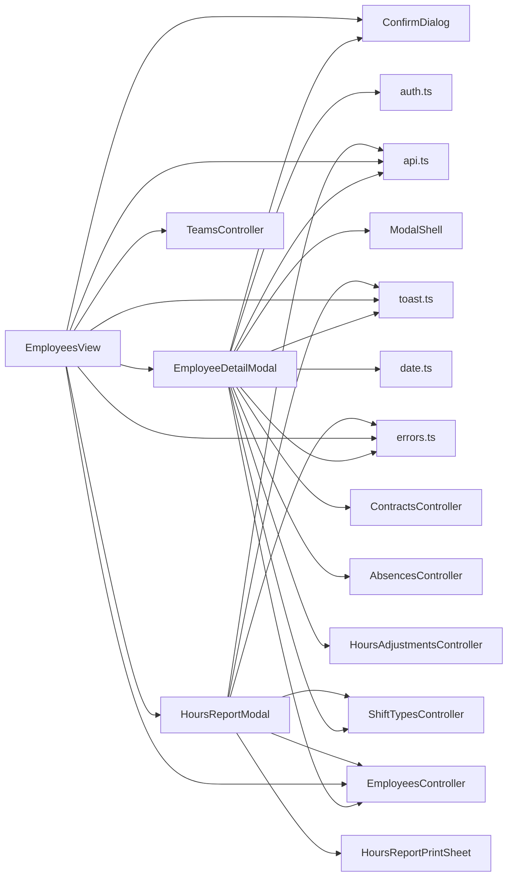

<!-- generated by docwizz: edits are overwritten -->
# frontend/src/views/Employees

Layer **ui** · project `frontend` · UI components: 4, Views: 4

Project navigation: [frontend](../projects/frontend-da6498268e99.md)

## Key components

| Component | Kind | Used by | Summary |
|---|---|---|---|
| [EmployeeDetailModal](#employeedetailmodal) | view | 1 | issue #165: HoursAdjustment writes are AdminWrite-only server-side (a manual correction to a computed balance, stricter than the ManagerWrite Absence/Contract use) — gate the create/delete controls the same way client-side; the list itself stays visible to any signed-in Staff user (ApiRead), same read/write split the backend enforces. |
| [EmployeesView](#employeesview) | view | 1 | Set only after a plain delete 409s because the employee still has shifts assigned — offers a second, more explicit confirmation for actually removing the employee *and* that history (e.g. leftover test/demo data nobody wants to keep), rather than requiring the shifts to be removed one by one or the employee kept around deactivated. |
| [HoursReportModal](#hoursreportmodal) | view | 1 | issue #165: on-screen month picker for the printable "Monatsbericht" — fetches GET /employees/{id}/hours-report?from=&to= for the chosen month and hands it to HoursReportPrintSheet, then triggers window.print(). Deliberately not built on ModalShell: this needs precise control over what's print:hidden vs. what prints (the picker itself must vanish on print, the report sheet must not), which ModalShell's shared overlay doesn't expose. |
| [HoursReportPrintSheet](#hoursreportprintsheet) | view | 1 | issue #165: the printable, signable monthly Ist/Soll report — same "separate print-only component, its own light/ink-friendly styling" pattern as views/Schedule/SchedulePrintSheet.vue (see that file's own header comment for why: reusing a dark interactive layout for print fights the theme at every turn). Renders nothing on screen (`hidden print:block`) and is the only thing visible on the page when printing, alongside HoursReportModal's own on-screen picker being `print:hidden`. |

## Flows through this module

- `/employees` → EmployeesView → ConfirmDialog, DELETE /api/employees/{id:guid}, EmployeeDetailModal, extractErrorMessage, GET /api/employees, GET /api/teams, +3 more → DELETE /api/absences/{id:guid}, DELETE /api/contracts/{id:guid}, DELETE /api/hours-adjustments/{id:guid}, GET /api/employees/{employeeId:guid}/absences, GET /api/employees/{employeeId:guid}/contracts, GET /api/employees/{employeeId:guid}/hours-adjustments, +16 more → POST /api/v1/auth/login, POST /api/v1/auth/logout, POST /api/v1/auth/logout-all, POST /api/v1/auth/refresh

## Documentation gaps

2 items need documentation (1 critical):

- high: `frontend/src/views/Employees/vue` — missing param (public; complexity 64; side effects: http)
- medium: `frontend/src/views/Employees/vue` — missing param (public; complexity 11)

## Architecture observations

- ARCH-002 (medium): ui → http is not allowed — EmployeeDetailModal calls HTTP directly ([EmployeeDetailModal.vue](../../frontend/src/views/Employees/EmployeeDetailModal.vue))
- ARCH-002 (medium): ui → http is not allowed — EmployeeDetailModal calls HTTP directly ([EmployeeDetailModal.vue](../../frontend/src/views/Employees/EmployeeDetailModal.vue))
- ARCH-002 (medium): ui → http is not allowed — EmployeeDetailModal calls HTTP directly ([EmployeeDetailModal.vue](../../frontend/src/views/Employees/EmployeeDetailModal.vue))
- ARCH-002 (medium): ui → http is not allowed — EmployeeDetailModal calls HTTP directly ([EmployeeDetailModal.vue](../../frontend/src/views/Employees/EmployeeDetailModal.vue))
- ARCH-002 (medium): ui → http is not allowed — EmployeeDetailModal calls HTTP directly ([EmployeeDetailModal.vue](../../frontend/src/views/Employees/EmployeeDetailModal.vue))
- ARCH-002 (medium): ui → http is not allowed — EmployeeDetailModal calls HTTP directly ([EmployeeDetailModal.vue](../../frontend/src/views/Employees/EmployeeDetailModal.vue))
- ARCH-002 (medium): ui → http is not allowed — EmployeeDetailModal calls HTTP directly ([EmployeeDetailModal.vue](../../frontend/src/views/Employees/EmployeeDetailModal.vue))
- ARCH-002 (medium): ui → http is not allowed — EmployeeDetailModal calls HTTP directly ([EmployeeDetailModal.vue](../../frontend/src/views/Employees/EmployeeDetailModal.vue))
- ARCH-002 (medium): ui → http is not allowed — EmployeeDetailModal calls HTTP directly ([EmployeeDetailModal.vue](../../frontend/src/views/Employees/EmployeeDetailModal.vue))
- ARCH-002 (medium): ui → http is not allowed — EmployeeDetailModal calls HTTP directly ([EmployeeDetailModal.vue](../../frontend/src/views/Employees/EmployeeDetailModal.vue))
- ARCH-002 (medium): ui → http is not allowed — EmployeeDetailModal calls HTTP directly ([EmployeeDetailModal.vue](../../frontend/src/views/Employees/EmployeeDetailModal.vue))
- ARCH-002 (medium): ui → http is not allowed — EmployeeDetailModal calls HTTP directly ([EmployeeDetailModal.vue](../../frontend/src/views/Employees/EmployeeDetailModal.vue))
- ARCH-002 (medium): ui → http is not allowed — EmployeeDetailModal calls HTTP directly ([EmployeeDetailModal.vue](../../frontend/src/views/Employees/EmployeeDetailModal.vue))
- ARCH-002 (medium): ui → http is not allowed — EmployeeDetailModal calls HTTP directly ([EmployeeDetailModal.vue](../../frontend/src/views/Employees/EmployeeDetailModal.vue))
- ARCH-002 (medium): ui → http is not allowed — EmployeeDetailModal calls HTTP directly ([EmployeeDetailModal.vue](../../frontend/src/views/Employees/EmployeeDetailModal.vue))
- ARCH-002 (medium): ui → http is not allowed — EmployeeDetailModal calls HTTP directly ([EmployeeDetailModal.vue](../../frontend/src/views/Employees/EmployeeDetailModal.vue))
- ARCH-002 (medium): ui → http is not allowed — EmployeeDetailModal calls HTTP directly ([EmployeeDetailModal.vue](../../frontend/src/views/Employees/EmployeeDetailModal.vue))
- ARCH-002 (medium): ui → http is not allowed — EmployeeDetailModal calls HTTP directly ([EmployeeDetailModal.vue](../../frontend/src/views/Employees/EmployeeDetailModal.vue))
- ARCH-002 (medium): ui → http is not allowed — EmployeesView calls HTTP directly ([EmployeesView.vue](../../frontend/src/views/Employees/EmployeesView.vue))
- ARCH-002 (medium): ui → http is not allowed — EmployeesView calls HTTP directly ([EmployeesView.vue](../../frontend/src/views/Employees/EmployeesView.vue))
- ARCH-002 (medium): ui → http is not allowed — EmployeesView calls HTTP directly ([EmployeesView.vue](../../frontend/src/views/Employees/EmployeesView.vue))
- ARCH-002 (medium): ui → http is not allowed — EmployeesView calls HTTP directly ([EmployeesView.vue](../../frontend/src/views/Employees/EmployeesView.vue))
- ARCH-002 (medium): ui → http is not allowed — HoursReportModal calls HTTP directly ([HoursReportModal.vue](../../frontend/src/views/Employees/HoursReportModal.vue))
- ARCH-002 (medium): ui → http is not allowed — HoursReportModal calls HTTP directly ([HoursReportModal.vue](../../frontend/src/views/Employees/HoursReportModal.vue))
- `EmployeeDetailModal` depends on 12 other components — high coupling, possibly several responsibilities

## Dependencies

Depends on: [frontend/src/components](frontend-src-components.md), [frontend/src/services](frontend-src-services.md), [frontend/src/stores](frontend-src-stores.md), [frontend/src/utils](frontend-src-utils.md), [src/ShiftPlanner.Api/Controllers](src-ShiftPlanner.Api-Controllers.md)

Used by: [frontend/src/router](frontend-src-router.md)

## Components

### EmployeeDetailModal

_component_ · [EmployeeDetailModal.vue](../../frontend/src/views/Employees/EmployeeDetailModal.vue#L1) ⚠

issue #165: HoursAdjustment writes are AdminWrite-only server-side (a manual correction to a computed balance, stricter than the ManagerWrite Absence/Contract use) — gate the create/delete controls the same way client-side; the list itself stays visible to any signed-in Staff user (ApiRead), same read/write split the backend enforces.

Props: employee: Employee, teams: Team[]

Emits: close, updated

- **dependencies** _(fact)_: api.ts, toast.ts, auth.ts, ModalShell, ConfirmDialog, date.ts, errors.ts, EmployeesController, ShiftTypesController, ContractsController, AbsencesController, HoursAdjustmentsController
- **events** _(fact)_: close, updated
- **state** _(fact)_: isAdmin (computed), form, savingEmployee, employeeError, shiftTypes, eligibleIds, savingEligible, shiftTypePrefs, weekdayPrefs, savingPreferences, contracts, contractForm, savingContract, contractError, editingContractId, contractSubmitLabel (computed), contractToDelete, absences, absenceForm, savingAbsence, absenceError, absenceToDelete, hoursAdjustments, hoursAdjustmentForm, savingHoursAdjustment, hoursAdjustmentError, hoursAdjustmentToDelete

_Reached from:_ [`/employees`](../frontend.md#flows)

_Evidence:_ [frontend/src/views/Employees/EmployeeDetailModal.vue:1-921](../../frontend/src/views/Employees/EmployeeDetailModal.vue#L1), [frontend/src/services/api.ts:1](../../frontend/src/services/api.ts#L1), [frontend/src/stores/toast.ts:1](../../frontend/src/stores/toast.ts#L1), [frontend/src/stores/auth.ts:1](../../frontend/src/stores/auth.ts#L1), [frontend/src/components/ModalShell.vue:1-53](../../frontend/src/components/ModalShell.vue#L1), [frontend/src/components/ConfirmDialog.vue:1-27](../../frontend/src/components/ConfirmDialog.vue#L1), [frontend/src/utils/date.ts:1](../../frontend/src/utils/date.ts#L1), [frontend/src/utils/errors.ts:1](../../frontend/src/utils/errors.ts#L1), [src/ShiftPlanner.Api/Controllers/EmployeesController.cs:45-363](../../src/ShiftPlanner.Api/Controllers/EmployeesController.cs#L45), [src/ShiftPlanner.Api/Controllers/ShiftTypesController.cs:35-120](../../src/ShiftPlanner.Api/Controllers/ShiftTypesController.cs#L35), [src/ShiftPlanner.Api/Controllers/ContractsController.cs:35-151](../../src/ShiftPlanner.Api/Controllers/ContractsController.cs#L35), [src/ShiftPlanner.Api/Controllers/AbsencesController.cs:17-107](../../src/ShiftPlanner.Api/Controllers/AbsencesController.cs#L17), [src/ShiftPlanner.Api/Controllers/HoursAdjustmentsController.cs:22-118](../../src/ShiftPlanner.Api/Controllers/HoursAdjustmentsController.cs#L22)

### EmployeesView

_component_ · [EmployeesView.vue](../../frontend/src/views/Employees/EmployeesView.vue#L1)

Set only after a plain delete 409s because the employee still has shifts assigned — offers a second, more explicit confirmation for actually removing the employee *and* that history (e.g. leftover test/demo data nobody wants to keep), rather than requiring the shifts to be removed one by one or the employee kept around deactivated.

- **dependencies** _(fact)_: api.ts, toast.ts, errors.ts, ConfirmDialog, EmployeeDetailModal, HoursReportModal, EmployeesController, TeamsController
- **state** _(fact)_: employees, teams, loading, error, showForm, saving, form, selectedEmployee, employeeToDelete, employeeToForceDelete, hoursReportEmployee

_Reached from:_ [`/employees`](../frontend.md#flows)

_Evidence:_ [frontend/src/views/Employees/EmployeesView.vue:1-346](../../frontend/src/views/Employees/EmployeesView.vue#L1), [frontend/src/services/api.ts:1](../../frontend/src/services/api.ts#L1), [frontend/src/stores/toast.ts:1](../../frontend/src/stores/toast.ts#L1), [frontend/src/utils/errors.ts:1](../../frontend/src/utils/errors.ts#L1), [frontend/src/components/ConfirmDialog.vue:1-27](../../frontend/src/components/ConfirmDialog.vue#L1), [frontend/src/views/Employees/EmployeeDetailModal.vue:1-921](../../frontend/src/views/Employees/EmployeeDetailModal.vue#L1), [frontend/src/views/Employees/HoursReportModal.vue:1-103](../../frontend/src/views/Employees/HoursReportModal.vue#L1), [src/ShiftPlanner.Api/Controllers/EmployeesController.cs:45-363](../../src/ShiftPlanner.Api/Controllers/EmployeesController.cs#L45), [src/ShiftPlanner.Api/Controllers/TeamsController.cs:17-58](../../src/ShiftPlanner.Api/Controllers/TeamsController.cs#L17)

### HoursReportModal

_component_ · [HoursReportModal.vue](../../frontend/src/views/Employees/HoursReportModal.vue#L1)

issue #165: on-screen month picker for the printable "Monatsbericht" — fetches GET /employees/{id}/hours-report?from=&to= for the chosen month and hands it to HoursReportPrintSheet, then triggers window.print(). Deliberately not built on ModalShell: this needs precise control over what's print:hidden vs. what prints (the picker itself must vanish on print, the report sheet must not), which ModalShell's shared overlay doesn't expose.

Props: employee: Employee

Emits: close

_Reached from:_ [`/employees`](../frontend.md#flows)

### HoursReportPrintSheet

_component_ · [HoursReportPrintSheet.vue](../../frontend/src/views/Employees/HoursReportPrintSheet.vue#L1) ⚠

issue #165: the printable, signable monthly Ist/Soll report — same "separate print-only component, its own light/ink-friendly styling" pattern as views/Schedule/SchedulePrintSheet.vue (see that file's own header comment for why: reusing a dark interactive layout for print fights the theme at every turn). Renders nothing on screen (`hidden print:block`) and is the only thing visible on the page when printing, alongside HoursReportModal's own on-screen picker being `print:hidden`.

Props: employee: { firstName: string; lastName: string; personnelNumber: string }, report: HoursReport | null, shiftTypeById: (id: string) => ShiftTypeLite | undefined

- **dependencies** _(fact)_: none
- **state** _(fact)_: periodLabel (computed)

_Reached from:_ [`/employees`](../frontend.md#flows)

_Evidence:_ [frontend/src/views/Employees/HoursReportPrintSheet.vue:1-336](../../frontend/src/views/Employees/HoursReportPrintSheet.vue#L1)

---
_Generated from 9 symbols in [frontend/src/views/Employees/EmployeeDetailModal.vue](../../frontend/src/views/Employees/EmployeeDetailModal.vue), [frontend/src/views/Employees/EmployeesView.vue](../../frontend/src/views/Employees/EmployeesView.vue), [frontend/src/views/Employees/HoursReportModal.vue](../../frontend/src/views/Employees/HoursReportModal.vue), [frontend/src/views/Employees/HoursReportPrintSheet.vue](../../frontend/src/views/Employees/HoursReportPrintSheet.vue) (commit `534b8b5`, profile `default`). Sections marked _fact_ are read from the code, _inferred_ come from heuristics, 🤖 marks AI drafts._
