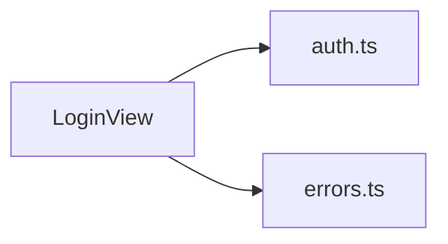

<!-- generated by docwizz: edits are overwritten -->
# frontend/src/views/Login

Layer **ui** · project `frontend` · UI components: 1, Views: 1

Project navigation: [frontend](../projects/frontend-da6498268e99.md)

## Flows through this module

- `/login` → LoginView → extractErrorMessage, useAuthStore → POST /api/v1/auth/login, POST /api/v1/auth/logout, POST /api/v1/auth/logout-all, POST /api/v1/auth/refresh

## Documentation gaps

1 items need documentation (0 critical):

- medium: `frontend/src/views/Login/vue` — missing summary (public; complexity 8; side effects: http)

## Dependencies

Depends on: [frontend/src/stores](frontend-src-stores.md), [frontend/src/utils](frontend-src-utils.md)

Used by: [frontend/src/router](frontend-src-router.md)

## Components

### LoginView

_component_ · [LoginView.vue](../../frontend/src/views/Login/LoginView.vue#L1) ⚠

- **dependencies** _(fact)_: auth.ts, errors.ts
- **state** _(fact)_: email, password, error, loading

_Reached from:_ [`/login`](../frontend.md#flows)

_Evidence:_ [frontend/src/views/Login/LoginView.vue:1-81](../../frontend/src/views/Login/LoginView.vue#L1), [frontend/src/stores/auth.ts:1](../../frontend/src/stores/auth.ts#L1), [frontend/src/utils/errors.ts:1](../../frontend/src/utils/errors.ts#L1)

---
_Generated from 1 symbols in [frontend/src/views/Login/LoginView.vue](../../frontend/src/views/Login/LoginView.vue) (commit `534b8b5`, profile `default`). Sections marked _fact_ are read from the code, _inferred_ come from heuristics, 🤖 marks AI drafts._
