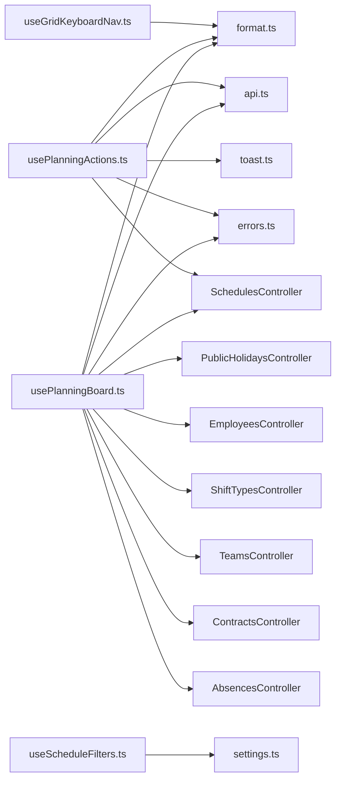

<!-- generated by docwizz: edits are overwritten -->
# frontend/src/views/Schedule/composables

Layer **state** · project `frontend`

Project navigation: [frontend](../projects/frontend-da6498268e99.md)

## Key components

| Component | Kind | Used by | Summary |
|---|---|---|---|
| [Coverage](#coverage) | interface | 0 |  |
| [DragPayload](#dragpayload) | interface | 0 |  |
| [DragState](#dragstate) | interface | 0 |  |

## Flows through this module

- `/` → MonthOverviewView → AutoFillModal, parseIso, startOfWeek, toIso, usePlanningActions, usePlanningBoard, +1 more → addDays, addMonths, extractErrorMessage, firstOfMonth, GET /api/employees, GET /api/employees/{employeeId:guid}/absences, +21 more
- `/dienstplan/woche/:date` → ScheduleView → addDays, ConfirmDialog, DELETE /api/assignments/{id:guid}, EmployeeSidebar, extractErrorMessage, ModalShell, +17 more → addMonths, EmployeeScheduleRow, firstOfMonth, GET /api/employees, GET /api/employees/{employeeId:guid}/absences, GET /api/employees/{employeeId:guid}/contracts, +18 more

## Documentation gaps

5 items need documentation (2 critical):

- high: `usePlanningActions.ts.usePlanningActions` — missing summary (public; complexity 35; side effects: event, http)
- high: `usePlanningBoard.ts.usePlanningBoard` — missing summary (public; complexity 64; side effects: http)
- medium: `useScheduleFilters.ts.useScheduleFilters` — missing summary (public; complexity 9)
- medium: `useGridKeyboardNav.ts.useGridKeyboardNav` — missing summary (public; complexity 24)
- medium: `useScheduleDnD.ts.useScheduleDnD` — missing summary (public; complexity 16)

## Architecture observations

- ARCH-002 (medium): state → http is not allowed — usePlanningActions calls HTTP directly ([usePlanningActions.ts](../../frontend/src/views/Schedule/composables/usePlanningActions.ts))
- ARCH-002 (medium): state → http is not allowed — usePlanningActions calls HTTP directly ([usePlanningActions.ts](../../frontend/src/views/Schedule/composables/usePlanningActions.ts))
- ARCH-002 (medium): state → http is not allowed — usePlanningActions calls HTTP directly ([usePlanningActions.ts](../../frontend/src/views/Schedule/composables/usePlanningActions.ts))
- ARCH-002 (medium): state → http is not allowed — usePlanningActions calls HTTP directly ([usePlanningActions.ts](../../frontend/src/views/Schedule/composables/usePlanningActions.ts))
- ARCH-002 (medium): state → http is not allowed — usePlanningActions calls HTTP directly ([usePlanningActions.ts](../../frontend/src/views/Schedule/composables/usePlanningActions.ts))
- ARCH-002 (medium): state → http is not allowed — usePlanningActions calls HTTP directly ([usePlanningActions.ts](../../frontend/src/views/Schedule/composables/usePlanningActions.ts))
- ARCH-002 (medium): state → http is not allowed — usePlanningActions calls HTTP directly ([usePlanningActions.ts](../../frontend/src/views/Schedule/composables/usePlanningActions.ts))
- ARCH-002 (medium): state → http is not allowed — usePlanningBoard calls HTTP directly ([usePlanningBoard.ts](../../frontend/src/views/Schedule/composables/usePlanningBoard.ts))
- ARCH-002 (medium): state → http is not allowed — usePlanningBoard calls HTTP directly ([usePlanningBoard.ts](../../frontend/src/views/Schedule/composables/usePlanningBoard.ts))
- ARCH-002 (medium): state → http is not allowed — usePlanningBoard calls HTTP directly ([usePlanningBoard.ts](../../frontend/src/views/Schedule/composables/usePlanningBoard.ts))
- ARCH-002 (medium): state → http is not allowed — usePlanningBoard calls HTTP directly ([usePlanningBoard.ts](../../frontend/src/views/Schedule/composables/usePlanningBoard.ts))
- ARCH-002 (medium): state → http is not allowed — usePlanningBoard calls HTTP directly ([usePlanningBoard.ts](../../frontend/src/views/Schedule/composables/usePlanningBoard.ts))
- ARCH-002 (medium): state → http is not allowed — usePlanningBoard calls HTTP directly ([usePlanningBoard.ts](../../frontend/src/views/Schedule/composables/usePlanningBoard.ts))
- ARCH-002 (medium): state → http is not allowed — usePlanningBoard calls HTTP directly ([usePlanningBoard.ts](../../frontend/src/views/Schedule/composables/usePlanningBoard.ts))
- ARCH-002 (medium): state → http is not allowed — usePlanningBoard calls HTTP directly ([usePlanningBoard.ts](../../frontend/src/views/Schedule/composables/usePlanningBoard.ts))
- ARCH-002 (medium): state → http is not allowed — usePlanningBoard calls HTTP directly ([usePlanningBoard.ts](../../frontend/src/views/Schedule/composables/usePlanningBoard.ts))
- ARCH-002 (medium): state → http is not allowed — usePlanningBoard calls HTTP directly ([usePlanningBoard.ts](../../frontend/src/views/Schedule/composables/usePlanningBoard.ts))
- ARCH-002 (medium): state → http is not allowed — usePlanningBoard calls HTTP directly ([usePlanningBoard.ts](../../frontend/src/views/Schedule/composables/usePlanningBoard.ts))
- ARCH-003: part of a dependency cycle [frontend/src/views/Schedule](frontend-src-views-Schedule.md) ↔ [frontend/src/views/Schedule/composables](frontend-src-views-Schedule-composables.md) — these modules can't be understood or changed independently
- 4 members have cyclomatic complexity ≥ 15 (many paths to test and explain): `usePlanningBoard.ts.usePlanningBoard` (64), `usePlanningActions.ts.usePlanningActions` (35), `useGridKeyboardNav.ts.useGridKeyboardNav` (24), `useScheduleDnD.ts.useScheduleDnD` (16)
- `usePlanningBoard.ts` depends on 10 other components — high coupling, possibly several responsibilities

## Dependencies

Depends on: [frontend/src/services](frontend-src-services.md), [frontend/src/stores](frontend-src-stores.md), [frontend/src/utils](frontend-src-utils.md), [frontend/src/views/Schedule](frontend-src-views-Schedule.md), [src/ShiftPlanner.Api/Controllers](src-ShiftPlanner.Api-Controllers.md)

Used by: [frontend/src/views/Schedule](frontend-src-views-Schedule.md)

## Components

### Coverage

_interface_ · [usePlanningBoard.ts](../../frontend/src/views/Schedule/composables/usePlanningBoard.ts#L26)

### DragPayload

_interface_ · [useScheduleDnD.ts](../../frontend/src/views/Schedule/composables/useScheduleDnD.ts#L14)

### DragState

_interface_ · [useScheduleDnD.ts](../../frontend/src/views/Schedule/composables/useScheduleDnD.ts#L23)

### useGridKeyboardNav.ts

_module_ · [useGridKeyboardNav.ts](../../frontend/src/views/Schedule/composables/useGridKeyboardNav.ts#L1)

| Member | Summary | Derived from code | Complexity |
|---|---|---|---|
| [`useGridKeyboardNav`](../../frontend/src/views/Schedule/composables/useGridKeyboardNav.ts#L18) ⚠ |  |  | 24 |

### usePlanningActions.ts

_module_ · [usePlanningActions.ts](../../frontend/src/views/Schedule/composables/usePlanningActions.ts#L1)

| Member | Summary | Derived from code | Complexity |
|---|---|---|---|
| [`usePlanningActions`](../../frontend/src/views/Schedule/composables/usePlanningActions.ts#L26) ⚠ |  |  | 35 |

### usePlanningBoard.ts

_module_ · [usePlanningBoard.ts](../../frontend/src/views/Schedule/composables/usePlanningBoard.ts#L1)

| Member | Summary | Derived from code | Complexity |
|---|---|---|---|
| [`usePlanningBoard`](../../frontend/src/views/Schedule/composables/usePlanningBoard.ts#L38) ⚠ |  |  | 64 |

### useScheduleDnD.ts

_module_ · [useScheduleDnD.ts](../../frontend/src/views/Schedule/composables/useScheduleDnD.ts#L1)

| Member | Summary | Derived from code | Complexity |
|---|---|---|---|
| [`paletteDragPayload`](../../frontend/src/views/Schedule/composables/useScheduleDnD.ts#L33) |  |  | 1 |
| [`assignmentDragPayload`](../../frontend/src/views/Schedule/composables/useScheduleDnD.ts#L42) |  |  | 3 |
| [`employeeDragPayload`](../../frontend/src/views/Schedule/composables/useScheduleDnD.ts#L57) |  |  | 1 |
| [`useScheduleDnD`](../../frontend/src/views/Schedule/composables/useScheduleDnD.ts#L69) ⚠ |  |  | 16 |

### useScheduleFilters.ts

_module_ · [useScheduleFilters.ts](../../frontend/src/views/Schedule/composables/useScheduleFilters.ts#L1)

| Member | Summary | Derived from code | Complexity |
|---|---|---|---|
| [`useScheduleFilters`](../../frontend/src/views/Schedule/composables/useScheduleFilters.ts#L10) ⚠ |  |  | 9 |

---
_Generated from 16 symbols in [frontend/src/views/Schedule/composables/useGridKeyboardNav.ts](../../frontend/src/views/Schedule/composables/useGridKeyboardNav.ts), [frontend/src/views/Schedule/composables/usePlanningActions.ts](../../frontend/src/views/Schedule/composables/usePlanningActions.ts), [frontend/src/views/Schedule/composables/usePlanningBoard.ts](../../frontend/src/views/Schedule/composables/usePlanningBoard.ts), [frontend/src/views/Schedule/composables/useScheduleDnD.ts](../../frontend/src/views/Schedule/composables/useScheduleDnD.ts), [frontend/src/views/Schedule/composables/useScheduleFilters.ts](../../frontend/src/views/Schedule/composables/useScheduleFilters.ts) (commit `534b8b5`, profile `default`). Sections marked _fact_ are read from the code, _inferred_ come from heuristics, 🤖 marks AI drafts._
