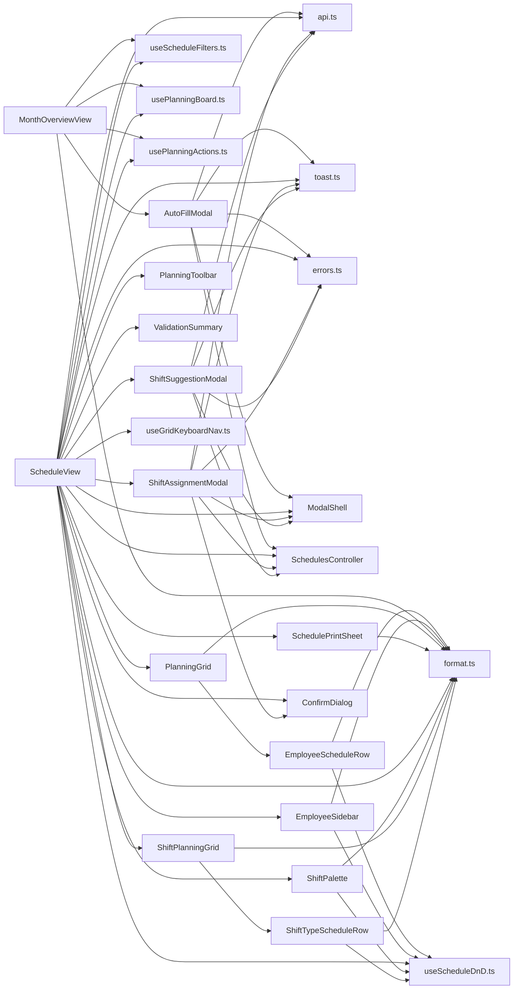

<!-- generated by docwizz: edits are overwritten -->
# frontend/src/views/Schedule

Layer **ui** · project `frontend` · UI components: 14, Views: 14

Project navigation: [frontend](../projects/frontend-da6498268e99.md)

## Key components

| Component | Kind | Used by | Summary |
|---|---|---|---|
| [AutoFillModal](#autofillmodal) | view | 1 | Dropped rows are tracked by index rather than spliced out of `proposals` — keeps the "N vorgeschlagen, M verworfen" summary stable while the manager reviews. |
| [EmployeeScheduleRow](#employeeschedulerow) | view | 1 |  |
| [EmployeeSidebar](#employeesidebar) | view | 1 | The "Nach Schicht" view's palette (requested directly — with only a handful of shift types but 20+ employees, dragging shifts onto employee rows is the wrong way round). Employees are listed here instead of as grid rows, each draggable onto a (shiftType, date) cell — the same per-employee Xh/Yh/Übertrag/Lohnkosten readouts EmployeeScheduleRow.vue shows per row move here, since there's no employee row left to show them on in this view. Eligibility hints (requested directly, follow-up): dragging blind meant only finding out an employee couldn't take a shift via a toast after the drop. Each chip now shows a dot per visible ShiftType (dim/ringed when the employee isn't eligible for it — same rule EligibilityValidator itself uses, an empty eligible list means unrestricted) and an "Abwesend" badge when they're absent on any day of the displayed period — both purely informational, dropping on a cell the hints flag still works the same as before (the backend validator is still the source of truth), this just surfaces what it would say up front. |
| [MonthOverviewView](#monthoverviewview) | view | 1 | issue #74: the Dienstplan's default landing view — a compact month-wide coverage/absence/ conflict glance, replacing what used to be the single full-month drag-and-drop grid trying to be both an editor and an overview at once. Detailed editing (drag-and-drop, the assignment modal, the grouped validation panel, keyboard shortcuts) now lives in the week-scoped ScheduleView.vue, reached by clicking a week/day header here. `Schedule` itself stays month-scoped server-side — this reuses the exact same usePlanningBoard/usePlanningActions composables the week view uses, just rendered as a dense per-day-per-employee grid instead of full shift chips. |
| [PlanningGrid](#planninggrid) | view | 1 | Auto-scrolls the horizontally-scrolling table while dragging near its edge — otherwise a month with 28+ day columns has no way to reach off-screen days mid-drag. Driven by useScheduleDnD's onAutoScroll callback (via ScheduleView's template ref to this component), so the DOM node this needs stays local to the component that owns it. |
| [PlanningToolbar](#planningtoolbar) | view | 1 | issue #68's ScheduleStatus enum (Domain/Scheduling/Schedule.cs), serialized as its ordinal same as every other backend enum this frontend consumes. |
| [SchedulePrintSheet](#scheduleprintsheet) | view | 1 | PDF export, redesigned. The interactive grid (PlanningGrid.vue) is dark, glassy, and built for on-screen drag-and-drop — reusing it for print (the previous approach, toggling `print:` utility classes on the same DOM) fought the dark theme, sticky positioning, and chip padding at every turn and still didn't reliably fit on one page. This component is a completely separate, print-only layout with its own light, ink-friendly styling: it renders nothing on screen (`hidden print:block`) and is the only thing visible when printing — PlanningGrid's wrapper is `print:hidden` now. Two layouts, chosen by whether a single employee is being exported (the "PDF exportieren" toolbar button vs. a row's own printer icon): - Single employee: a plain day-by-day list (the shape a member actually wants to check "when do I work this week" or pin to a fridge) plus an hours summary, not a one-row slice of a multi-employee grid. - Whole team: a compact grid — the day columns are a fixed share of the page width (via `<colgroup>`, `dayColWidth` below) instead of auto-sizing to content, so a full month's 28-31 columns always fits the page width, not just a week's 7. Each cell shows a colored shift-type initial (same abbreviation the interactive month overview uses) rather than the full "name · time" text the single-employee list can afford — there's no room for that at month width, and print has no hover tooltip to fall back on, hence the legend below the grid. |
| [ScheduleView](#scheduleview) | view | 1 | issue #73: this file is orchestration only now — every DTO/date-math/formatting helper, data-loading concern, drag-and-drop mechanic, and mutation call that used to live here directly has moved into the composables/components imported above. Behavior is unchanged; see each file's own header comment for what it owns. issue #74: this view is week-scoped — the route's `:date` param is any date within the displayed week (MonthOverviewView.vue always passes the week's first visible day). `Schedule` itself stays month-scoped server-side (usePlanningBoard's `days`/`currentSchedule` are unchanged), only the *displayed* grid columns narrow to one week here. |

## Flows through this module

- `/` → MonthOverviewView → AutoFillModal, parseIso, startOfWeek, toIso, usePlanningActions, usePlanningBoard, +1 more → addDays, addMonths, extractErrorMessage, firstOfMonth, GET /api/employees, GET /api/employees/{employeeId:guid}/absences, +21 more
- `/dienstplan/woche/:date` → ScheduleView → addDays, ConfirmDialog, DELETE /api/assignments/{id:guid}, EmployeeSidebar, extractErrorMessage, ModalShell, +17 more → addMonths, EmployeeScheduleRow, firstOfMonth, GET /api/employees, GET /api/employees/{employeeId:guid}/absences, GET /api/employees/{employeeId:guid}/contracts, +18 more

## Documentation gaps

12 items need documentation (5 critical):

- high: `frontend/src/views/Schedule/vue` — missing param (public; complexity 11; 4 props; side effects: http)
- high: `frontend/src/views/Schedule/vue` — missing param (public; complexity 15; 13 props)
- high: `frontend/src/views/Schedule/vue` — missing param (public; complexity 34; 15 props)
- high: `frontend/src/views/Schedule/vue` — missing param (public; complexity 17; side effects: http)
- high: `frontend/src/views/Schedule/vue` — missing param (public; complexity 12; 5 props; side effects: http)
- medium: `frontend/src/views/Schedule/vue` — missing summary, param (public; complexity 10; 17 props)
- medium: `frontend/src/views/Schedule/vue` — missing param (public; complexity 11; 21 props)
- medium: `frontend/src/views/Schedule/vue` — missing param (public; complexity 5; 9 props)
- … see [quality](../quality.md)

## Architecture observations

- ARCH-002 (medium): ui → http is not allowed — AutoFillModal calls HTTP directly ([AutoFillModal.vue](../../frontend/src/views/Schedule/AutoFillModal.vue))
- ARCH-002 (medium): ui → http is not allowed — AutoFillModal calls HTTP directly ([AutoFillModal.vue](../../frontend/src/views/Schedule/AutoFillModal.vue))
- ARCH-002 (medium): ui → http is not allowed — ScheduleView calls HTTP directly ([ScheduleView.vue](../../frontend/src/views/Schedule/ScheduleView.vue))
- ARCH-002 (medium): ui → http is not allowed — ShiftAssignmentModal calls HTTP directly ([ShiftAssignmentModal.vue](../../frontend/src/views/Schedule/ShiftAssignmentModal.vue))
- ARCH-002 (medium): ui → http is not allowed — ShiftAssignmentModal calls HTTP directly ([ShiftAssignmentModal.vue](../../frontend/src/views/Schedule/ShiftAssignmentModal.vue))
- ARCH-002 (medium): ui → http is not allowed — ShiftSuggestionModal calls HTTP directly ([ShiftSuggestionModal.vue](../../frontend/src/views/Schedule/ShiftSuggestionModal.vue))
- ARCH-002 (medium): ui → http is not allowed — ShiftSuggestionModal calls HTTP directly ([ShiftSuggestionModal.vue](../../frontend/src/views/Schedule/ShiftSuggestionModal.vue))
- ARCH-003: part of a dependency cycle [frontend/src/views/Schedule](frontend-src-views-Schedule.md) ↔ [frontend/src/views/Schedule/composables](frontend-src-views-Schedule-composables.md) — these modules can't be understood or changed independently
- `ScheduleView` depends on 21 other components — high coupling, possibly several responsibilities

## Dependencies

Depends on: [frontend/src/components](frontend-src-components.md), [frontend/src/services](frontend-src-services.md), [frontend/src/stores](frontend-src-stores.md), [frontend/src/utils](frontend-src-utils.md), [frontend/src/views/Schedule/composables](frontend-src-views-Schedule-composables.md), [src/ShiftPlanner.Api/Controllers](src-ShiftPlanner.Api-Controllers.md)

Used by: [frontend/src/router](frontend-src-router.md), [frontend/src/views/Schedule/composables](frontend-src-views-Schedule-composables.md)

## Components

### Absence

_interface_ · [types.ts](../../frontend/src/views/Schedule/types.ts#L69)

### Assignment

_interface_ · [types.ts](../../frontend/src/views/Schedule/types.ts#L41)

### AutoFillModal

_component_ · [AutoFillModal.vue](../../frontend/src/views/Schedule/AutoFillModal.vue#L1) ⚠

Dropped rows are tracked by index rather than spliced out of `proposals` — keeps the "N vorgeschlagen, M verworfen" summary stable while the manager reviews.

Props: scheduleId: string, monthStart: string, monthEnd: string, shiftTypes: ShiftType[]

Emits: close, committed

- **dependencies** _(fact)_: api.ts, toast.ts, errors.ts, ModalShell, SchedulesController
- **events** _(fact)_: close, committed
- **state** _(fact)_: loading, committing, error, proposals, dropped, keptProposals (computed)

_Reached from:_ [`/`](../frontend.md#flows)

_Evidence:_ [frontend/src/views/Schedule/AutoFillModal.vue:1-165](../../frontend/src/views/Schedule/AutoFillModal.vue#L1), [frontend/src/services/api.ts:1](../../frontend/src/services/api.ts#L1), [frontend/src/stores/toast.ts:1](../../frontend/src/stores/toast.ts#L1), [frontend/src/utils/errors.ts:1](../../frontend/src/utils/errors.ts#L1), [frontend/src/components/ModalShell.vue:1-53](../../frontend/src/components/ModalShell.vue#L1), [src/ShiftPlanner.Api/Controllers/SchedulesController.cs:66-687](../../src/ShiftPlanner.Api/Controllers/SchedulesController.cs#L66)

### Contract

_interface_ · [types.ts](../../frontend/src/views/Schedule/types.ts#L59)

### Employee

_interface_ · [types.ts](../../frontend/src/views/Schedule/types.ts#L4)

### EmployeeScheduleRow

_component_ · [EmployeeScheduleRow.vue](../../frontend/src/views/Schedule/EmployeeScheduleRow.vue#L1) ⚠

Props: employee: Employee, days: Date[], isWeekend: (d: Date) => boolean, dragOverKey: string | null, highlightKey: string | null, shiftTypeById: (id: string) => ShiftType | undefined, assignmentsFor: (employeeId: string, dateIso: string) => Assignment[], targetHoursFor: (employeeId: string) => number | null, netHoursFor: (employeeId: string) => number, carriedOverFor: (employeeId: string) => number, laborCostFor: (employeeId: string) => number | null, drag: DragState | null, isEditable: boolean, chipPointerDown: (e: PointerEvent, payload: DragPayload) => void, isFocusableCell: (employeeId: string, dateIso: string) => boolean, cellAriaLabel: (employeeId: string, dateIso: string) => string, onCellFocus: (employeeId: string, dateIso: string) => void

Emits: export-pdf, view-readonly

- **dependencies** _(fact)_: useScheduleDnD.ts, format.ts
- **events** _(fact)_: export-pdf, view-readonly

_Reached from:_ [`/dienstplan/woche/:date`](../frontend.md#flows)

_Evidence:_ [frontend/src/views/Schedule/EmployeeScheduleRow.vue:1-149](../../frontend/src/views/Schedule/EmployeeScheduleRow.vue#L1), [frontend/src/views/Schedule/composables/useScheduleDnD.ts:1](../../frontend/src/views/Schedule/composables/useScheduleDnD.ts#L1), [frontend/src/views/Schedule/format.ts:1](../../frontend/src/views/Schedule/format.ts#L1)

### EmployeeSidebar

_component_ · [EmployeeSidebar.vue](../../frontend/src/views/Schedule/EmployeeSidebar.vue#L1) ⚠

The "Nach Schicht" view's palette (requested directly — with only a handful of shift types but 20+ employees, dragging shifts onto employee rows is the wrong way round). Employees are listed here instead of as grid rows, each draggable onto a (shiftType, date) cell — the same per-employee Xh/Yh/Übertrag/Lohnkosten readouts EmployeeScheduleRow.vue shows per row move here, since there's no employee row left to show them on in this view. Eligibility hints (requested directly, follow-up): dragging blind meant only finding out an employee couldn't take a shift via a toast after the drop. Each chip now shows a dot per visible ShiftType (dim/ringed when the employee isn't eligible for it — same rule EligibilityValidator itself uses, an empty eligible list means unrestricted) and an "Abwesend" badge when they're absent on any day of the displayed period — both purely informational, dropping on a cell the hints flag still works the same as before (the backend validator is still the source of truth), this just surfaces what it would say up front.

Props: employees: Employee[], activeEmployeesCount: number, activeShiftTypes: ShiftType[], isEligibleFor: (employeeId: string, shiftTypeId: string) => boolean, days: Date[], isAbsentOn: (employeeId: string, dateIso: string) => boolean, targetHoursFor: (employeeId: string) => number | null, netHoursFor: (employeeId: string) => number, carriedOverFor: (employeeId: string) => number, laborCostFor: (employeeId: string) => number | null, drag: DragState | null, isEditable: boolean, chipPointerDown: (e: PointerEvent, payload: DragPayload) => void

- **dependencies** _(fact)_: useScheduleDnD.ts, format.ts

_Reached from:_ [`/dienstplan/woche/:date`](../frontend.md#flows)

_Evidence:_ [frontend/src/views/Schedule/EmployeeSidebar.vue:1-124](../../frontend/src/views/Schedule/EmployeeSidebar.vue#L1), [frontend/src/views/Schedule/composables/useScheduleDnD.ts:1](../../frontend/src/views/Schedule/composables/useScheduleDnD.ts#L1), [frontend/src/views/Schedule/format.ts:1](../../frontend/src/views/Schedule/format.ts#L1)

### format.ts

_module_ · [format.ts](../../frontend/src/views/Schedule/format.ts#L1)

| Member | Summary | Derived from code | Complexity |
|---|---|---|---|
| [`firstOfMonth`](../../frontend/src/views/Schedule/format.ts#L5) |  |  | 1 |
| [`lastOfMonth`](../../frontend/src/views/Schedule/format.ts#L8) |  |  | 1 |
| [`addDays`](../../frontend/src/views/Schedule/format.ts#L11) |  |  | 1 |
| [`addMonths`](../../frontend/src/views/Schedule/format.ts#L16) |  |  | 1 |
| [`toIso`](../../frontend/src/views/Schedule/format.ts#L19) |  |  | 1 |
| [`parseIso`](../../frontend/src/views/Schedule/format.ts#L25) |  |  | 1 |
| [`startOfWeek`](../../frontend/src/views/Schedule/format.ts#L31) |  |  | 2 |

### MonthOverviewView

_component_ · [MonthOverviewView.vue](../../frontend/src/views/Schedule/MonthOverviewView.vue#L1)

issue #74: the Dienstplan's default landing view — a compact month-wide coverage/absence/ conflict glance, replacing what used to be the single full-month drag-and-drop grid trying to be both an editor and an overview at once. Detailed editing (drag-and-drop, the assignment modal, the grouped validation panel, keyboard shortcuts) now lives in the week-scoped ScheduleView.vue, reached by clicking a week/day header here. `Schedule` itself stays month-scoped server-side — this reuses the exact same usePlanningBoard/usePlanningActions composables the week view uses, just rendered as a dense per-day-per-employee grid instead of full shift chips.

- **dependencies** _(fact)_: AutoFillModal, useScheduleFilters.ts, usePlanningBoard.ts, usePlanningActions.ts, format.ts
- **state** _(fact)_: weekGroups (computed), cellSeverity (computed), monthlyIssueCountByEmployee (computed), showAutoFill

_Reached from:_ [`/`](../frontend.md#flows)

_Evidence:_ [frontend/src/views/Schedule/MonthOverviewView.vue:1-366](../../frontend/src/views/Schedule/MonthOverviewView.vue#L1), [frontend/src/views/Schedule/AutoFillModal.vue:1-165](../../frontend/src/views/Schedule/AutoFillModal.vue#L1), [frontend/src/views/Schedule/composables/useScheduleFilters.ts:1](../../frontend/src/views/Schedule/composables/useScheduleFilters.ts#L1), [frontend/src/views/Schedule/composables/usePlanningBoard.ts:1](../../frontend/src/views/Schedule/composables/usePlanningBoard.ts#L1), [frontend/src/views/Schedule/composables/usePlanningActions.ts:1](../../frontend/src/views/Schedule/composables/usePlanningActions.ts#L1), [frontend/src/views/Schedule/format.ts:1](../../frontend/src/views/Schedule/format.ts#L1)

### PlanningGrid

_component_ · [PlanningGrid.vue](../../frontend/src/views/Schedule/PlanningGrid.vue#L1) ⚠

Auto-scrolls the horizontally-scrolling table while dragging near its edge — otherwise a month with 28+ day columns has no way to reach off-screen days mid-drag. Driven by useScheduleDnD's onAutoScroll callback (via ScheduleView's template ref to this component), so the DOM node this needs stays local to the component that owns it.

Props: days: Date[], visibleEmployees: Employee[], activeEmployeesCount: number, holidayFor: (dateIso: string) => PublicHoliday | undefined, isWeekend: (d: Date) => boolean, dragOverKey: string | null, highlightKey: string | null, shiftTypeById: (id: string) => ShiftType | undefined, coverageShiftTypes: ShiftType[], coverageFor: (shiftTypeId: string, dateIso: string) => Coverage, assignmentsFor: (employeeId: string, dateIso: string) => Assignment[], targetHoursFor: (employeeId: string) => number | null, netHoursFor: (employeeId: string) => number, carriedOverFor: (employeeId: string) => number, laborCostFor: (employeeId: string) => number | null, drag: DragState | null, isEditable: boolean, chipPointerDown: (e: PointerEvent, payload: DragPayload) => void, isFocusableCell: (employeeId: string, dateIso: string) => boolean, cellAriaLabel: (employeeId: string, dateIso: string) => string, onCellFocus: (employeeId: string, dateIso: string) => void

Emits: export-employee-pdf, view-readonly

- **dependencies** _(fact)_: EmployeeScheduleRow, format.ts
- **events** _(fact)_: export-employee-pdf, view-readonly
- **state** _(fact)_: tableWrapRef

_Reached from:_ [`/dienstplan/woche/:date`](../frontend.md#flows)

_Evidence:_ [frontend/src/views/Schedule/PlanningGrid.vue:1-142](../../frontend/src/views/Schedule/PlanningGrid.vue#L1), [frontend/src/views/Schedule/EmployeeScheduleRow.vue:1-149](../../frontend/src/views/Schedule/EmployeeScheduleRow.vue#L1), [frontend/src/views/Schedule/format.ts:1](../../frontend/src/views/Schedule/format.ts#L1)

### PlanningToolbar

_component_ · [PlanningToolbar.vue](../../frontend/src/views/Schedule/PlanningToolbar.vue#L1) ⚠

issue #68's ScheduleStatus enum (Domain/Scheduling/Schedule.cs), serialized as its ordinal same as every other backend enum this frontend consumes.

Props: monthLabel: string, currentSchedule: Schedule | null, isDraft: boolean, isPublished: boolean, publishing: boolean, archiving: boolean, blockingErrorCount: number, publishBlockReason: string | undefined, viewMode: 'employee' | 'shift'

Emits: prev, next, show-shortcuts, export-all, publish, archive, set-view-mode

- **dependencies** _(fact)_: none
- **events** _(fact)_: prev, next, show-shortcuts, export-all, publish, archive, set-view-mode

_Reached from:_ [`/dienstplan/woche/:date`](../frontend.md#flows)

_Evidence:_ [frontend/src/views/Schedule/PlanningToolbar.vue:1-134](../../frontend/src/views/Schedule/PlanningToolbar.vue#L1)

### PublicHoliday

_interface_ · [types.ts](../../frontend/src/views/Schedule/types.ts#L74)

### Schedule

_interface_ · [types.ts](../../frontend/src/views/Schedule/types.ts#L32)

### SchedulePrintSheet

_component_ · [SchedulePrintSheet.vue](../../frontend/src/views/Schedule/SchedulePrintSheet.vue#L1) ⚠

PDF export, redesigned. The interactive grid (PlanningGrid.vue) is dark, glassy, and built for on-screen drag-and-drop — reusing it for print (the previous approach, toggling `print:` utility classes on the same DOM) fought the dark theme, sticky positioning, and chip padding at every turn and still didn't reliably fit on one page. This component is a completely separate, print-only layout with its own light, ink-friendly styling: it renders nothing on screen (`hidden print:block`) and is the only thing visible when printing — PlanningGrid's wrapper is `print:hidden` now. Two layouts, chosen by whether a single employee is being exported (the "PDF exportieren" toolbar button vs. a row's own printer icon): - Single employee: a plain day-by-day list (the shape a member actually wants to check "when do I work this week" or pin to a fridge) plus an hours summary, not a one-row slice of a multi-employee grid. - Whole team: a compact grid — the day columns are a fixed share of the page width (via `<colgroup>`, `dayColWidth` below) instead of auto-sizing to content, so a full month's 28-31 columns always fits the page width, not just a week's 7. Each cell shows a colored shift-type initial (same abbreviation the interactive month overview uses) rather than the full "name · time" text the single-employee list can afford — there's no room for that at month width, and print has no hover tooltip to fall back on, hence the legend below the grid.

Props: printEmployeeId: string | null, employees: Employee[], days: Date[], scheduleName: string, scheduleStatus: number | null, periodLabel: string, holidayFor: (dateIso: string) => PublicHoliday | undefined, isWeekend: (d: Date) => boolean, isAbsentOn: (employeeId: string, dateIso: string) => boolean, shiftTypeById: (id: string) => ShiftType | undefined, assignmentsFor: (employeeId: string, dateIso: string) => Assignment[], netHoursFor: (employeeId: string) => number, targetHoursFor: (employeeId: string) => number | null, carriedOverFor: (employeeId: string) => number, laborCostFor: (employeeId: string) => number | null

- **dependencies** _(fact)_: format.ts
- **state** _(fact)_: printedEmployees (computed), singleEmployee (computed), dayColWidth (computed), usedShiftTypes (computed), hasAbsences (computed)

_Reached from:_ [`/dienstplan/woche/:date`](../frontend.md#flows)

_Evidence:_ [frontend/src/views/Schedule/SchedulePrintSheet.vue:1-493](../../frontend/src/views/Schedule/SchedulePrintSheet.vue#L1), [frontend/src/views/Schedule/format.ts:1](../../frontend/src/views/Schedule/format.ts#L1)

### ScheduleView

_component_ · [ScheduleView.vue](../../frontend/src/views/Schedule/ScheduleView.vue#L1)

issue #73: this file is orchestration only now — every DTO/date-math/formatting helper, data-loading concern, drag-and-drop mechanic, and mutation call that used to live here directly has moved into the composables/components imported above. Behavior is unchanged; see each file's own header comment for what it owns. issue #74: this view is week-scoped — the route's `:date` param is any date within the displayed week (MonthOverviewView.vue always passes the week's first visible day). `Schedule` itself stays month-scoped server-side (usePlanningBoard's `days`/`currentSchedule` are unchanged), only the *displayed* grid columns narrow to one week here.

- **dependencies** _(fact)_: api.ts, toast.ts, errors.ts, ModalShell, ConfirmDialog, ShiftAssignmentModal, ShiftSuggestionModal, PlanningToolbar, ShiftPalette, EmployeeSidebar, ValidationSummary, PlanningGrid, ShiftPlanningGrid, SchedulePrintSheet, useScheduleFilters.ts, usePlanningBoard.ts, usePlanningActions.ts, useScheduleDnD.ts, useGridKeyboardNav.ts, format.ts, SchedulesController
- **state** _(fact)_: viewMode, routeDateIso (computed), watch routeDateIso, weekStart (computed), weekEnd (computed), weekDays (computed), weekLabel (computed), isPartialWeek (computed), weekDayIsoSet (computed), weekValidation (computed), selectedAssignment, deletingAssignment, showShortcuts, highlightKey, suggestingShiftType, gridRef, shiftGridRef, printEmployeeId, printMode, printDays (computed), printLabel (computed)

_Reached from:_ [`/dienstplan/woche/:date`](../frontend.md#flows)

_Evidence:_ [frontend/src/views/Schedule/ScheduleView.vue:1-677](../../frontend/src/views/Schedule/ScheduleView.vue#L1), [frontend/src/services/api.ts:1](../../frontend/src/services/api.ts#L1), [frontend/src/stores/toast.ts:1](../../frontend/src/stores/toast.ts#L1), [frontend/src/utils/errors.ts:1](../../frontend/src/utils/errors.ts#L1), [frontend/src/components/ModalShell.vue:1-53](../../frontend/src/components/ModalShell.vue#L1), [frontend/src/components/ConfirmDialog.vue:1-27](../../frontend/src/components/ConfirmDialog.vue#L1), [frontend/src/views/Schedule/ShiftAssignmentModal.vue:1-229](../../frontend/src/views/Schedule/ShiftAssignmentModal.vue#L1), [frontend/src/views/Schedule/ShiftSuggestionModal.vue:1-172](../../frontend/src/views/Schedule/ShiftSuggestionModal.vue#L1), [frontend/src/views/Schedule/PlanningToolbar.vue:1-134](../../frontend/src/views/Schedule/PlanningToolbar.vue#L1), [frontend/src/views/Schedule/ShiftPalette.vue:1-85](../../frontend/src/views/Schedule/ShiftPalette.vue#L1), [frontend/src/views/Schedule/EmployeeSidebar.vue:1-124](../../frontend/src/views/Schedule/EmployeeSidebar.vue#L1), [frontend/src/views/Schedule/ValidationSummary.vue:1-123](../../frontend/src/views/Schedule/ValidationSummary.vue#L1), [frontend/src/views/Schedule/PlanningGrid.vue:1-142](../../frontend/src/views/Schedule/PlanningGrid.vue#L1), [frontend/src/views/Schedule/ShiftPlanningGrid.vue:1-114](../../frontend/src/views/Schedule/ShiftPlanningGrid.vue#L1), [frontend/src/views/Schedule/SchedulePrintSheet.vue:1-493](../../frontend/src/views/Schedule/SchedulePrintSheet.vue#L1), [frontend/src/views/Schedule/composables/useScheduleFilters.ts:1](../../frontend/src/views/Schedule/composables/useScheduleFilters.ts#L1), [frontend/src/views/Schedule/composables/usePlanningBoard.ts:1](../../frontend/src/views/Schedule/composables/usePlanningBoard.ts#L1), [frontend/src/views/Schedule/composables/usePlanningActions.ts:1](../../frontend/src/views/Schedule/composables/usePlanningActions.ts#L1), [frontend/src/views/Schedule/composables/useScheduleDnD.ts:1](../../frontend/src/views/Schedule/composables/useScheduleDnD.ts#L1), [frontend/src/views/Schedule/composables/useGridKeyboardNav.ts:1](../../frontend/src/views/Schedule/composables/useGridKeyboardNav.ts#L1), [frontend/src/views/Schedule/format.ts:1](../../frontend/src/views/Schedule/format.ts#L1), [src/ShiftPlanner.Api/Controllers/SchedulesController.cs:66-687](../../src/ShiftPlanner.Api/Controllers/SchedulesController.cs#L66)

### ShiftAssignmentModal

_component_ · [ShiftAssignmentModal.vue](../../frontend/src/views/Schedule/ShiftAssignmentModal.vue#L1) ⚠

issue #156's optimistic-concurrency 409 always carries this exact backend message — used to tell it apart from every other reason PUT/DELETE .../assignments/{id} can 409 (e.g. the Schedule having been Archived in the meantime), which need their own real message shown instead of this one's "someone else changed it, reload" wording.

Props: assignment: Assignment, shiftTypes: ShiftType[], readonly: boolean

Emits: close, updated

- **dependencies** _(fact)_: api.ts, toast.ts, errors.ts, ModalShell, ConfirmDialog, SchedulesController
- **events** _(fact)_: close, updated
- **state** _(fact)_: form, saving, error, confirmingDelete

_Reached from:_ [`/dienstplan/woche/:date`](../frontend.md#flows)

_Evidence:_ [frontend/src/views/Schedule/ShiftAssignmentModal.vue:1-229](../../frontend/src/views/Schedule/ShiftAssignmentModal.vue#L1), [frontend/src/services/api.ts:1](../../frontend/src/services/api.ts#L1), [frontend/src/stores/toast.ts:1](../../frontend/src/stores/toast.ts#L1), [frontend/src/utils/errors.ts:1](../../frontend/src/utils/errors.ts#L1), [frontend/src/components/ModalShell.vue:1-53](../../frontend/src/components/ModalShell.vue#L1), [frontend/src/components/ConfirmDialog.vue:1-27](../../frontend/src/components/ConfirmDialog.vue#L1), [src/ShiftPlanner.Api/Controllers/SchedulesController.cs:66-687](../../src/ShiftPlanner.Api/Controllers/SchedulesController.cs#L66)

### ShiftPalette

_component_ · [ShiftPalette.vue](../../frontend/src/views/Schedule/ShiftPalette.vue#L1) ⚠

Props: activeShiftTypes: ShiftType[], hasAssignments: boolean, copyingMonth: boolean, totalLaborCost: number | null, isEditable: boolean, chipPointerDown: (e: PointerEvent, payload: DragPayload) => void, showMonthActions: boolean

Emits: copy-month, open-auto-fill, suggest

- **dependencies** _(fact)_: useScheduleDnD.ts, format.ts
- **events** _(fact)_: copy-month, open-auto-fill, suggest

_Reached from:_ [`/dienstplan/woche/:date`](../frontend.md#flows)

_Evidence:_ [frontend/src/views/Schedule/ShiftPalette.vue:1-85](../../frontend/src/views/Schedule/ShiftPalette.vue#L1), [frontend/src/views/Schedule/composables/useScheduleDnD.ts:1](../../frontend/src/views/Schedule/composables/useScheduleDnD.ts#L1), [frontend/src/views/Schedule/format.ts:1](../../frontend/src/views/Schedule/format.ts#L1)

### ShiftPlanningGrid

_component_ · [ShiftPlanningGrid.vue](../../frontend/src/views/Schedule/ShiftPlanningGrid.vue#L1) ⚠

The "Nach Schicht" view's grid — PlanningGrid.vue's counterpart with the axes swapped (rows = ShiftType, not Employee). Mirrors its sticky-header/sticky-column and edge auto-scroll setup exactly; see PlanningGrid.vue for why both exist (overflow-x-auto forces overflow-y auto too, so a bounded, genuinely-scrolling panel is what sticky positioning actually binds to — issue #76).

Props: days: Date[], shiftTypes: ShiftType[], holidayFor: (dateIso: string) => PublicHoliday | undefined, isWeekend: (d: Date) => boolean, dragOverKey: string | null, highlightKey: string | null, employeeById: (id: string) => Employee | undefined, assignmentsForShift: (shiftTypeId: string, dateIso: string) => Assignment[], coverageFor: (shiftTypeId: string, dateIso: string) => Coverage, drag: DragState | null, isEditable: boolean, chipPointerDown: (e: PointerEvent, payload: DragPayload) => void, isFocusableCell: (shiftTypeId: string, dateIso: string) => boolean, cellAriaLabel: (shiftTypeId: string, dateIso: string) => string, onCellFocus: (shiftTypeId: string, dateIso: string) => void

Emits: view-readonly, suggest

- **dependencies** _(fact)_: ShiftTypeScheduleRow, format.ts
- **events** _(fact)_: view-readonly, suggest
- **state** _(fact)_: tableWrapRef

_Reached from:_ [`/dienstplan/woche/:date`](../frontend.md#flows)

_Evidence:_ [frontend/src/views/Schedule/ShiftPlanningGrid.vue:1-114](../../frontend/src/views/Schedule/ShiftPlanningGrid.vue#L1), [frontend/src/views/Schedule/ShiftTypeScheduleRow.vue:1-123](../../frontend/src/views/Schedule/ShiftTypeScheduleRow.vue#L1), [frontend/src/views/Schedule/format.ts:1](../../frontend/src/views/Schedule/format.ts#L1)

### ShiftSuggestionModal

_component_ · [ShiftSuggestionModal.vue](../../frontend/src/views/Schedule/ShiftSuggestionModal.vue#L1) ⚠

Mirrors ShiftSuggestionEngine.SuggestionReasonCode — used only to pick an icon per reason, the message text itself comes fully formed from the backend.

Props: scheduleId: string, shiftType: ShiftType, defaultDate: string, minDate: string, maxDate: string

Emits: close, assigned

- **dependencies** _(fact)_: api.ts, toast.ts, errors.ts, ModalShell, SchedulesController
- **events** _(fact)_: close, assigned
- **state** _(fact)_: date, suggestions, loading, error, assigningId, watch date

_Reached from:_ [`/dienstplan/woche/:date`](../frontend.md#flows)

_Evidence:_ [frontend/src/views/Schedule/ShiftSuggestionModal.vue:1-172](../../frontend/src/views/Schedule/ShiftSuggestionModal.vue#L1), [frontend/src/services/api.ts:1](../../frontend/src/services/api.ts#L1), [frontend/src/stores/toast.ts:1](../../frontend/src/stores/toast.ts#L1), [frontend/src/utils/errors.ts:1](../../frontend/src/utils/errors.ts#L1), [frontend/src/components/ModalShell.vue:1-53](../../frontend/src/components/ModalShell.vue#L1), [src/ShiftPlanner.Api/Controllers/SchedulesController.cs:66-687](../../src/ShiftPlanner.Api/Controllers/SchedulesController.cs#L66)

### ShiftType

_interface_ · [types.ts](../../frontend/src/views/Schedule/types.ts#L18)

### ShiftTypeScheduleRow

_component_ · [ShiftTypeScheduleRow.vue](../../frontend/src/views/Schedule/ShiftTypeScheduleRow.vue#L1) ⚠

The "Nach Schicht" view's row (requested directly — the counterpart to EmployeeScheduleRow.vue with the axes swapped: one row per ShiftType instead of per Employee, each day cell holding the employees assigned to that shift rather than the shifts assigned to that employee).

Props: shiftType: ShiftType, days: Date[], isWeekend: (d: Date) => boolean, dragOverKey: string | null, highlightKey: string | null, employeeById: (id: string) => Employee | undefined, assignmentsForShift: (shiftTypeId: string, dateIso: string) => Assignment[], coverageFor: (shiftTypeId: string, dateIso: string) => Coverage, drag: DragState | null, isEditable: boolean, chipPointerDown: (e: PointerEvent, payload: DragPayload) => void, isFocusableCell: (shiftTypeId: string, dateIso: string) => boolean, cellAriaLabel: (shiftTypeId: string, dateIso: string) => string, onCellFocus: (shiftTypeId: string, dateIso: string) => void

Emits: view-readonly, suggest

- **dependencies** _(fact)_: useScheduleDnD.ts, format.ts
- **events** _(fact)_: view-readonly, suggest

_Reached from:_ [`/dienstplan/woche/:date`](../frontend.md#flows)

_Evidence:_ [frontend/src/views/Schedule/ShiftTypeScheduleRow.vue:1-123](../../frontend/src/views/Schedule/ShiftTypeScheduleRow.vue#L1), [frontend/src/views/Schedule/composables/useScheduleDnD.ts:1](../../frontend/src/views/Schedule/composables/useScheduleDnD.ts#L1), [frontend/src/views/Schedule/format.ts:1](../../frontend/src/views/Schedule/format.ts#L1)

### Team

_interface_ · [types.ts](../../frontend/src/views/Schedule/types.ts#L11)

### types.ts

_module_ · [types.ts](../../frontend/src/views/Schedule/types.ts#L1)

### ValidationIssue

_interface_ · [types.ts](../../frontend/src/views/Schedule/types.ts#L78)

### ValidationResult

_interface_ · [types.ts](../../frontend/src/views/Schedule/types.ts#L84)

### ValidationSummary

_component_ · [ValidationSummary.vue](../../frontend/src/views/Schedule/ValidationSummary.vue#L1) ⚠

issue #78: German labels for ScheduleValidator's rule types (Application/Validation/*.cs), used to group the validation panel by rule instead of a flat list.

Props: validation: ValidationResult | null

Emits: focus

- **dependencies** _(fact)_: none
- **events** _(fact)_: focus
- **state** _(fact)_: expandedIssueGroups, validationGroups (computed)

_Reached from:_ [`/dienstplan/woche/:date`](../frontend.md#flows)

_Evidence:_ [frontend/src/views/Schedule/ValidationSummary.vue:1-123](../../frontend/src/views/Schedule/ValidationSummary.vue#L1)

---
_Generated from 33 symbols in [frontend/src/views/Schedule/AutoFillModal.vue](../../frontend/src/views/Schedule/AutoFillModal.vue), [frontend/src/views/Schedule/EmployeeScheduleRow.vue](../../frontend/src/views/Schedule/EmployeeScheduleRow.vue), [frontend/src/views/Schedule/EmployeeSidebar.vue](../../frontend/src/views/Schedule/EmployeeSidebar.vue), [frontend/src/views/Schedule/format.ts](../../frontend/src/views/Schedule/format.ts), [frontend/src/views/Schedule/MonthOverviewView.vue](../../frontend/src/views/Schedule/MonthOverviewView.vue), [frontend/src/views/Schedule/PlanningGrid.vue](../../frontend/src/views/Schedule/PlanningGrid.vue), [frontend/src/views/Schedule/PlanningToolbar.vue](../../frontend/src/views/Schedule/PlanningToolbar.vue), [frontend/src/views/Schedule/SchedulePrintSheet.vue](../../frontend/src/views/Schedule/SchedulePrintSheet.vue), [frontend/src/views/Schedule/ScheduleView.vue](../../frontend/src/views/Schedule/ScheduleView.vue), [frontend/src/views/Schedule/ShiftAssignmentModal.vue](../../frontend/src/views/Schedule/ShiftAssignmentModal.vue), [frontend/src/views/Schedule/ShiftPalette.vue](../../frontend/src/views/Schedule/ShiftPalette.vue), [frontend/src/views/Schedule/ShiftPlanningGrid.vue](../../frontend/src/views/Schedule/ShiftPlanningGrid.vue), [frontend/src/views/Schedule/ShiftSuggestionModal.vue](../../frontend/src/views/Schedule/ShiftSuggestionModal.vue), [frontend/src/views/Schedule/ShiftTypeScheduleRow.vue](../../frontend/src/views/Schedule/ShiftTypeScheduleRow.vue), [frontend/src/views/Schedule/types.ts](../../frontend/src/views/Schedule/types.ts), [frontend/src/views/Schedule/ValidationSummary.vue](../../frontend/src/views/Schedule/ValidationSummary.vue) (commit `534b8b5`, profile `default`). Sections marked _fact_ are read from the code, _inferred_ come from heuristics, 🤖 marks AI drafts._
