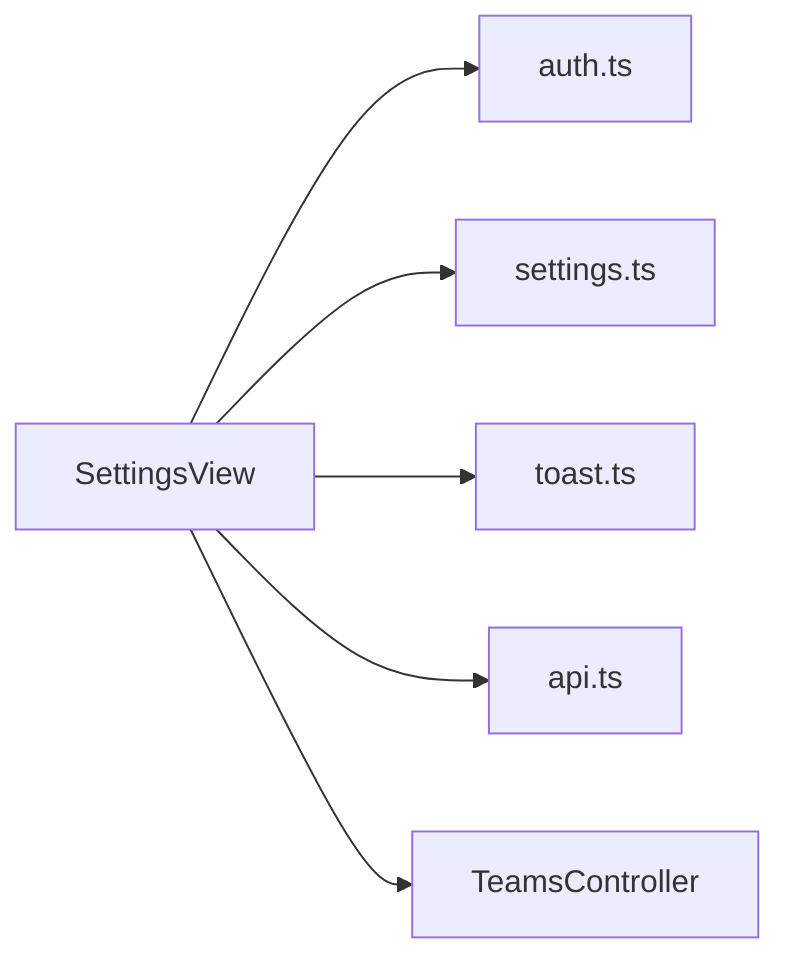

<!-- generated by docwizz: edits are overwritten -->
# frontend/src/views/Settings

Layer **ui** · project `frontend` · UI components: 1, Views: 1

Project navigation: [frontend](../projects/frontend-da6498268e99.md)

## Flows through this module

- `/settings` → SettingsView → GET /api/teams, useAuthStore, useSettingsStore, useToastStore → POST /api/v1/auth/login, POST /api/v1/auth/logout, POST /api/v1/auth/logout-all, POST /api/v1/auth/refresh

## Architecture observations

- ARCH-002 (medium): ui → http is not allowed — SettingsView calls HTTP directly ([SettingsView.vue](../../frontend/src/views/Settings/SettingsView.vue))

## Dependencies

Depends on: [frontend/src/services](frontend-src-services.md), [frontend/src/stores](frontend-src-stores.md), [src/ShiftPlanner.Api/Controllers](src-ShiftPlanner.Api-Controllers.md)

Used by: [frontend/src/router](frontend-src-router.md)

## Components

### SettingsView

_component_ · [SettingsView.vue](../../frontend/src/views/Settings/SettingsView.vue#L1)

_Reached from:_ [`/settings`](../frontend.md#flows)

---
_Generated from 1 symbols in [frontend/src/views/Settings/SettingsView.vue](../../frontend/src/views/Settings/SettingsView.vue) (commit `11abf0b`, profile `default`). Sections marked _fact_ are read from the code, _inferred_ come from heuristics, 🤖 marks AI drafts._
