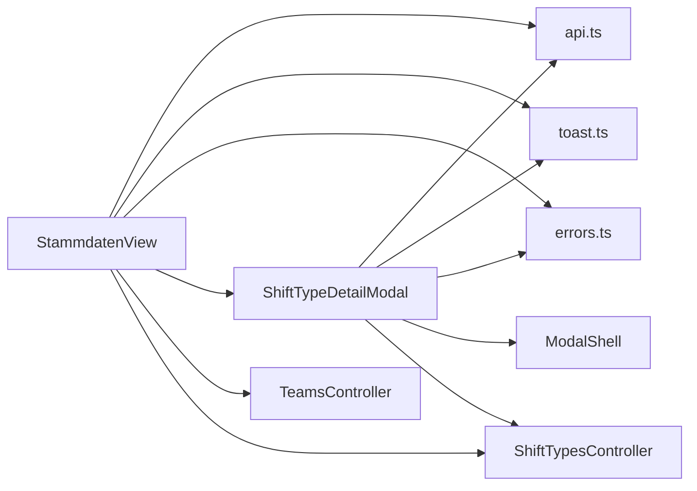

<!-- generated by docwizz: edits are overwritten -->
# frontend/src/views/Stammdaten

Layer **ui** · project `frontend` · UI components: 2, Views: 2

Project navigation: [frontend](../projects/frontend-da6498268e99.md)

## Key components

| Component | Kind | Used by | Summary |
|---|---|---|---|
| [ShiftTypeDetailModal](#shifttypedetailmodal) | view | 1 |  |
| [StammdatenView](#stammdatenview) | view | 1 | issue #57: German labels for the Bundesland enum, indexed by its backend ordinal (Domain/Scheduling/Bundesland.cs) — mirrors AbsenceType's client-side label mapping. |

## Flows through this module

- `/stammdaten` → StammdatenView → extractErrorMessage, GET /api/shift-types, GET /api/teams, POST /api/shift-types, POST /api/teams, ShiftTypeDetailModal, +1 more → ModalShell, PUT /api/shift-types/{id:guid}

## Documentation gaps

1 items need documentation (0 critical):

- medium: `frontend/src/views/Stammdaten/vue` — missing summary, param (public; complexity 7; side effects: http)

## Architecture observations

- ARCH-002 (medium): ui → http is not allowed — ShiftTypeDetailModal calls HTTP directly ([ShiftTypeDetailModal.vue](../../frontend/src/views/Stammdaten/ShiftTypeDetailModal.vue))
- ARCH-002 (medium): ui → http is not allowed — StammdatenView calls HTTP directly ([StammdatenView.vue](../../frontend/src/views/Stammdaten/StammdatenView.vue))
- ARCH-002 (medium): ui → http is not allowed — StammdatenView calls HTTP directly ([StammdatenView.vue](../../frontend/src/views/Stammdaten/StammdatenView.vue))
- ARCH-002 (medium): ui → http is not allowed — StammdatenView calls HTTP directly ([StammdatenView.vue](../../frontend/src/views/Stammdaten/StammdatenView.vue))
- ARCH-002 (medium): ui → http is not allowed — StammdatenView calls HTTP directly ([StammdatenView.vue](../../frontend/src/views/Stammdaten/StammdatenView.vue))

## Dependencies

Depends on: [frontend/src/components](frontend-src-components.md), [frontend/src/services](frontend-src-services.md), [frontend/src/stores](frontend-src-stores.md), [frontend/src/utils](frontend-src-utils.md), [src/ShiftPlanner.Api/Controllers](src-ShiftPlanner.Api-Controllers.md)

Used by: [frontend/src/router](frontend-src-router.md)

## Components

### ShiftTypeDetailModal

_component_ · [ShiftTypeDetailModal.vue](../../frontend/src/views/Stammdaten/ShiftTypeDetailModal.vue#L1) ⚠

Props: shiftType: ShiftType

Emits: close, updated

- **dependencies** _(fact)_: api.ts, toast.ts, errors.ts, ModalShell, ShiftTypesController
- **events** _(fact)_: close, updated
- **state** _(fact)_: form, saving, error

_Reached from:_ [`/stammdaten`](../frontend.md#flows)

_Evidence:_ [frontend/src/views/Stammdaten/ShiftTypeDetailModal.vue:1-129](../../frontend/src/views/Stammdaten/ShiftTypeDetailModal.vue#L1), [frontend/src/services/api.ts:1](../../frontend/src/services/api.ts#L1), [frontend/src/stores/toast.ts:1](../../frontend/src/stores/toast.ts#L1), [frontend/src/utils/errors.ts:1](../../frontend/src/utils/errors.ts#L1), [frontend/src/components/ModalShell.vue:1-53](../../frontend/src/components/ModalShell.vue#L1), [src/ShiftPlanner.Api/Controllers/ShiftTypesController.cs:35-120](../../src/ShiftPlanner.Api/Controllers/ShiftTypesController.cs#L35)

### StammdatenView

_component_ · [StammdatenView.vue](../../frontend/src/views/Stammdaten/StammdatenView.vue#L1)

issue #57: German labels for the Bundesland enum, indexed by its backend ordinal (Domain/Scheduling/Bundesland.cs) — mirrors AbsenceType's client-side label mapping.

- **dependencies** _(fact)_: api.ts, toast.ts, errors.ts, ShiftTypeDetailModal, TeamsController, ShiftTypesController
- **state** _(fact)_: teams, shiftTypes, loading, error, showTeamForm, teamForm, savingTeam, showShiftTypeForm, shiftTypeForm, savingShiftType, selectedShiftType

_Reached from:_ [`/stammdaten`](../frontend.md#flows)

_Evidence:_ [frontend/src/views/Stammdaten/StammdatenView.vue:1-452](../../frontend/src/views/Stammdaten/StammdatenView.vue#L1), [frontend/src/services/api.ts:1](../../frontend/src/services/api.ts#L1), [frontend/src/stores/toast.ts:1](../../frontend/src/stores/toast.ts#L1), [frontend/src/utils/errors.ts:1](../../frontend/src/utils/errors.ts#L1), [frontend/src/views/Stammdaten/ShiftTypeDetailModal.vue:1-129](../../frontend/src/views/Stammdaten/ShiftTypeDetailModal.vue#L1), [src/ShiftPlanner.Api/Controllers/TeamsController.cs:17-58](../../src/ShiftPlanner.Api/Controllers/TeamsController.cs#L17), [src/ShiftPlanner.Api/Controllers/ShiftTypesController.cs:35-120](../../src/ShiftPlanner.Api/Controllers/ShiftTypesController.cs#L35)

---
_Generated from 2 symbols in [frontend/src/views/Stammdaten/ShiftTypeDetailModal.vue](../../frontend/src/views/Stammdaten/ShiftTypeDetailModal.vue), [frontend/src/views/Stammdaten/StammdatenView.vue](../../frontend/src/views/Stammdaten/StammdatenView.vue) (commit `534b8b5`, profile `default`). Sections marked _fact_ are read from the code, _inferred_ come from heuristics, 🤖 marks AI drafts._
