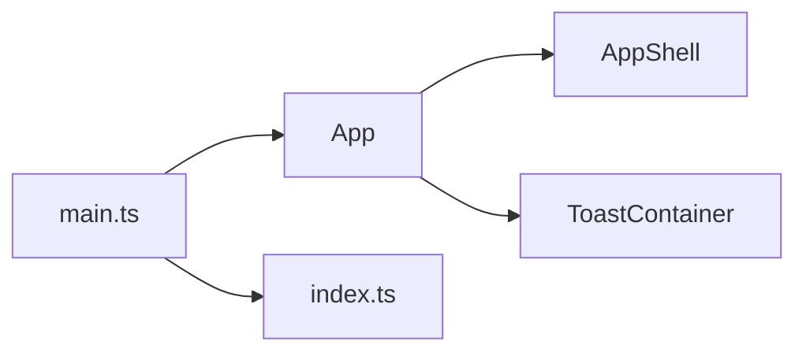

<!-- generated by docwizz: edits are overwritten -->
# frontend/src

Layer **ui** · project `frontend` · UI components: 1

Project navigation: [frontend](../projects/frontend-da6498268e99.md)

## Dependencies

Depends on: [frontend/src/components](frontend-src-components.md), [frontend/src/router](frontend-src-router.md)

## Components

### App

_component_ · [App.vue](../../frontend/src/App.vue#L1)

### main.ts

_module_ · [main.ts](../../frontend/src/main.ts#L1)

---
_Generated from 2 symbols in [frontend/src/App.vue](../../frontend/src/App.vue), [frontend/src/main.ts](../../frontend/src/main.ts) (commit `534b8b5`, profile `default`). Sections marked _fact_ are read from the code, _inferred_ come from heuristics, 🤖 marks AI drafts._
