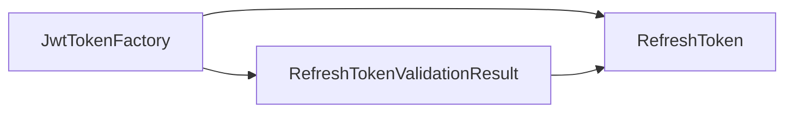

<!-- generated by docwizz: edits are overwritten -->
# src/ShiftPlanner.Api/Authentication

Layer **api** · project `ShiftPlanner.Api` · Options: 1

Project navigation: [ShiftPlanner.Api](../projects/ShiftPlanner-Api-b964678aa746.md)

## Key components

| Component | Kind | Used by | Summary |
|---|---|---|---|
| [JwtTokenFactory](#jwttokenfactory) | class | 1 |  |
| [RefreshTokenValidationResult](#refreshtokenvalidationresult) | record | 1 |  |
| [JwtOptions](#jwtoptions) | options | 0 |  |
| [JwtOptionsValidator](#jwtoptionsvalidator) | class | 0 |  |

## Flows through this module

- `POST /api/v1/auth/login`: AuthController → ApplicationDbContext, AuthController, JwtTokenFactory → PostgreSQL, RefreshToken
- `POST /api/v1/auth/refresh`: AuthController → ApplicationDbContext, AuthController, JwtTokenFactory → PostgreSQL, RefreshToken

## Dependencies

Depends on: [src/ShiftPlanner.Domain/Common](src-ShiftPlanner.Domain-Common.md)

Used by: [src/ShiftPlanner.Api/Controllers](src-ShiftPlanner.Api-Controllers.md)

## Components

### JwtOptions

_class_ · [JwtOptions.cs](../../src/ShiftPlanner.Api/Authentication/JwtOptions.cs#L10)

### JwtOptionsValidator

_class_ · [JwtOptions.cs](../../src/ShiftPlanner.Api/Authentication/JwtOptions.cs#L26)

| Member | Summary | Derived from code | Complexity |
|---|---|---|---|
| [`Validate(string?, ShiftPlanner.Api.Authentication.JwtOptions)`](../../src/ShiftPlanner.Api/Authentication/JwtOptions.cs#L28) |  |  | 5 |

### JwtTokenFactory

_class_ · [JwtTokenFactory.cs](../../src/ShiftPlanner.Api/Authentication/JwtTokenFactory.cs#L20)

_Reached from:_ [`POST /api/v1/auth/login`](../api.md#flows), [`POST /api/v1/auth/refresh`](../api.md#flows)

| Member | Summary | Derived from code | Complexity |
|---|---|---|---|
| [`CreateAccessToken(ShiftPlanner.Infrastructure.Persistence.ApplicationUser, System.Collections.Generic.IEnumerable<string>, ShiftPlanner.Api.Authentication.JwtOptions)`](../../src/ShiftPlanner.Api/Authentication/JwtTokenFactory.cs#L25) |  |  | 1 |
| [`CreateRefreshToken(ShiftPlanner.Infrastructure.Persistence.ApplicationUser, ShiftPlanner.Api.Authentication.JwtOptions)`](../../src/ShiftPlanner.Api/Authentication/JwtTokenFactory.cs#L28) |  |  | 1 |
| [`CreateRefreshTokenRecord(string, string)`](../../src/ShiftPlanner.Api/Authentication/JwtTokenFactory.cs#L35) |  |  | 1 |
| [`ValidateRefreshToken(string, ShiftPlanner.Api.Authentication.JwtOptions)`](../../src/ShiftPlanner.Api/Authentication/JwtTokenFactory.cs#L48) |  |  | 3 |
| [`ValidateRefreshTokenAsync(string, ShiftPlanner.Api.Authentication.JwtOptions, ShiftPlanner.Infrastructure.Persistence.ApplicationDbContext)`](../../src/ShiftPlanner.Api/Authentication/JwtTokenFactory.cs#L57) |  |  | 6 |

### RefreshTokenValidationResult

_record_ · [JwtTokenFactory.cs](../../src/ShiftPlanner.Api/Authentication/JwtTokenFactory.cs#L129)

---
_Generated from 15 symbols in [src/ShiftPlanner.Api/Authentication/JwtOptions.cs](../../src/ShiftPlanner.Api/Authentication/JwtOptions.cs), [src/ShiftPlanner.Api/Authentication/JwtTokenFactory.cs](../../src/ShiftPlanner.Api/Authentication/JwtTokenFactory.cs) (commit `534b8b5`, profile `default`). Sections marked _fact_ are read from the code, _inferred_ come from heuristics, 🤖 marks AI drafts._
