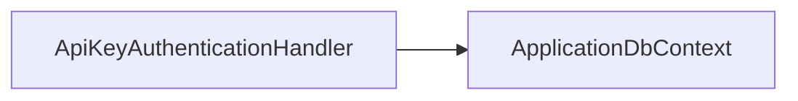

<!-- generated by docwizz: edits are overwritten -->
# src/ShiftPlanner.Api/Middleware

Layer **api** · project `ShiftPlanner.Api` · Middleware: 1

Project navigation: [ShiftPlanner.Api](../projects/ShiftPlanner-Api-b964678aa746.md)

## Key components

| Component | Kind | Used by | Summary |
|---|---|---|---|
| [ApiKeyAuthenticationHandler](#apikeyauthenticationhandler) | class | 0 |  |
| [GlobalExceptionMiddleware](#globalexceptionmiddleware) | middleware | 0 |  |

## Dependencies

Depends on: [src/ShiftPlanner.Infrastructure/Persistence](src-ShiftPlanner.Infrastructure-Persistence.md)

## Components

### ApiKeyAuthenticationHandler

_class_ · [ApiKeyAuthenticationHandler.cs](../../src/ShiftPlanner.Api/Middleware/ApiKeyAuthenticationHandler.cs#L13)

| Member | Summary | Derived from code | Complexity |
|---|---|---|---|
| [`HandleAuthenticateAsync()`](../../src/ShiftPlanner.Api/Middleware/ApiKeyAuthenticationHandler.cs#L22) |  |  | 5 |

### GlobalExceptionMiddleware

_class_ · [GlobalExceptionMiddleware.cs](../../src/ShiftPlanner.Api/Middleware/GlobalExceptionMiddleware.cs#L15)

| Member | Summary | Derived from code | Complexity |
|---|---|---|---|
| [`InvokeAsync(HttpContext)`](../../src/ShiftPlanner.Api/Middleware/GlobalExceptionMiddleware.cs#L17) |  |  | 5 |

---
_Generated from 5 symbols in [src/ShiftPlanner.Api/Middleware/ApiKeyAuthenticationHandler.cs](../../src/ShiftPlanner.Api/Middleware/ApiKeyAuthenticationHandler.cs), [src/ShiftPlanner.Api/Middleware/GlobalExceptionMiddleware.cs](../../src/ShiftPlanner.Api/Middleware/GlobalExceptionMiddleware.cs) (commit `534b8b5`, profile `default`). Sections marked _fact_ are read from the code, _inferred_ come from heuristics, 🤖 marks AI drafts._
