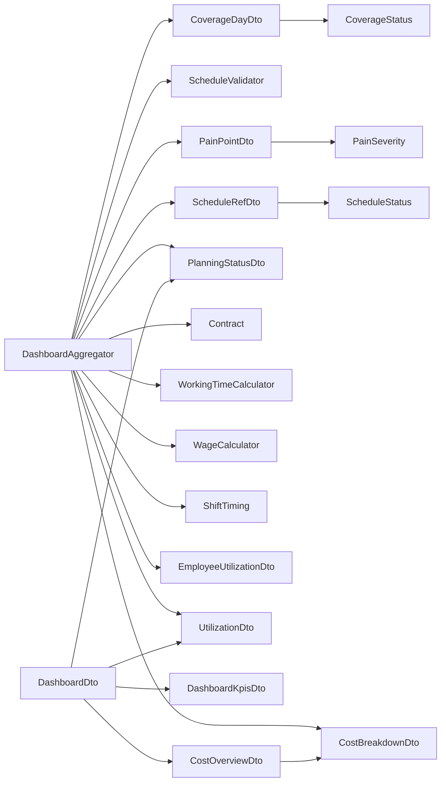

<!-- generated by docwizz: edits are overwritten -->
# src/ShiftPlanner.Application/Dashboard

Layer **application** · project `ShiftPlanner.Application`

Project navigation: [ShiftPlanner.Application](../projects/ShiftPlanner-Application-bbdb4cab28c5.md)

## Key components

| Component | Kind | Used by | Summary |
|---|---|---|---|
| [CostBreakdownDto](#costbreakdowndto) | record | 2 |  |
| [CostOverviewDto](#costoverviewdto) | record | 2 |  |
| [DashboardKpisDto](#dashboardkpisdto) | record | 2 |  |
| [PlanningStatusDto](#planningstatusdto) | record | 2 |  |
| [UtilizationDto](#utilizationdto) | record | 2 |  |
| [CoverageDayDto](#coveragedaydto) | record | 1 |  |
| [DashboardAggregator](#dashboardaggregator) | class | 1 |  |
| [DashboardDto](#dashboarddto) | record | 1 |  |

## Flows through this module

- `GET /api/dashboard`: DashboardController → ApplicationDbContext, DashboardAggregator, GermanPublicHolidays → Contract, PostgreSQL, ScheduleValidator, WageCalculator, WorkingTimeCalculator → AbsenceValidator, BreakMinutesValidator, ConsecutiveDaysValidator, ContractValidator, EligibilityValidator, RestTimeValidator, +2 more → ShiftAssignment

## Documentation gaps

3 items need documentation (1 critical):

- high: `DashboardAggregator.BuildCoverage(IReadOnlyList<ShiftAssignment>, IReadOnlyDictionary<Guid, ShiftType>, IReadOnlyList<StaffingRequirement>, IReadOnlyDictionary<Guid, Employee>, DateOnly, DateOnly, Guid?, Guid?)` — missing summary (public; complexity 22; 8 params)
- medium: `DashboardAggregator.BuildPainPoints(IReadOnlyList<Schedule>, IReadOnlyDictionary<Guid, IReadOnlyList<ShiftAssignment>>, IReadOnlyList<ShiftAssignment>, IReadOnlyDictionary<Guid, Employee>, IReadOnlyList<ShiftType>, IReadOnlyList<Contract>, IReadOnlyList<Absence>, IReadOnlyList<StaffingRequirement>, Guid?)` — missing summary (public; complexity 9; 9 params)
- medium: `DashboardAggregator.BuildCostBreakdown(IReadOnlyList<ShiftAssignment>, IReadOnlyList<Contract>, IReadOnlyDictionary<Guid, Bundesland?>, IReadOnlyDictionary<Bundesland, HashSet<DateOnly>>, HashSet<DateOnly>)` — missing summary (public; complexity 6; 5 params)

## Architecture observations

- 1 member has cyclomatic complexity ≥ 15 (many paths to test and explain): `DashboardAggregator.BuildCoverage(IReadOnlyList<ShiftAssignment>, IReadOnlyDictionary<Guid, ShiftType>, IReadOnlyList<StaffingRequirement>, IReadOnlyDictionary<Guid, Employee>, DateOnly, DateOnly, Guid?, Guid?)` (22)
- `DashboardAggregator` depends on 12 other components — high coupling, possibly several responsibilities

## Dependencies

Depends on: [src/ShiftPlanner.Application/Validation](src-ShiftPlanner.Application-Validation.md), [src/ShiftPlanner.Domain/Contracts](src-ShiftPlanner.Domain-Contracts.md), [src/ShiftPlanner.Domain/Scheduling](src-ShiftPlanner.Domain-Scheduling.md)

Used by: [src/ShiftPlanner.Api/Controllers](src-ShiftPlanner.Api-Controllers.md)

## Components

### CostBreakdownDto

_record_ · [DashboardDtos.cs](../../src/ShiftPlanner.Application/Dashboard/DashboardDtos.cs#L46)

### CostOverviewDto

_record_ · [DashboardDtos.cs](../../src/ShiftPlanner.Application/Dashboard/DashboardDtos.cs#L44)

### CoverageDayDto

_record_ · [DashboardDtos.cs](../../src/ShiftPlanner.Application/Dashboard/DashboardDtos.cs#L24)

### DashboardAggregator

_class_ · [DashboardAggregator.cs](../../src/ShiftPlanner.Application/Dashboard/DashboardAggregator.cs#L14)

_Reached from:_ [`GET /api/dashboard`](../api.md#flows) · _Linked tests:_ `DashboardAggregatorTests.BuildCostBreakdown_MatchesWageCalculatorBreakdownPerAssignment` (via `DashboardAggregator.BuildCostBreakdown(IReadOnlyList<ShiftAssignment>, IReadOnlyList<Contract>, IReadOnlyDictionary<Guid, Bundesland?>, IReadOnlyDictionary<Bundesland, HashSet<DateOnly>>, HashSet<DateOnly>)`), `DashboardAggregatorTests.BuildCostBreakdown_UsesPerBundeslandHolidaySetWhenEmployeeHasOne` (via `DashboardAggregator.BuildCostBreakdown(IReadOnlyList<ShiftAssignment>, IReadOnlyList<Contract>, IReadOnlyDictionary<Guid, Bundesland?>, IReadOnlyDictionary<Bundesland, HashSet<DateOnly>>, HashSet<DateOnly>)`), `DashboardAggregatorTests.BuildCoverage_ComputesPercentAndStatusPerShiftTypeAndDate` (via `DashboardAggregator.BuildCoverage(IReadOnlyList<ShiftAssignment>, IReadOnlyDictionary<Guid, ShiftType>, IReadOnlyList<StaffingRequirement>, IReadOnlyDictionary<Guid, Employee>, DateOnly, DateOnly, Guid?, Guid?)`), `DashboardAggregatorTests.BuildEmployeeUtilization_ComputesExpectedActualAndOvertimePerEmployee` (via `DashboardAggregator.BuildEmployeeUtilization(IReadOnlyList<Employee>, IReadOnlyList<ShiftAssignment>, IReadOnlyList<Contract>, IReadOnlyList<Absence>, DateOnly, DateOnly)`), `DashboardAggregatorTests.BuildEmployeeUtilization_ZeroExpectedHoursDoesNotDivideByZero` (via `DashboardAggregator.BuildEmployeeUtilization(IReadOnlyList<Employee>, IReadOnlyList<ShiftAssignment>, IReadOnlyList<Contract>, IReadOnlyList<Absence>, DateOnly, DateOnly)`), `DashboardAggregatorTests.BuildPainPoints_CollectsValidatorIssuesAndRespectsTeamFilter` (via `DashboardAggregator.BuildPainPoints(IReadOnlyList<Schedule>, IReadOnlyDictionary<Guid, IReadOnlyList<ShiftAssignment>>, IReadOnlyList<ShiftAssignment>, IReadOnlyDictionary<Guid, Employee>, IReadOnlyList<ShiftType>, IReadOnlyList<Contract>, IReadOnlyList<Absence>, IReadOnlyList<StaffingRequirement>, Guid?)`), `DashboardAggregatorTests.BuildPlanningStatus_CountsDraftPublishedAndConflicts` (via `DashboardAggregator.BuildPlanningStatus(IReadOnlyList<Schedule>, IReadOnlyList<PainPointDto>)`), `DashboardAggregatorTests.BuildUtilization_SumsCapacityAndPlannedAcrossEmployees` (via `DashboardAggregator.BuildUtilization(IReadOnlyList<EmployeeUtilizationDto>)`), +6 more — test code that uses it, not coverage

| Member | Summary | Derived from code | Complexity |
|---|---|---|---|
| [`ResolvePeriod(System.DateOnly?, System.DateOnly?, System.DateOnly)`](../../src/ShiftPlanner.Application/Dashboard/DashboardAggregator.cs#L16) |  |  | 3 |
| [`DeltaPercent(decimal, decimal)`](../../src/ShiftPlanner.Application/Dashboard/DashboardAggregator.cs#L25) |  |  | 2 |
| [`BuildCoverage(System.Collections.Generic.IReadOnlyList<ShiftPlanner.Domain.Scheduling.ShiftAssignment>, System.Collections.Generic.IReadOnlyDictionary<System.Guid, ShiftPlanner.Domain.Scheduling.ShiftType>, System.Collections.Generic.IReadOnlyList<ShiftPlanner.Domain.Scheduling.StaffingRequirement>, System.Collections.Generic.IReadOnlyDictionary<System.Guid, ShiftPlanner.Domain.Employees.Employee>, System.DateOnly, System.DateOnly, System.Guid?, System.Guid?)`](../../src/ShiftPlanner.Application/Dashboard/DashboardAggregator.cs#L28) ⚠ |  |  | 22 |
| [`CoveragePercent(System.Collections.Generic.IReadOnlyList<ShiftPlanner.Application.Dashboard.CoverageDayDto>)`](../../src/ShiftPlanner.Application/Dashboard/DashboardAggregator.cs#L95) |  |  | 2 |
| [`BuildPainPoints(System.Collections.Generic.IReadOnlyList<ShiftPlanner.Domain.Scheduling.Schedule>, System.Collections.Generic.IReadOnlyDictionary<System.Guid, System.Collections.Generic.IReadOnlyList<ShiftPlanner.Domain.Scheduling.ShiftAssignment>>, System.Collections.Generic.IReadOnlyList<ShiftPlanner.Domain.Scheduling.ShiftAssignment>, System.Collections.Generic.IReadOnlyDictionary<System.Guid, ShiftPlanner.Domain.Employees.Employee>, System.Collections.Generic.IReadOnlyList<ShiftPlanner.Domain.Scheduling.ShiftType>, System.Collections.Generic.IReadOnlyList<ShiftPlanner.Domain.Contracts.Contract>, System.Collections.Generic.IReadOnlyList<ShiftPlanner.Domain.Employees.Absence>, System.Collections.Generic.IReadOnlyList<ShiftPlanner.Domain.Scheduling.StaffingRequirement>, System.Guid?)`](../../src/ShiftPlanner.Application/Dashboard/DashboardAggregator.cs#L98) ⚠ |  |  | 9 |
| [`BuildPlanningStatus(System.Collections.Generic.IReadOnlyList<ShiftPlanner.Domain.Scheduling.Schedule>, System.Collections.Generic.IReadOnlyList<ShiftPlanner.Application.Dashboard.PainPointDto>)`](../../src/ShiftPlanner.Application/Dashboard/DashboardAggregator.cs#L137) |  |  | 2 |
| [`BuildCostBreakdown(System.Collections.Generic.IReadOnlyList<ShiftPlanner.Domain.Scheduling.ShiftAssignment>, System.Collections.Generic.IReadOnlyList<ShiftPlanner.Domain.Contracts.Contract>, System.Collections.Generic.IReadOnlyDictionary<System.Guid, ShiftPlanner.Domain.Scheduling.Bundesland?>, System.Collections.Generic.IReadOnlyDictionary<ShiftPlanner.Domain.Scheduling.Bundesland, System.Collections.Generic.HashSet<System.DateOnly>>, System.Collections.Generic.HashSet<System.DateOnly>)`](../../src/ShiftPlanner.Application/Dashboard/DashboardAggregator.cs#L152) ⚠ |  |  | 6 |
| [`BuildEmployeeUtilization(System.Collections.Generic.IReadOnlyList<ShiftPlanner.Domain.Employees.Employee>, System.Collections.Generic.IReadOnlyList<ShiftPlanner.Domain.Scheduling.ShiftAssignment>, System.Collections.Generic.IReadOnlyList<ShiftPlanner.Domain.Contracts.Contract>, System.Collections.Generic.IReadOnlyList<ShiftPlanner.Domain.Employees.Absence>, System.DateOnly, System.DateOnly)`](../../src/ShiftPlanner.Application/Dashboard/DashboardAggregator.cs#L192) |  |  | 3 |
| [`BuildUtilization(System.Collections.Generic.IReadOnlyList<ShiftPlanner.Application.Dashboard.EmployeeUtilizationDto>)`](../../src/ShiftPlanner.Application/Dashboard/DashboardAggregator.cs#L209) |  |  | 1 |
| [`UtilizationPercent(System.Collections.Generic.IReadOnlyList<ShiftPlanner.Application.Dashboard.EmployeeUtilizationDto>)`](../../src/ShiftPlanner.Application/Dashboard/DashboardAggregator.cs#L215) |  |  | 2 |

### DashboardDto

_record_ · [DashboardDtos.cs](../../src/ShiftPlanner.Application/Dashboard/DashboardDtos.cs#L11)

### DashboardKpisDto

_record_ · [DashboardDtos.cs](../../src/ShiftPlanner.Application/Dashboard/DashboardDtos.cs#L16)

### EmployeeUtilizationDto

_record_ · [DashboardDtos.cs](../../src/ShiftPlanner.Application/Dashboard/DashboardDtos.cs#L54)

### PainPointDto

_record_ · [DashboardDtos.cs](../../src/ShiftPlanner.Application/Dashboard/DashboardDtos.cs#L34)

### PlanningStatusDto

_record_ · [DashboardDtos.cs](../../src/ShiftPlanner.Application/Dashboard/DashboardDtos.cs#L28)

### ScheduleRefDto

_record_ · [DashboardDtos.cs](../../src/ShiftPlanner.Application/Dashboard/DashboardDtos.cs#L32)

### UtilizationDto

_record_ · [DashboardDtos.cs](../../src/ShiftPlanner.Application/Dashboard/DashboardDtos.cs#L58)

---
_Generated from 23 symbols in [src/ShiftPlanner.Application/Dashboard/DashboardAggregator.cs](../../src/ShiftPlanner.Application/Dashboard/DashboardAggregator.cs), [src/ShiftPlanner.Application/Dashboard/DashboardDtos.cs](../../src/ShiftPlanner.Application/Dashboard/DashboardDtos.cs) (commit `534b8b5`, profile `default`). Sections marked _fact_ are read from the code, _inferred_ come from heuristics, 🤖 marks AI drafts._
