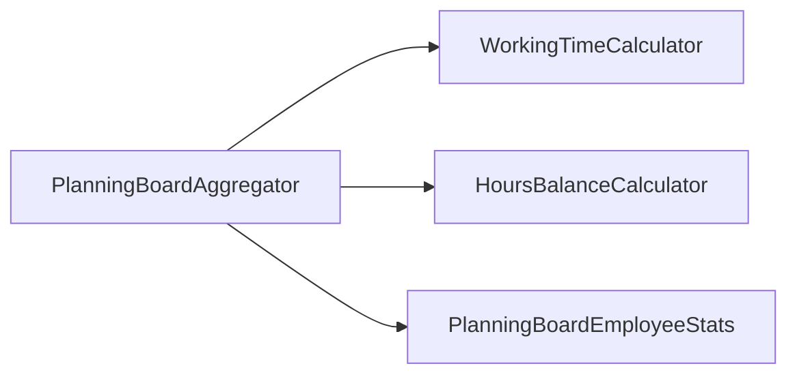

<!-- generated by docwizz: edits are overwritten -->
# src/ShiftPlanner.Application/Planning

Layer **application** · project `ShiftPlanner.Application`

Project navigation: [ShiftPlanner.Application](../projects/ShiftPlanner-Application-bbdb4cab28c5.md)

## Overview 🤖

Manages the aggregation and statistics for employees on a planning board.

**Responsibilities.** Aggregates employee statistics based on scheduling data and contracts.

**Usage.** Used by the API controllers to fetch planning board statistics.

_AI draft from the facts on this page; review it, then write the module's documentation yourself._

## Key components

| Component | Kind | Used by | Summary |
|---|---|---|---|
| [PlanningBoardAggregator](#planningboardaggregator) | class | 1 |  |
| [PlanningBoardEmployeeStats](#planningboardemployeestats) | record | 1 |  |

## Flows through this module

- `GET /api/planning-board`: PlanningBoardController → ApplicationDbContext, GermanPublicHolidays, PlanningBoardAggregator, PlanningBoardController → HoursBalanceCalculator, PostgreSQL, WageCalculator, WorkingTimeCalculator → Contract

## Dependencies

Depends on: [src/ShiftPlanner.Domain/Scheduling](src-ShiftPlanner.Domain-Scheduling.md)

Used by: [src/ShiftPlanner.Api/Controllers](src-ShiftPlanner.Api-Controllers.md)

## Components

### PlanningBoardAggregator

_class_ · [PlanningBoardAggregator.cs](../../src/ShiftPlanner.Application/Planning/PlanningBoardAggregator.cs#L17)

_Reached from:_ [`GET /api/planning-board`](../api.md#flows) · _Linked tests:_ `PlanningBoardAggregatorTests.BuildStats_ExcludesAbsenceDaysFromTargetHours` (via `PlanningBoardAggregator.BuildStats(Guid, DateOnly, DateOnly, IReadOnlyList<ShiftAssignment>, IReadOnlyList<Contract>, IReadOnlyList<Absence>, IReadOnlyList<Schedule>, IReadOnlyList<ShiftAssignment>, IReadOnlyList<HoursAdjustment>?)`), `PlanningBoardAggregatorTests.BuildStats_MatchesHandComputedTargetPlannedAndBalance` (via `PlanningBoardAggregator.BuildStats(Guid, DateOnly, DateOnly, IReadOnlyList<ShiftAssignment>, IReadOnlyList<Contract>, IReadOnlyList<Absence>, IReadOnlyList<Schedule>, IReadOnlyList<ShiftAssignment>, IReadOnlyList<HoursAdjustment>?)`), `PlanningBoardAggregatorTests.BuildStats_NoContract_TargetHoursNull_PlannedAndBalanceStillComputed` (via `PlanningBoardAggregator.BuildStats(Guid, DateOnly, DateOnly, IReadOnlyList<ShiftAssignment>, IReadOnlyList<Contract>, IReadOnlyList<Absence>, IReadOnlyList<Schedule>, IReadOnlyList<ShiftAssignment>, IReadOnlyList<HoursAdjustment>?)`), `PlanningBoardAggregatorTests.BuildStats_OnlyCountsTheGivenEmployeesOwnAssignments` (via `PlanningBoardAggregator.BuildStats(Guid, DateOnly, DateOnly, IReadOnlyList<ShiftAssignment>, IReadOnlyList<Contract>, IReadOnlyList<Absence>, IReadOnlyList<Schedule>, IReadOnlyList<ShiftAssignment>, IReadOnlyList<HoursAdjustment>?)`), `PlanningBoardAggregatorTests.ResolveTargetContract_NoContracts_ReturnsNull` (via `PlanningBoardAggregator.ResolveTargetContract(IReadOnlyList<Contract>, DateOnly)`), `PlanningBoardAggregatorTests.ResolveTargetContract_NoneActive_FallsBackToMostRecentlyStarted` (via `PlanningBoardAggregator.ResolveTargetContract(IReadOnlyList<Contract>, DateOnly)`), `PlanningBoardAggregatorTests.ResolveTargetContract_PrefersContractActiveOnFromDate` (via `PlanningBoardAggregator.ResolveTargetContract(IReadOnlyList<Contract>, DateOnly)`) — test code that uses it, not coverage

| Member | Summary | Derived from code | Complexity |
|---|---|---|---|
| [`BuildStats(System.Guid, System.DateOnly, System.DateOnly, System.Collections.Generic.IReadOnlyList<ShiftPlanner.Domain.Scheduling.ShiftAssignment>, System.Collections.Generic.IReadOnlyList<ShiftPlanner.Domain.Contracts.Contract>, System.Collections.Generic.IReadOnlyList<ShiftPlanner.Domain.Employees.Absence>, System.Collections.Generic.IReadOnlyList<ShiftPlanner.Domain.Scheduling.Schedule>, System.Collections.Generic.IReadOnlyList<ShiftPlanner.Domain.Scheduling.ShiftAssignment>, System.Collections.Generic.IReadOnlyList<ShiftPlanner.Domain.Employees.HoursAdjustment>?)`](../../src/ShiftPlanner.Application/Planning/PlanningBoardAggregator.cs#L25) |  |  | 3 |
| [`ResolveTargetContract(System.Collections.Generic.IReadOnlyList<ShiftPlanner.Domain.Contracts.Contract>, System.DateOnly)`](../../src/ShiftPlanner.Application/Planning/PlanningBoardAggregator.cs#L62) |  |  | 5 |

### PlanningBoardEmployeeStats

_record_ · [PlanningBoardAggregator.cs](../../src/ShiftPlanner.Application/Planning/PlanningBoardAggregator.cs#L15)

---
_Generated from 4 symbols in [src/ShiftPlanner.Application/Planning/PlanningBoardAggregator.cs](../../src/ShiftPlanner.Application/Planning/PlanningBoardAggregator.cs) (commit `11abf0b`, profile `default`). Sections marked _fact_ are read from the code, _inferred_ come from heuristics, 🤖 marks AI drafts._
