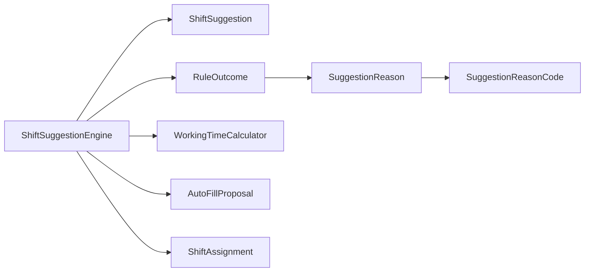

<!-- generated by docwizz: edits are overwritten -->
# src/ShiftPlanner.Application/Suggestions

Layer **application** · project `ShiftPlanner.Application`

Project navigation: [ShiftPlanner.Application](../projects/ShiftPlanner-Application-bbdb4cab28c5.md)

## Key components

| Component | Kind | Used by | Summary |
|---|---|---|---|
| [AutoFillProposal](#autofillproposal) | record | 1 |  |
| [RuleOutcome](#ruleoutcome) | record | 1 |  |
| [SchedulingContext](#schedulingcontext) | record | 1 |  |
| [ShiftSuggestion](#shiftsuggestion) | record | 1 |  |
| [ShiftSuggestionEngine](#shiftsuggestionengine) | class | 1 |  |
| [SuggestionReason](#suggestionreason) | record | 1 |  |
| [SuggestionReasonCode](#suggestionreasoncode) | enum | 1 |  |

## Flows through this module

- `GET /api/schedules/{id:guid}/auto-fill-preview`: SchedulesController → ApplicationDbContext, ShiftSuggestionEngine → PostgreSQL, PreferenceLevel, RuleOutcome, WorkingTimeCalculator → Contract
- `GET /api/schedules/{id:guid}/suggestions`: SchedulesController → ApplicationDbContext, ShiftSuggestionEngine → PostgreSQL, PreferenceLevel, RuleOutcome, WorkingTimeCalculator → Contract

## Documentation gaps

1 items need documentation (0 critical):

- medium: `ShiftSuggestionEngine.AutoFill(DateOnly, DateOnly, IReadOnlyList<ShiftType>, SchedulingContext)` — missing summary (public; complexity 8; 4 params)

## Dependencies

Depends on: [src/ShiftPlanner.Domain/Scheduling](src-ShiftPlanner.Domain-Scheduling.md)

Used by: [src/ShiftPlanner.Api/Controllers](src-ShiftPlanner.Api-Controllers.md)

## Components

### AutoFillProposal

_record_ · [ShiftSuggestionEngine.cs](../../src/ShiftPlanner.Application/Suggestions/ShiftSuggestionEngine.cs#L27)

### RuleOutcome

_record_ · [ShiftSuggestionEngine.cs](../../src/ShiftPlanner.Application/Suggestions/ShiftSuggestionEngine.cs#L75)

_Reached from:_ [`GET /api/schedules/{id:guid}/auto-fill-preview`](../api.md#flows), [`GET /api/schedules/{id:guid}/suggestions`](../api.md#flows)

| Member | Summary | Derived from code | Complexity |
|---|---|---|---|
| [`Exclude(ShiftPlanner.Application.Suggestions.SuggestionReasonCode, string)`](../../src/ShiftPlanner.Application/Suggestions/ShiftSuggestionEngine.cs#L79) |  |  | 1 |
| [`Scored(decimal, ShiftPlanner.Application.Suggestions.SuggestionReasonCode, string)`](../../src/ShiftPlanner.Application/Suggestions/ShiftSuggestionEngine.cs#L82) |  |  | 1 |

### SchedulingContext

_record_ · [ShiftSuggestionEngine.cs](../../src/ShiftPlanner.Application/Suggestions/ShiftSuggestionEngine.cs#L36)

### ShiftSuggestion

_record_ · [ShiftSuggestionEngine.cs](../../src/ShiftPlanner.Application/Suggestions/ShiftSuggestionEngine.cs#L23)

### ShiftSuggestionEngine

_class_ · [ShiftSuggestionEngine.cs](../../src/ShiftPlanner.Application/Suggestions/ShiftSuggestionEngine.cs#L57)

_Reached from:_ [`GET /api/schedules/{id:guid}/auto-fill-preview`](../api.md#flows), [`GET /api/schedules/{id:guid}/suggestions`](../api.md#flows) · _Linked tests:_ `ShiftSuggestionEngineAutoFillTests.AutoFill` (via `ShiftSuggestionEngine.AutoFill(DateOnly, DateOnly, IReadOnlyList<ShiftType>, SchedulingContext)`), `ShiftSuggestionEngineRulesTests.EvaluateAbsence_OnDate_IsIneligible` (via `ShiftSuggestionEngine.EvaluateAbsence(Employee, DateOnly, IReadOnlyList<Absence>)`), `ShiftSuggestionEngineRulesTests.EvaluateAbsence_OutsideRange_IsEligible` (via `ShiftSuggestionEngine.EvaluateAbsence(Employee, DateOnly, IReadOnlyList<Absence>)`), `ShiftSuggestionEngineRulesTests.EvaluateConsecutiveDays_SeventhDay_IsIneligible` (via `ShiftSuggestionEngine.EvaluateConsecutiveDays(IReadOnlyList<ShiftAssignment>, DateOnly)`), `ShiftSuggestionEngineRulesTests.EvaluateConsecutiveDays_SixthDay_IsEligible` (via `ShiftSuggestionEngine.EvaluateConsecutiveDays(IReadOnlyList<ShiftAssignment>, DateOnly)`), `ShiftSuggestionEngineRulesTests.EvaluateContractTarget_AtOrOverTarget_NoBonus` (via `ShiftSuggestionEngine.EvaluateContractTarget(Employee, DateOnly, DateOnly, IReadOnlyList<Absence>, IReadOnlyList<Contract>, IReadOnlyList<ShiftAssignment>)`), `ShiftSuggestionEngineRulesTests.EvaluateContractTarget_NoContract_NoBonus` (via `ShiftSuggestionEngine.EvaluateContractTarget(Employee, DateOnly, DateOnly, IReadOnlyList<Absence>, IReadOnlyList<Contract>, IReadOnlyList<ShiftAssignment>)`), `ShiftSuggestionEngineRulesTests.EvaluateContractTarget_UnderTarget_ScoresPositive` (via `ShiftSuggestionEngine.EvaluateContractTarget(Employee, DateOnly, DateOnly, IReadOnlyList<Absence>, IReadOnlyList<Contract>, IReadOnlyList<ShiftAssignment>)`), +12 more — test code that uses it, not coverage

| Member | Summary | Derived from code | Complexity |
|---|---|---|---|
| [`Suggest(System.DateOnly, ShiftPlanner.Domain.Scheduling.ShiftType, ShiftPlanner.Application.Suggestions.SchedulingContext)`](../../src/ShiftPlanner.Application/Suggestions/ShiftSuggestionEngine.cs#L86) |  |  | 5 |
| [`EvaluateEligibility(ShiftPlanner.Domain.Employees.Employee, ShiftPlanner.Domain.Scheduling.ShiftType)`](../../src/ShiftPlanner.Application/Suggestions/ShiftSuggestionEngine.cs#L130) |  |  | 3 |
| [`EvaluateAbsence(ShiftPlanner.Domain.Employees.Employee, System.DateOnly, System.Collections.Generic.IReadOnlyList<ShiftPlanner.Domain.Employees.Absence>)`](../../src/ShiftPlanner.Application/Suggestions/ShiftSuggestionEngine.cs#L136) |  |  | 4 |
| [`EvaluateRestTime(System.Collections.Generic.IReadOnlyList<ShiftPlanner.Domain.Scheduling.ShiftAssignment>, System.DateTime, System.DateTime)`](../../src/ShiftPlanner.Application/Suggestions/ShiftSuggestionEngine.cs#L144) |  |  | 7 |
| [`EvaluateConsecutiveDays(System.Collections.Generic.IReadOnlyList<ShiftPlanner.Domain.Scheduling.ShiftAssignment>, System.DateOnly)`](../../src/ShiftPlanner.Application/Suggestions/ShiftSuggestionEngine.cs#L166) |  |  | 4 |
| [`EvaluateSameDayOverlap(System.Collections.Generic.IReadOnlyList<ShiftPlanner.Domain.Scheduling.ShiftAssignment>, System.DateOnly)`](../../src/ShiftPlanner.Application/Suggestions/ShiftSuggestionEngine.cs#L184) |  |  | 2 |
| [`EvaluateShiftTypePreference(ShiftPlanner.Domain.Employees.Employee, ShiftPlanner.Domain.Scheduling.ShiftType, System.Collections.Generic.IReadOnlyList<ShiftPlanner.Domain.Employees.ShiftTypePreference>)`](../../src/ShiftPlanner.Application/Suggestions/ShiftSuggestionEngine.cs#L189) |  |  | 6 |
| [`EvaluateWeekdayPreference(ShiftPlanner.Domain.Employees.Employee, System.DateOnly, System.Collections.Generic.IReadOnlyList<ShiftPlanner.Domain.Employees.WeekdayPreference>)`](../../src/ShiftPlanner.Application/Suggestions/ShiftSuggestionEngine.cs#L201) |  |  | 6 |
| [`EvaluateContractTarget(ShiftPlanner.Domain.Employees.Employee, System.DateOnly, System.DateOnly, System.Collections.Generic.IReadOnlyList<ShiftPlanner.Domain.Employees.Absence>, System.Collections.Generic.IReadOnlyList<ShiftPlanner.Domain.Contracts.Contract>, System.Collections.Generic.IReadOnlyList<ShiftPlanner.Domain.Scheduling.ShiftAssignment>)`](../../src/ShiftPlanner.Application/Suggestions/ShiftSuggestionEngine.cs#L222) |  |  | 6 |
| [`AutoFill(System.DateOnly, System.DateOnly, System.Collections.Generic.IReadOnlyList<ShiftPlanner.Domain.Scheduling.ShiftType>, ShiftPlanner.Application.Suggestions.SchedulingContext)`](../../src/ShiftPlanner.Application/Suggestions/ShiftSuggestionEngine.cs#L259) ⚠ |  |  | 8 |

### SuggestionReason

_record_ · [ShiftSuggestionEngine.cs](../../src/ShiftPlanner.Application/Suggestions/ShiftSuggestionEngine.cs#L21)

### SuggestionReasonCode

_enum_ · [ShiftSuggestionEngine.cs](../../src/ShiftPlanner.Application/Suggestions/ShiftSuggestionEngine.cs#L7)

---
_Generated from 19 symbols in [src/ShiftPlanner.Application/Suggestions/ShiftSuggestionEngine.cs](../../src/ShiftPlanner.Application/Suggestions/ShiftSuggestionEngine.cs) (commit `534b8b5`, profile `default`). Sections marked _fact_ are read from the code, _inferred_ come from heuristics, 🤖 marks AI drafts._
