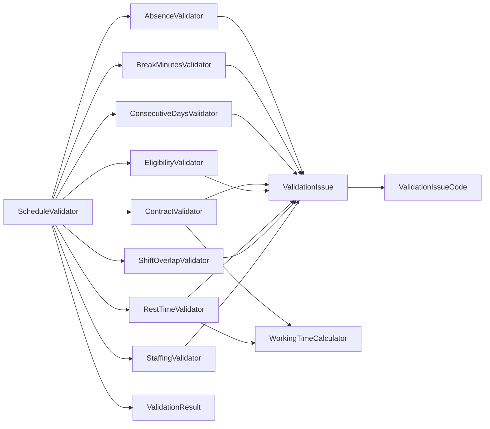

<!-- generated by docwizz: edits are overwritten -->
# src/ShiftPlanner.Application/Validation

Layer **application** · project `ShiftPlanner.Application`

Project navigation: [ShiftPlanner.Application](../projects/ShiftPlanner-Application-bbdb4cab28c5.md)

## Key components

| Component | Kind | Used by | Summary |
|---|---|---|---|
| [ValidationIssue](#validationissue) | record | 8 |  |
| [ScheduleValidator](#schedulevalidator) | class | 2 |  |
| [AbsenceValidator](#absencevalidator) | class | 1 |  |
| [BreakMinutesValidator](#breakminutesvalidator) | class | 1 |  |
| [ConsecutiveDaysValidator](#consecutivedaysvalidator) | class | 1 |  |
| [ContractValidator](#contractvalidator) | class | 1 |  |
| [EligibilityValidator](#eligibilityvalidator) | class | 1 |  |
| [RestTimeValidator](#resttimevalidator) | class | 1 |  |

## Flows through this module

- `GET /api/dashboard`: DashboardController → ApplicationDbContext, DashboardAggregator, GermanPublicHolidays → Contract, PostgreSQL, ScheduleValidator, WageCalculator, WorkingTimeCalculator → AbsenceValidator, BreakMinutesValidator, ConsecutiveDaysValidator, ContractValidator, EligibilityValidator, RestTimeValidator, +2 more → ShiftAssignment
- `POST /api/schedules/{id:guid}/publish`: SchedulesController → ApplicationDbContext, SchedulesController → PostgreSQL, ScheduleValidator → AbsenceValidator, BreakMinutesValidator, ConsecutiveDaysValidator, ContractValidator, EligibilityValidator, RestTimeValidator, +2 more → ShiftAssignment, WorkingTimeCalculator → Contract
- `GET /api/schedules/{id:guid}/validate`: SchedulesController → ApplicationDbContext, SchedulesController → PostgreSQL, ScheduleValidator → AbsenceValidator, BreakMinutesValidator, ConsecutiveDaysValidator, ContractValidator, EligibilityValidator, RestTimeValidator, +2 more → ShiftAssignment, WorkingTimeCalculator → Contract

## Documentation gaps

4 items need documentation (0 critical):

- medium: `AbsenceValidator.Validate(IReadOnlyList<ShiftAssignment>, IReadOnlyList<Absence>, IReadOnlyDictionary<Guid, Employee>, ValidationResult)` — missing summary (public; complexity 6; 4 params)
- medium: `ContractValidator.Validate(Schedule, IReadOnlyList<ShiftAssignment>, IReadOnlyList<Contract>, IReadOnlyList<Absence>?, ValidationResult)` — missing summary (public; complexity 8; 5 params)
- medium: `ScheduleValidator.Validate(Schedule, IReadOnlyList<ShiftAssignment>, IReadOnlyList<Employee>, IReadOnlyList<ShiftType>, IReadOnlyList<Contract>, IReadOnlyList<ShiftAssignment>?, IReadOnlyList<Absence>?, IReadOnlyList<StaffingRequirement>?)` — missing summary (public; complexity 5; 8 params)
- medium: `StaffingValidator.ValidateRequirements(DateOnly, DateOnly, IReadOnlyList<ShiftAssignment>, IReadOnlyDictionary<Guid, ShiftType>, IReadOnlyDictionary<Guid, Employee>, IReadOnlyList<StaffingRequirement>, ValidationResult)` — missing summary (public; complexity 10; 7 params)

## Dependencies

Depends on: [src/ShiftPlanner.Domain/Scheduling](src-ShiftPlanner.Domain-Scheduling.md)

Used by: [src/ShiftPlanner.Api/Controllers](src-ShiftPlanner.Api-Controllers.md), [src/ShiftPlanner.Application/Dashboard](src-ShiftPlanner.Application-Dashboard.md)

## Components

### AbsenceValidator

_class_ · [AbsenceValidator.cs](../../src/ShiftPlanner.Application/Validation/AbsenceValidator.cs#L9)

_Reached from:_ [`GET /api/dashboard`](../api.md#flows), [`POST /api/schedules/{id:guid}/publish`](../api.md#flows), [`GET /api/schedules/{id:guid}/validate`](../api.md#flows) · _Linked tests:_ `AbsenceValidatorTests.AbsenceForDifferentEmployee_NotFlagged` (via `AbsenceValidator.Validate(IReadOnlyList<ShiftAssignment>, IReadOnlyList<Absence>, IReadOnlyDictionary<Guid, Employee>, ValidationResult)`), `AbsenceValidatorTests.AssignmentInsideAbsenceRange_ProducesError` (via `AbsenceValidator.Validate(IReadOnlyList<ShiftAssignment>, IReadOnlyList<Absence>, IReadOnlyDictionary<Guid, Employee>, ValidationResult)`), `AbsenceValidatorTests.AssignmentOnAbsenceBoundaryDates_Flagged` (via `AbsenceValidator.Validate(IReadOnlyList<ShiftAssignment>, IReadOnlyList<Absence>, IReadOnlyDictionary<Guid, Employee>, ValidationResult)`), `AbsenceValidatorTests.AssignmentOutsideAbsenceRange_NoError` (via `AbsenceValidator.Validate(IReadOnlyList<ShiftAssignment>, IReadOnlyList<Absence>, IReadOnlyDictionary<Guid, Employee>, ValidationResult)`), `AbsenceValidatorTests.UnknownEmployee_FallsBackToPlaceholderName` (via `AbsenceValidator.Validate(IReadOnlyList<ShiftAssignment>, IReadOnlyList<Absence>, IReadOnlyDictionary<Guid, Employee>, ValidationResult)`) — test code that uses it, not coverage

| Member | Summary | Derived from code | Complexity |
|---|---|---|---|
| [`Validate(System.Collections.Generic.IReadOnlyList<ShiftPlanner.Domain.Scheduling.ShiftAssignment>, System.Collections.Generic.IReadOnlyList<ShiftPlanner.Domain.Employees.Absence>, System.Collections.Generic.IReadOnlyDictionary<System.Guid, ShiftPlanner.Domain.Employees.Employee>, ShiftPlanner.Application.Validation.ValidationResult)`](../../src/ShiftPlanner.Application/Validation/AbsenceValidator.cs#L11) ⚠ |  |  | 6 |

### BreakMinutesValidator

_class_ · [BreakMinutesValidator.cs](../../src/ShiftPlanner.Application/Validation/BreakMinutesValidator.cs#L6)

_Reached from:_ [`GET /api/dashboard`](../api.md#flows), [`POST /api/schedules/{id:guid}/publish`](../api.md#flows), [`GET /api/schedules/{id:guid}/validate`](../api.md#flows) · _Linked tests:_ `BreakMinutesValidatorTests.ExactlyNineHours_OnlyThirtyMinuteBreakRequired` (via `BreakMinutesValidator.Validate(IReadOnlyList<ShiftAssignment>, ValidationResult)`), `BreakMinutesValidatorTests.ExactlySixHours_NoBreakRequired` (via `BreakMinutesValidator.Validate(IReadOnlyList<ShiftAssignment>, ValidationResult)`), `BreakMinutesValidatorTests.GenuinelyBackwardsShift_NotSkipped_ProcessedWithWrappedDuration` (via `BreakMinutesValidator.Validate(IReadOnlyList<ShiftAssignment>, ValidationResult)`), `BreakMinutesValidatorTests.OverNineHours_RequiresFortyFiveMinuteBreak` (via `BreakMinutesValidator.Validate(IReadOnlyList<ShiftAssignment>, ValidationResult)`), `BreakMinutesValidatorTests.OverSixHours_RequiresThirtyMinuteBreak` (via `BreakMinutesValidator.Validate(IReadOnlyList<ShiftAssignment>, ValidationResult)`), `BreakMinutesValidatorTests.OverSixHours_ThirtyMinuteBreak_Satisfied` (via `BreakMinutesValidator.Validate(IReadOnlyList<ShiftAssignment>, ValidationResult)`), `BreakMinutesValidatorTests.ShortShift_NoBreakRequired` (via `BreakMinutesValidator.Validate(IReadOnlyList<ShiftAssignment>, ValidationResult)`), `BreakMinutesValidatorTests.ZeroLengthShift_SkippedDefensively` (via `BreakMinutesValidator.Validate(IReadOnlyList<ShiftAssignment>, ValidationResult)`) — test code that uses it, not coverage

| Member | Summary | Derived from code | Complexity |
|---|---|---|---|
| [`Validate(System.Collections.Generic.IReadOnlyList<ShiftPlanner.Domain.Scheduling.ShiftAssignment>, ShiftPlanner.Application.Validation.ValidationResult)`](../../src/ShiftPlanner.Application/Validation/BreakMinutesValidator.cs#L8) |  |  | 7 |

### ConsecutiveDaysValidator

_class_ · [ConsecutiveDaysValidator.cs](../../src/ShiftPlanner.Application/Validation/ConsecutiveDaysValidator.cs#L8)

_Reached from:_ [`GET /api/dashboard`](../api.md#flows), [`POST /api/schedules/{id:guid}/publish`](../api.md#flows), [`GET /api/schedules/{id:guid}/validate`](../api.md#flows) · _Linked tests:_ `ConsecutiveDaysValidatorTests.DuplicateAssignmentsSameDay_CountedOnce` (via `ConsecutiveDaysValidator.Validate(IReadOnlyList<ShiftAssignment>, ValidationResult)`), `ConsecutiveDaysValidatorTests.SevenConsecutiveDays_ProducesError` (via `ConsecutiveDaysValidator.Validate(IReadOnlyList<ShiftAssignment>, ValidationResult)`), `ConsecutiveDaysValidatorTests.SixConsecutiveDays_NoError` (via `ConsecutiveDaysValidator.Validate(IReadOnlyList<ShiftAssignment>, ValidationResult)`), `ConsecutiveDaysValidatorTests.SixDaysThenRestThenSixMore_NoError` (via `ConsecutiveDaysValidator.Validate(IReadOnlyList<ShiftAssignment>, ValidationResult)`) — test code that uses it, not coverage

| Member | Summary | Derived from code | Complexity |
|---|---|---|---|
| [`Validate(System.Collections.Generic.IReadOnlyList<ShiftPlanner.Domain.Scheduling.ShiftAssignment>, ShiftPlanner.Application.Validation.ValidationResult)`](../../src/ShiftPlanner.Application/Validation/ConsecutiveDaysValidator.cs#L12) |  |  | 6 |

### ContractValidator

_class_ · [ContractValidator.cs](../../src/ShiftPlanner.Application/Validation/ContractValidator.cs#L9)

_Reached from:_ [`GET /api/dashboard`](../api.md#flows), [`POST /api/schedules/{id:guid}/publish`](../api.md#flows), [`GET /api/schedules/{id:guid}/validate`](../api.md#flows) · _Linked tests:_ `ContractValidatorTests.AbsenceDays_ReduceExpectedHours` (via `ContractValidator.Validate(Schedule, IReadOnlyList<ShiftAssignment>, IReadOnlyList<Contract>, IReadOnlyList<Absence>?, ValidationResult)`), `ContractValidatorTests.ContractChangesMidSchedule_BlendsBothSegments_DoesNotFalseFlag` (via `ContractValidator.Validate(Schedule, IReadOnlyList<ShiftAssignment>, IReadOnlyList<Contract>, IReadOnlyList<Absence>?, ValidationResult)`), `ContractValidatorTests.MonthlyContingentContract_PlannedExceedsBudget_ProducesError` (via `ContractValidator.Validate(Schedule, IReadOnlyList<ShiftAssignment>, IReadOnlyList<Contract>, IReadOnlyList<Absence>?, ValidationResult)`), `ContractValidatorTests.MonthlyContingentContract_PlannedWithinBudget_NoError` (via `ContractValidator.Validate(Schedule, IReadOnlyList<ShiftAssignment>, IReadOnlyList<Contract>, IReadOnlyList<Absence>?, ValidationResult)`), `ContractValidatorTests.NoContractCoveringSchedule_Skipped` (via `ContractValidator.Validate(Schedule, IReadOnlyList<ShiftAssignment>, IReadOnlyList<Contract>, IReadOnlyList<Absence>?, ValidationResult)`), `ContractValidatorTests.PlannedHoursExceedContract_ProducesError` (via `ContractValidator.Validate(Schedule, IReadOnlyList<ShiftAssignment>, IReadOnlyList<Contract>, IReadOnlyList<Absence>?, ValidationResult)`), `ContractValidatorTests.PlannedHoursWithinContract_NoError` (via `ContractValidator.Validate(Schedule, IReadOnlyList<ShiftAssignment>, IReadOnlyList<Contract>, IReadOnlyList<Absence>?, ValidationResult)`), `ContractValidatorTests.ScalesLimitByScheduleSpan` (via `ContractValidator.Validate(Schedule, IReadOnlyList<ShiftAssignment>, IReadOnlyList<Contract>, IReadOnlyList<Absence>?, ValidationResult)`) — test code that uses it, not coverage

| Member | Summary | Derived from code | Complexity |
|---|---|---|---|
| [`Validate(ShiftPlanner.Domain.Scheduling.Schedule, System.Collections.Generic.IReadOnlyList<ShiftPlanner.Domain.Scheduling.ShiftAssignment>, System.Collections.Generic.IReadOnlyList<ShiftPlanner.Domain.Contracts.Contract>, System.Collections.Generic.IReadOnlyList<ShiftPlanner.Domain.Employees.Absence>?, ShiftPlanner.Application.Validation.ValidationResult)`](../../src/ShiftPlanner.Application/Validation/ContractValidator.cs#L11) ⚠ |  |  | 8 |

### EligibilityValidator

_class_ · [EligibilityValidator.cs](../../src/ShiftPlanner.Application/Validation/EligibilityValidator.cs#L10)

_Reached from:_ [`GET /api/dashboard`](../api.md#flows), [`POST /api/schedules/{id:guid}/publish`](../api.md#flows), [`GET /api/schedules/{id:guid}/validate`](../api.md#flows) · _Linked tests:_ `EligibilityValidatorTests.AssignedEligibleShiftType_NoError` (via `EligibilityValidator.Validate(IReadOnlyList<ShiftAssignment>, IReadOnlyDictionary<Guid, Employee>, ValidationResult)`), `EligibilityValidatorTests.AssignedIneligibleShiftType_ProducesError` (via `EligibilityValidator.Validate(IReadOnlyList<ShiftAssignment>, IReadOnlyDictionary<Guid, Employee>, ValidationResult)`), `EligibilityValidatorTests.EmptyEligibilityList_TreatedAsUnrestricted_NoError` (via `EligibilityValidator.Validate(IReadOnlyList<ShiftAssignment>, IReadOnlyDictionary<Guid, Employee>, ValidationResult)`), `EligibilityValidatorTests.UnknownEmployee_SkippedWithoutThrowing` (via `EligibilityValidator.Validate(IReadOnlyList<ShiftAssignment>, IReadOnlyDictionary<Guid, Employee>, ValidationResult)`) — test code that uses it, not coverage

| Member | Summary | Derived from code | Complexity |
|---|---|---|---|
| [`Validate(System.Collections.Generic.IReadOnlyList<ShiftPlanner.Domain.Scheduling.ShiftAssignment>, System.Collections.Generic.IReadOnlyDictionary<System.Guid, ShiftPlanner.Domain.Employees.Employee>, ShiftPlanner.Application.Validation.ValidationResult)`](../../src/ShiftPlanner.Application/Validation/EligibilityValidator.cs#L12) |  |  | 5 |

### RestTimeValidator

_class_ · [RestTimeValidator.cs](../../src/ShiftPlanner.Application/Validation/RestTimeValidator.cs#L7)

_Reached from:_ [`GET /api/dashboard`](../api.md#flows), [`POST /api/schedules/{id:guid}/publish`](../api.md#flows), [`GET /api/schedules/{id:guid}/validate`](../api.md#flows) · _Linked tests:_ `RestTimeValidatorTests.CrossMidnightAssignment_ExcludedFromRestTimeCheck_NoFalseViolation` (via `RestTimeValidator.Validate(IReadOnlyList<ShiftAssignment>, ValidationResult)`), `RestTimeValidatorTests.CrossMidnightAssignment_ExcludedWithoutThrowing` (via `RestTimeValidator.Validate(IReadOnlyList<ShiftAssignment>, ValidationResult)`), `RestTimeValidatorTests.DifferentEmployees_NotComparedToEachOther` (via `RestTimeValidator.Validate(IReadOnlyList<ShiftAssignment>, ValidationResult)`), `RestTimeValidatorTests.ElevenHoursRest_NoError` (via `RestTimeValidator.Validate(IReadOnlyList<ShiftAssignment>, ValidationResult)`), `RestTimeValidatorTests.EndsNextDayAssignment_RestMeasuredFromPushedEndInstant` (via `RestTimeValidator.Validate(IReadOnlyList<ShiftAssignment>, ValidationResult)`), `RestTimeValidatorTests.EndsNextDayAssignment_SufficientRestFromPushedEndInstant_NoError` (via `RestTimeValidator.Validate(IReadOnlyList<ShiftAssignment>, ValidationResult)`), `RestTimeValidatorTests.LessThanElevenHoursRest_ProducesError` (via `RestTimeValidator.Validate(IReadOnlyList<ShiftAssignment>, ValidationResult)`), `RestTimeValidatorTests.NonConsecutiveShiftsWithGapDay_NoError` (via `RestTimeValidator.Validate(IReadOnlyList<ShiftAssignment>, ValidationResult)`) — test code that uses it, not coverage

| Member | Summary | Derived from code | Complexity |
|---|---|---|---|
| [`Validate(System.Collections.Generic.IReadOnlyList<ShiftPlanner.Domain.Scheduling.ShiftAssignment>, ShiftPlanner.Application.Validation.ValidationResult)`](../../src/ShiftPlanner.Application/Validation/RestTimeValidator.cs#L11) |  |  | 6 |

### ScheduleValidator

_class_ · [ScheduleValidator.cs](../../src/ShiftPlanner.Application/Validation/ScheduleValidator.cs#L9)

_Reached from:_ [`GET /api/dashboard`](../api.md#flows), [`POST /api/schedules/{id:guid}/publish`](../api.md#flows), [`GET /api/schedules/{id:guid}/validate`](../api.md#flows) · _Linked tests:_ `ScheduleValidatorTests.AbsenceOverlappingAssignment_ProducesError` (via `ScheduleValidator.Validate(Schedule, IReadOnlyList<ShiftAssignment>, IReadOnlyList<Employee>, IReadOnlyList<ShiftType>, IReadOnlyList<Contract>, IReadOnlyList<ShiftAssignment>?, IReadOnlyList<Absence>?, IReadOnlyList<StaffingRequirement>?)`), `ScheduleValidatorTests.CleanSchedule_IsValidWithNoIssues` (via `ScheduleValidator.Validate(Schedule, IReadOnlyList<ShiftAssignment>, IReadOnlyList<Employee>, IReadOnlyList<ShiftType>, IReadOnlyList<Contract>, IReadOnlyList<ShiftAssignment>?, IReadOnlyList<Absence>?, IReadOnlyList<StaffingRequirement>?)`), `ScheduleValidatorTests.CombinesMultipleRuleViolationsInOneResult` (via `ScheduleValidator.Validate(Schedule, IReadOnlyList<ShiftAssignment>, IReadOnlyList<Employee>, IReadOnlyList<ShiftType>, IReadOnlyList<Contract>, IReadOnlyList<ShiftAssignment>?, IReadOnlyList<Absence>?, IReadOnlyList<StaffingRequirement>?)`), `ScheduleValidatorTests.KitchenSink_MessySchedule_TripsAllEightRuleTypesWithoutMaskingOrBleed` (via `ScheduleValidator.Validate(Schedule, IReadOnlyList<ShiftAssignment>, IReadOnlyList<Employee>, IReadOnlyList<ShiftType>, IReadOnlyList<Contract>, IReadOnlyList<ShiftAssignment>?, IReadOnlyList<Absence>?, IReadOnlyList<StaffingRequirement>?)`), `ScheduleValidatorTests.RestTimeAndConsecutiveDays_UseHistoryWindowWhenSupplied` (via `ScheduleValidator.Validate(Schedule, IReadOnlyList<ShiftAssignment>, IReadOnlyList<Employee>, IReadOnlyList<ShiftType>, IReadOnlyList<Contract>, IReadOnlyList<ShiftAssignment>?, IReadOnlyList<Absence>?, IReadOnlyList<StaffingRequirement>?)`) — test code that uses it, not coverage

| Member | Summary | Derived from code | Complexity |
|---|---|---|---|
| [`Validate(ShiftPlanner.Domain.Scheduling.Schedule, System.Collections.Generic.IReadOnlyList<ShiftPlanner.Domain.Scheduling.ShiftAssignment>, System.Collections.Generic.IReadOnlyList<ShiftPlanner.Domain.Employees.Employee>, System.Collections.Generic.IReadOnlyList<ShiftPlanner.Domain.Scheduling.ShiftType>, System.Collections.Generic.IReadOnlyList<ShiftPlanner.Domain.Contracts.Contract>, System.Collections.Generic.IReadOnlyList<ShiftPlanner.Domain.Scheduling.ShiftAssignment>?, System.Collections.Generic.IReadOnlyList<ShiftPlanner.Domain.Employees.Absence>?, System.Collections.Generic.IReadOnlyList<ShiftPlanner.Domain.Scheduling.StaffingRequirement>?)`](../../src/ShiftPlanner.Application/Validation/ScheduleValidator.cs#L11) ⚠ |  |  | 5 |

### ShiftOverlapValidator

_class_ · [ShiftOverlapValidator.cs](../../src/ShiftPlanner.Application/Validation/ShiftOverlapValidator.cs#L17)

_Reached from:_ [`GET /api/dashboard`](../api.md#flows), [`POST /api/schedules/{id:guid}/publish`](../api.md#flows), [`GET /api/schedules/{id:guid}/validate`](../api.md#flows) · _Linked tests:_ `ShiftOverlapValidatorTests.BackToBackShifts_TouchingNotOverlapping_NoWarning` (via `ShiftOverlapValidator.Validate(IReadOnlyList<ShiftAssignment>, ValidationResult)`), `ShiftOverlapValidatorTests.NoOverlap_NoWarning` (via `ShiftOverlapValidator.Validate(IReadOnlyList<ShiftAssignment>, ValidationResult)`), `ShiftOverlapValidatorTests.OverlapAcrossDifferentEmployees_NotFlagged` (via `ShiftOverlapValidator.Validate(IReadOnlyList<ShiftAssignment>, ValidationResult)`), `ShiftOverlapValidatorTests.OverlappingShiftsSameEmployeeSameDay_ProducesWarning` (via `ShiftOverlapValidator.Validate(IReadOnlyList<ShiftAssignment>, ValidationResult)`), `ShiftOverlapValidatorTests.OvernightShift_NoOverlapWithNextDayShift_NoWarning` (via `ShiftOverlapValidator.Validate(IReadOnlyList<ShiftAssignment>, ValidationResult)`), `ShiftOverlapValidatorTests.OvernightShift_OverlapsEarlyShiftNextCalendarDay_ProducesWarning` (via `ShiftOverlapValidator.Validate(IReadOnlyList<ShiftAssignment>, ValidationResult)`) — test code that uses it, not coverage

| Member | Summary | Derived from code | Complexity |
|---|---|---|---|
| [`Validate(System.Collections.Generic.IReadOnlyList<ShiftPlanner.Domain.Scheduling.ShiftAssignment>, ShiftPlanner.Application.Validation.ValidationResult)`](../../src/ShiftPlanner.Application/Validation/ShiftOverlapValidator.cs#L19) |  |  | 5 |

### StaffingValidator

_class_ · [StaffingValidator.cs](../../src/ShiftPlanner.Application/Validation/StaffingValidator.cs#L12)

_Reached from:_ [`GET /api/dashboard`](../api.md#flows), [`POST /api/schedules/{id:guid}/publish`](../api.md#flows), [`GET /api/schedules/{id:guid}/validate`](../api.md#flows) · _Linked tests:_ `StaffingValidatorTests.AboveMaxStaffing_ProducesWarning` (via `StaffingValidator.Validate(IReadOnlyList<ShiftAssignment>, IReadOnlyDictionary<Guid, ShiftType>, ValidationResult)`), `StaffingValidatorTests.AssignmentReferencingUnknownShiftType_SkippedWithoutThrowing` (via `StaffingValidator.Validate(IReadOnlyList<ShiftAssignment>, IReadOnlyDictionary<Guid, ShiftType>, ValidationResult)`), `StaffingValidatorTests.BelowMinStaffing_ProducesWarning` (via `StaffingValidator.Validate(IReadOnlyList<ShiftAssignment>, IReadOnlyDictionary<Guid, ShiftType>, ValidationResult)`), `StaffingValidatorTests.DayWithNoAssignment_NotFlagged` (via `StaffingValidator.Validate(IReadOnlyList<ShiftAssignment>, IReadOnlyDictionary<Guid, ShiftType>, ValidationResult)`), `StaffingValidatorTests.DistinctEmployeesCounted_NotAssignmentRows` (via `StaffingValidator.Validate(IReadOnlyList<ShiftAssignment>, IReadOnlyDictionary<Guid, ShiftType>, ValidationResult)`), `StaffingValidatorTests.UnconstrainedShiftType_NeverWarns` (via `StaffingValidator.Validate(IReadOnlyList<ShiftAssignment>, IReadOnlyDictionary<Guid, ShiftType>, ValidationResult)`), `StaffingValidatorTests.WithinMinMaxRange_NoWarning` (via `StaffingValidator.Validate(IReadOnlyList<ShiftAssignment>, IReadOnlyDictionary<Guid, ShiftType>, ValidationResult)`), `StaffingValidatorValidateRequirementsTests.DayOfWeekMismatch_NotFlagged` (via `StaffingValidator.ValidateRequirements(DateOnly, DateOnly, IReadOnlyList<ShiftAssignment>, IReadOnlyDictionary<Guid, ShiftType>, IReadOnlyDictionary<Guid, Employee>, IReadOnlyList<StaffingRequirement>, ValidationResult)`), +6 more — test code that uses it, not coverage

| Member | Summary | Derived from code | Complexity |
|---|---|---|---|
| [`Validate(System.Collections.Generic.IReadOnlyList<ShiftPlanner.Domain.Scheduling.ShiftAssignment>, System.Collections.Generic.IReadOnlyDictionary<System.Guid, ShiftPlanner.Domain.Scheduling.ShiftType>, ShiftPlanner.Application.Validation.ValidationResult)`](../../src/ShiftPlanner.Application/Validation/StaffingValidator.cs#L14) |  |  | 7 |
| [`ValidateRequirements(System.DateOnly, System.DateOnly, System.Collections.Generic.IReadOnlyList<ShiftPlanner.Domain.Scheduling.ShiftAssignment>, System.Collections.Generic.IReadOnlyDictionary<System.Guid, ShiftPlanner.Domain.Scheduling.ShiftType>, System.Collections.Generic.IReadOnlyDictionary<System.Guid, ShiftPlanner.Domain.Employees.Employee>, System.Collections.Generic.IReadOnlyList<ShiftPlanner.Domain.Scheduling.StaffingRequirement>, ShiftPlanner.Application.Validation.ValidationResult)`](../../src/ShiftPlanner.Application/Validation/StaffingValidator.cs#L45) ⚠ |  |  | 10 |

### ValidationIssue

_record_ · [ValidationResult.cs](../../src/ShiftPlanner.Application/Validation/ValidationResult.cs#L30)

### ValidationIssueCode

_enum_ · [ValidationResult.cs](../../src/ShiftPlanner.Application/Validation/ValidationResult.cs#L14)

### ValidationResult

_class_ · [ValidationResult.cs](../../src/ShiftPlanner.Application/Validation/ValidationResult.cs#L32)

---
_Generated from 25 symbols in [src/ShiftPlanner.Application/Validation/AbsenceValidator.cs](../../src/ShiftPlanner.Application/Validation/AbsenceValidator.cs), [src/ShiftPlanner.Application/Validation/BreakMinutesValidator.cs](../../src/ShiftPlanner.Application/Validation/BreakMinutesValidator.cs), [src/ShiftPlanner.Application/Validation/ConsecutiveDaysValidator.cs](../../src/ShiftPlanner.Application/Validation/ConsecutiveDaysValidator.cs), [src/ShiftPlanner.Application/Validation/ContractValidator.cs](../../src/ShiftPlanner.Application/Validation/ContractValidator.cs), [src/ShiftPlanner.Application/Validation/EligibilityValidator.cs](../../src/ShiftPlanner.Application/Validation/EligibilityValidator.cs), [src/ShiftPlanner.Application/Validation/RestTimeValidator.cs](../../src/ShiftPlanner.Application/Validation/RestTimeValidator.cs), [src/ShiftPlanner.Application/Validation/ScheduleValidator.cs](../../src/ShiftPlanner.Application/Validation/ScheduleValidator.cs), [src/ShiftPlanner.Application/Validation/ShiftOverlapValidator.cs](../../src/ShiftPlanner.Application/Validation/ShiftOverlapValidator.cs), [src/ShiftPlanner.Application/Validation/StaffingValidator.cs](../../src/ShiftPlanner.Application/Validation/StaffingValidator.cs), [src/ShiftPlanner.Application/Validation/ValidationResult.cs](../../src/ShiftPlanner.Application/Validation/ValidationResult.cs) (commit `534b8b5`, profile `default`). Sections marked _fact_ are read from the code, _inferred_ come from heuristics, 🤖 marks AI drafts._
