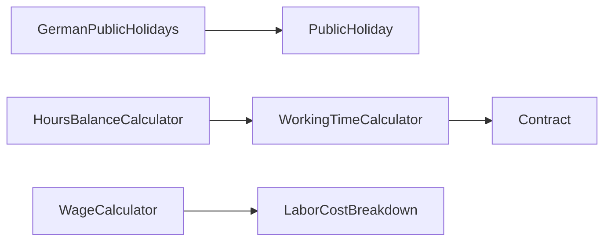

<!-- generated by docwizz: edits are overwritten -->
# src/ShiftPlanner.Domain/Scheduling

Layer **domain** · project `ShiftPlanner.Domain` · Entities: 4

Project navigation: [ShiftPlanner.Domain](../projects/ShiftPlanner-Domain-f2a83529199c.md)

## Key components

| Component | Kind | Used by | Summary |
|---|---|---|---|
| [WorkingTimeCalculator](#workingtimecalculator) | class | 10 |  |
| [GermanPublicHolidays](#germanpublicholidays) | class | 5 |  |
| [ScheduleStatus](#schedulestatus) | enum | 3 |  |
| [ShiftAssignment](#shiftassignment) | entity | 3 |  |
| [ShiftTiming](#shifttiming) | record | 3 |  |
| [WageCalculator](#wagecalculator) | class | 3 |  |
| [HoursBalanceCalculator](#hoursbalancecalculator) | class | 2 |  |
| [Schedule](#schedule) | entity | 2 |  |

## Flows through this module

- `PUT /api/assignments/{id:guid}`: SchedulesController → ApplicationDbContext, WorkingTimeCalculator → PostgreSQL
- `GET /api/dashboard`: DashboardController → ApplicationDbContext, DashboardAggregator, GermanPublicHolidays → Contract, PostgreSQL, ScheduleValidator, WageCalculator, WorkingTimeCalculator → AbsenceValidator, BreakMinutesValidator, ConsecutiveDaysValidator, ContractValidator, EligibilityValidator, RestTimeValidator, +2 more → ShiftAssignment
- `GET /api/employees/{id:guid}/hours-balance`: EmployeesController → ApplicationDbContext, HoursBalanceCalculator → PostgreSQL, WorkingTimeCalculator → Contract
- `GET /api/employees/{id:guid}/hours-report`: EmployeesController → ApplicationDbContext, GermanPublicHolidays, HoursBalanceCalculator, WorkingTimeCalculator → Contract, PostgreSQL
- `GET /api/planning-board`: PlanningBoardController → ApplicationDbContext, GermanPublicHolidays, PlanningBoardAggregator, PlanningBoardController → HoursBalanceCalculator, PostgreSQL, WageCalculator, WorkingTimeCalculator → Contract
- `GET /api/public-holidays`: PublicHolidaysController → GermanPublicHolidays
- `GET /api/schedules/{id:guid}`: SchedulesController → ApplicationDbContext, GermanPublicHolidays, SchedulesController → Contract, PostgreSQL, WageCalculator, WorkingTimeCalculator
- `POST /api/schedules/{id:guid}/assignments`: SchedulesController → ApplicationDbContext, GermanPublicHolidays, SchedulesController, WorkingTimeCalculator → PostgreSQL, WageCalculator
- … 8 more in [API](../api.md#flows) and [frontend](../frontend.md#flows)

## Documentation gaps

5 items need documentation (2 critical):

- high: `HoursBalanceCalculator.CumulativeBalance(Guid, DateOnly, IReadOnlyList<Schedule>, IReadOnlyList<ShiftAssignment>, IReadOnlyList<Contract>, IReadOnlyList<Absence>?, IReadOnlyList<HoursAdjustment>?)` — missing summary (public; complexity 10; 7 params; 3 callers)
- high: `WorkingTimeCalculator.ExpectedHours(IReadOnlyList<Contract>, IReadOnlyList<Absence>, Guid, DateOnly, DateOnly)` — missing summary (public; complexity 10; 5 params; 6 callers)
- medium: `WorkingTimeCalculator.NetHours(TimeOnly, TimeOnly, int, bool)` — missing summary (public; 4 params; 9 callers)
- medium: `WorkingTimeCalculator.OverlapDays(DateOnly, DateOnly, DateOnly, DateOnly)` — missing summary (public; complexity 4; 4 params)
- medium: `WageCalculator.Breakdown(ShiftTiming, DayOfWeek, bool, decimal, decimal?)` — missing summary (public; complexity 5; 5 params)

## Dependencies

Depends on: [src/ShiftPlanner.Domain/Contracts](src-ShiftPlanner.Domain-Contracts.md)

Used by: [src/ShiftPlanner.Api/Controllers](src-ShiftPlanner.Api-Controllers.md), [src/ShiftPlanner.Application/Dashboard](src-ShiftPlanner.Application-Dashboard.md), [src/ShiftPlanner.Application/Planning](src-ShiftPlanner.Application-Planning.md), [src/ShiftPlanner.Application/Suggestions](src-ShiftPlanner.Application-Suggestions.md), [src/ShiftPlanner.Application/Validation](src-ShiftPlanner.Application-Validation.md), [src/ShiftPlanner.Infrastructure/Persistence](src-ShiftPlanner.Infrastructure-Persistence.md)

## Components

### Bundesland

_enum_ · [Bundesland.cs](../../src/ShiftPlanner.Domain/Scheduling/Bundesland.cs#L6)

### CoverageStatus

_enum_ · [CoverageStatus.cs](../../src/ShiftPlanner.Domain/Scheduling/CoverageStatus.cs#L9)

### GermanPublicHolidays

_class_ · [GermanPublicHolidays.cs](../../src/ShiftPlanner.Domain/Scheduling/GermanPublicHolidays.cs#L23)

_Reached from:_ [`GET /api/dashboard`](../api.md#flows), [`GET /api/employees/{id:guid}/hours-report`](../api.md#flows), [`GET /api/planning-board`](../api.md#flows), [`GET /api/public-holidays`](../api.md#flows), [`GET /api/schedules/{id:guid}`](../api.md#flows), [`POST /api/schedules/{id:guid}/assignments`](../api.md#flows), [`POST /api/schedules/{id:guid}/auto-fill`](../api.md#flows) · _Linked tests:_ `GermanPublicHolidaysTests.InRange_Allerheiligen_AbsentInSachsen` (via `GermanPublicHolidays.InRange(DateOnly, DateOnly, Bundesland?)`), `GermanPublicHolidaysTests.InRange_Allerheiligen_OnNov1InTheRightStates` (via `GermanPublicHolidays.InRange(DateOnly, DateOnly, Bundesland?)`), `GermanPublicHolidaysTests.InRange_BussUndBettag_2022WhenNov23IsAWednesday_FallsOneWeekEarlier` (via `GermanPublicHolidays.InRange(DateOnly, DateOnly, Bundesland?)`), `GermanPublicHolidaysTests.InRange_BussUndBettag_AbsentOutsideSachsen` (via `GermanPublicHolidays.InRange(DateOnly, DateOnly, Bundesland?)`), `GermanPublicHolidaysTests.InRange_BussUndBettag_SachsenOnly_2026IsNov18` (via `GermanPublicHolidays.InRange(DateOnly, DateOnly, Bundesland?)`), `GermanPublicHolidaysTests.InRange_CrossesYearBoundary_IncludesChristmasAndNewYears` (via `GermanPublicHolidays.InRange(DateOnly, DateOnly, Bundesland?)`), `GermanPublicHolidaysTests.InRange_EasterRelativeHolidays_MatchKnownDates` (via `GermanPublicHolidays.InRange(DateOnly, DateOnly, Bundesland?)`), `GermanPublicHolidaysTests.InRange_Fronleichnam_60DaysAfterEasterInTheRightStates` (via `GermanPublicHolidays.InRange(DateOnly, DateOnly, Bundesland?)`), +11 more — test code that uses it, not coverage

| Member | Summary | Derived from code | Complexity |
|---|---|---|---|
| [`InRange(System.DateOnly, System.DateOnly, ShiftPlanner.Domain.Scheduling.Bundesland?)`](../../src/ShiftPlanner.Domain/Scheduling/GermanPublicHolidays.cs#L25) |  |  | 3 |

### HoursBalanceCalculator

_class_ · [HoursBalanceCalculator.cs](../../src/ShiftPlanner.Domain/Scheduling/HoursBalanceCalculator.cs#L10)

_Reached from:_ [`GET /api/employees/{id:guid}/hours-balance`](../api.md#flows), [`GET /api/employees/{id:guid}/hours-report`](../api.md#flows), [`GET /api/planning-board`](../api.md#flows) · _Linked tests:_ `HoursBalanceCalculatorTests.CumulativeBalance_AddsPositiveAdjustmentBeforeCutoff` (via `HoursBalanceCalculator.CumulativeBalance(Guid, DateOnly, IReadOnlyList<Schedule>, IReadOnlyList<ShiftAssignment>, IReadOnlyList<Contract>, IReadOnlyList<Absence>?, IReadOnlyList<HoursAdjustment>?)`), `HoursBalanceCalculatorTests.CumulativeBalance_CombinesScheduleDeviationAndAdjustment` (via `HoursBalanceCalculator.CumulativeBalance(Guid, DateOnly, IReadOnlyList<Schedule>, IReadOnlyList<ShiftAssignment>, IReadOnlyList<Contract>, IReadOnlyList<Absence>?, IReadOnlyList<HoursAdjustment>?)`), `HoursBalanceCalculatorTests.CumulativeBalance_ExcludesAbsenceDaysFromExpectedHours` (via `HoursBalanceCalculator.CumulativeBalance(Guid, DateOnly, IReadOnlyList<Schedule>, IReadOnlyList<ShiftAssignment>, IReadOnlyList<Contract>, IReadOnlyList<Absence>?, IReadOnlyList<HoursAdjustment>?)`), `HoursBalanceCalculatorTests.CumulativeBalance_IgnoresAdjustmentForAnotherEmployee` (via `HoursBalanceCalculator.CumulativeBalance(Guid, DateOnly, IReadOnlyList<Schedule>, IReadOnlyList<ShiftAssignment>, IReadOnlyList<Contract>, IReadOnlyList<Absence>?, IReadOnlyList<HoursAdjustment>?)`), `HoursBalanceCalculatorTests.CumulativeBalance_IgnoresAdjustmentOnOrAfterCutoff` (via `HoursBalanceCalculator.CumulativeBalance(Guid, DateOnly, IReadOnlyList<Schedule>, IReadOnlyList<ShiftAssignment>, IReadOnlyList<Contract>, IReadOnlyList<Absence>?, IReadOnlyList<HoursAdjustment>?)`), `HoursBalanceCalculatorTests.CumulativeBalance_IgnoresSchedulesNotYetElapsed` (via `HoursBalanceCalculator.CumulativeBalance(Guid, DateOnly, IReadOnlyList<Schedule>, IReadOnlyList<ShiftAssignment>, IReadOnlyList<Contract>, IReadOnlyList<Absence>?, IReadOnlyList<HoursAdjustment>?)`), `HoursBalanceCalculatorTests.CumulativeBalance_NoContractCoveringSchedule_Skipped` (via `HoursBalanceCalculator.CumulativeBalance(Guid, DateOnly, IReadOnlyList<Schedule>, IReadOnlyList<ShiftAssignment>, IReadOnlyList<Contract>, IReadOnlyList<Absence>?, IReadOnlyList<HoursAdjustment>?)`), `HoursBalanceCalculatorTests.CumulativeBalance_SubtractsNegativeAdjustmentBeforeCutoff` (via `HoursBalanceCalculator.CumulativeBalance(Guid, DateOnly, IReadOnlyList<Schedule>, IReadOnlyList<ShiftAssignment>, IReadOnlyList<Contract>, IReadOnlyList<Absence>?, IReadOnlyList<HoursAdjustment>?)`), +1 more — test code that uses it, not coverage

| Member | Summary | Derived from code | Complexity |
|---|---|---|---|
| [`CumulativeBalance(System.Guid, System.DateOnly, System.Collections.Generic.IReadOnlyList<ShiftPlanner.Domain.Scheduling.Schedule>, System.Collections.Generic.IReadOnlyList<ShiftPlanner.Domain.Scheduling.ShiftAssignment>, System.Collections.Generic.IReadOnlyList<ShiftPlanner.Domain.Contracts.Contract>, System.Collections.Generic.IReadOnlyList<ShiftPlanner.Domain.Employees.Absence>?, System.Collections.Generic.IReadOnlyList<ShiftPlanner.Domain.Employees.HoursAdjustment>?)`](../../src/ShiftPlanner.Domain/Scheduling/HoursBalanceCalculator.cs#L12) ⚠ |  |  | 10 |

### LaborCostBreakdown

_record_ · [WageCalculator.cs](../../src/ShiftPlanner.Domain/Scheduling/WageCalculator.cs#L119)

### PainSeverity

_enum_ · [PainSeverity.cs](../../src/ShiftPlanner.Domain/Scheduling/PainSeverity.cs#L12)

### PublicHoliday

_record_ · [GermanPublicHolidays.cs](../../src/ShiftPlanner.Domain/Scheduling/GermanPublicHolidays.cs#L3)

### Schedule

_class_ · [Schedule.cs](../../src/ShiftPlanner.Domain/Scheduling/Schedule.cs#L6)

_Linked tests:_ `DashboardAggregatorTests.BuildPlanningStatus_CountsDraftPublishedAndConflicts` (via `Schedule.Publish(string, DateTimeOffset)`), `ScheduleTests.Archive_FromPublished_Succeeds` (via `Schedule.Publish(string, DateTimeOffset)`), `ScheduleTests.Archive_WhenAlreadyArchived_Throws` (via `Schedule.Publish(string, DateTimeOffset)`), `ScheduleTests.Publish_FromDraft_SucceedsAndSetsBothFieldsTogether` (via `Schedule.Publish(string, DateTimeOffset)`), `ScheduleTests.Publish_FromDraft_ThenArchive_DirectlySkippingPublished_Throws` (via `Schedule.Archive()`), `ScheduleTests.Publish_WhenAlreadyPublished_Throws` (via `Schedule.Publish(string, DateTimeOffset)`), `ScheduleTests.Publish_WhenArchived_Throws` (via `Schedule.Publish(string, DateTimeOffset)`) — test code that uses it, not coverage

| Member | Summary | Derived from code | Complexity |
|---|---|---|---|
| [`Publish(string, System.DateTimeOffset)`](../../src/ShiftPlanner.Domain/Scheduling/Schedule.cs#L28) | Draft -> Published. Throws `InvalidOperationException` unless the Schedule is currently Draft. Callers (SchedulesController) are expected to have already run the blocking-Errors validation check before calling this — this method only enforces the starting-state invariant, not business/validation rules. |  | 2 |
| [`Archive()`](../../src/ShiftPlanner.Domain/Scheduling/Schedule.cs#L42) | Published -> Archived. Throws `InvalidOperationException` unless the Schedule is currently Published. |  | 2 |

### ScheduleStatus

_enum_ · [Schedule.cs](../../src/ShiftPlanner.Domain/Scheduling/Schedule.cs#L3)

### ShiftAssignment

_class_ · [ShiftAssignment.cs](../../src/ShiftPlanner.Domain/Scheduling/ShiftAssignment.cs#L4)

_Reached from:_ [`GET /api/dashboard`](../api.md#flows), [`POST /api/schedules/{id:guid}/publish`](../api.md#flows), [`GET /api/schedules/{id:guid}/validate`](../api.md#flows)

### ShiftTiming

_record_ · [WageCalculator.cs](../../src/ShiftPlanner.Domain/Scheduling/WageCalculator.cs#L9)

### ShiftType

_class_ · [ShiftType.cs](../../src/ShiftPlanner.Domain/Scheduling/ShiftType.cs#L4)

### StaffingRequirement

_class_ · [StaffingRequirement.cs](../../src/ShiftPlanner.Domain/Scheduling/StaffingRequirement.cs#L9)

### WageCalculator

_class_ · [WageCalculator.cs](../../src/ShiftPlanner.Domain/Scheduling/WageCalculator.cs#L13)

_Reached from:_ [`GET /api/dashboard`](../api.md#flows), [`GET /api/planning-board`](../api.md#flows), [`GET /api/schedules/{id:guid}`](../api.md#flows), [`POST /api/schedules/{id:guid}/assignments`](../api.md#flows), [`POST /api/schedules/{id:guid}/auto-fill`](../api.md#flows) · _Linked tests:_ `DashboardAggregatorTests.BuildCostBreakdown_MatchesWageCalculatorBreakdownPerAssignment` (via `WageCalculator.Breakdown(ShiftTiming, DayOfWeek, bool, decimal, decimal?)`), `WageCalculatorTests.Breakdown_Holiday_SplitOutSeparately_HolidayWinsOverSunday` (via `WageCalculator.Breakdown(ShiftTiming, DayOfWeek, bool, decimal, decimal?)`), `WageCalculatorTests.Breakdown_NightOverlap_SplitOutSeparately` (via `WageCalculator.Breakdown(ShiftTiming, DayOfWeek, bool, decimal, decimal?)`), `WageCalculatorTests.Breakdown_NullRate_ReturnsNull` (via `WageCalculator.Breakdown(ShiftTiming, DayOfWeek, bool, decimal, decimal?)`), `WageCalculatorTests.Breakdown_PlainWeekday_OnlyRegular` (via `WageCalculator.Breakdown(ShiftTiming, DayOfWeek, bool, decimal, decimal?)`), `WageCalculatorTests.Breakdown_Sunday_SplitOutSeparately` (via `WageCalculator.Breakdown(ShiftTiming, DayOfWeek, bool, decimal, decimal?)`), `WageCalculatorTests.Breakdown_TotalAlwaysMatchesLaborCost` (via `WageCalculator.LaborCostWithSurcharges(ShiftTiming, DayOfWeek, bool, decimal, decimal?)`), `WageCalculatorTests.LaborCostWithSurcharges_BreakEntirelyInsideNightWindow_ReducesNightSurcharge` (via `WageCalculator.LaborCostWithSurcharges(ShiftTiming, DayOfWeek, bool, decimal, decimal?)`), +17 more — test code that uses it, not coverage

| Member | Summary | Derived from code | Complexity |
|---|---|---|---|
| [`SimpleLaborCost(decimal, decimal?)`](../../src/ShiftPlanner.Domain/Scheduling/WageCalculator.cs#L28) |  |  | 2 |
| [`LaborCostWithSurcharges(ShiftPlanner.Domain.Scheduling.ShiftTiming, System.DayOfWeek, bool, decimal, decimal?)`](../../src/ShiftPlanner.Domain/Scheduling/WageCalculator.cs#L41) |  |  | 2 |
| [`Breakdown(ShiftPlanner.Domain.Scheduling.ShiftTiming, System.DayOfWeek, bool, decimal, decimal?)`](../../src/ShiftPlanner.Domain/Scheduling/WageCalculator.cs#L51) ⚠ |  |  | 5 |

### WorkingTimeCalculator

_class_ · [WorkingTimeCalculator.cs](../../src/ShiftPlanner.Domain/Scheduling/WorkingTimeCalculator.cs#L7)

_Reached from:_ [`PUT /api/assignments/{id:guid}`](../api.md#flows), [`GET /api/dashboard`](../api.md#flows), [`GET /api/employees/{id:guid}/hours-balance`](../api.md#flows), [`GET /api/employees/{id:guid}/hours-report`](../api.md#flows), [`GET /api/planning-board`](../api.md#flows), [`GET /api/schedules/{id:guid}`](../api.md#flows), [`POST /api/schedules/{id:guid}/assignments`](../api.md#flows), [`POST /api/schedules/{id:guid}/auto-fill`](../api.md#flows), +7 more · _Linked tests:_ `DashboardAggregatorTests.BuildCostBreakdown_MatchesWageCalculatorBreakdownPerAssignment` (via `WorkingTimeCalculator.NetHours(TimeOnly, TimeOnly, int, bool)`), `WorkingTimeCalculatorTests.ClampDayToMonth_Jan30And31_BothCollideOnFeb28` (via `WorkingTimeCalculator.ClampDayToMonth(DateOnly, int, int)`), `WorkingTimeCalculatorTests.ClampDayToMonth_Jan31IntoFebruary_LeapYear_ClampsTo29` (via `WorkingTimeCalculator.ClampDayToMonth(DateOnly, int, int)`), `WorkingTimeCalculatorTests.ClampDayToMonth_Jan31IntoFebruary_NonLeapYear_ClampsTo28` (via `WorkingTimeCalculator.ClampDayToMonth(DateOnly, int, int)`), `WorkingTimeCalculatorTests.ClampDayToMonth_SameLengthMonth_NoClamping` (via `WorkingTimeCalculator.ClampDayToMonth(DateOnly, int, int)`), `WorkingTimeCalculatorTests.ExpectedHours_AbsenceForDifferentEmployee_Ignored` (via `WorkingTimeCalculator.ExpectedHours(IReadOnlyList<Contract>, IReadOnlyList<Absence>, Guid, DateOnly, DateOnly)`), `WorkingTimeCalculatorTests.ExpectedHours_ContractChangesMidSpan_BlendsBothSegments` (via `WorkingTimeCalculator.ExpectedHours(IReadOnlyList<Contract>, IReadOnlyList<Absence>, Guid, DateOnly, DateOnly)`), `WorkingTimeCalculatorTests.ExpectedHours_ExcludesAbsenceDaysOverlappingRange` (via `WorkingTimeCalculator.ExpectedHours(IReadOnlyList<Contract>, IReadOnlyList<Absence>, Guid, DateOnly, DateOnly)`), +25 more — test code that uses it, not coverage

| Member | Summary | Derived from code | Complexity |
|---|---|---|---|
| [`IsValidShiftTiming(System.TimeOnly, System.TimeOnly, bool)`](../../src/ShiftPlanner.Domain/Scheduling/WorkingTimeCalculator.cs#L18) |  |  | 2 |
| [`NetHours(System.TimeOnly, System.TimeOnly, int, bool)`](../../src/ShiftPlanner.Domain/Scheduling/WorkingTimeCalculator.cs#L25) ⚠ |  |  | 2 |
| [`TouchesSunday(System.DateOnly, bool)`](../../src/ShiftPlanner.Domain/Scheduling/WorkingTimeCalculator.cs#L37) |  |  | 3 |
| [`TouchesHoliday(System.DateOnly, bool, System.Collections.Generic.IReadOnlySet<System.DateOnly>)`](../../src/ShiftPlanner.Domain/Scheduling/WorkingTimeCalculator.cs#L40) |  |  | 3 |
| [`OverlapDays(System.DateOnly, System.DateOnly, System.DateOnly, System.DateOnly)`](../../src/ShiftPlanner.Domain/Scheduling/WorkingTimeCalculator.cs#L46) ⚠ |  |  | 4 |
| [`ExpectedHours(System.Collections.Generic.IReadOnlyList<ShiftPlanner.Domain.Contracts.Contract>, System.Collections.Generic.IReadOnlyList<ShiftPlanner.Domain.Employees.Absence>, System.Guid, System.DateOnly, System.DateOnly)`](../../src/ShiftPlanner.Domain/Scheduling/WorkingTimeCalculator.cs#L77) ⚠ |  |  | 10 |
| [`ClampDayToMonth(System.DateOnly, int, int)`](../../src/ShiftPlanner.Domain/Scheduling/WorkingTimeCalculator.cs#L148) |  |  | 1 |

---
_Generated from 70 symbols in [src/ShiftPlanner.Domain/Scheduling/Bundesland.cs](../../src/ShiftPlanner.Domain/Scheduling/Bundesland.cs), [src/ShiftPlanner.Domain/Scheduling/CoverageStatus.cs](../../src/ShiftPlanner.Domain/Scheduling/CoverageStatus.cs), [src/ShiftPlanner.Domain/Scheduling/GermanPublicHolidays.cs](../../src/ShiftPlanner.Domain/Scheduling/GermanPublicHolidays.cs), [src/ShiftPlanner.Domain/Scheduling/HoursBalanceCalculator.cs](../../src/ShiftPlanner.Domain/Scheduling/HoursBalanceCalculator.cs), [src/ShiftPlanner.Domain/Scheduling/PainSeverity.cs](../../src/ShiftPlanner.Domain/Scheduling/PainSeverity.cs), [src/ShiftPlanner.Domain/Scheduling/Schedule.cs](../../src/ShiftPlanner.Domain/Scheduling/Schedule.cs), [src/ShiftPlanner.Domain/Scheduling/ShiftAssignment.cs](../../src/ShiftPlanner.Domain/Scheduling/ShiftAssignment.cs), [src/ShiftPlanner.Domain/Scheduling/ShiftType.cs](../../src/ShiftPlanner.Domain/Scheduling/ShiftType.cs), [src/ShiftPlanner.Domain/Scheduling/StaffingRequirement.cs](../../src/ShiftPlanner.Domain/Scheduling/StaffingRequirement.cs), [src/ShiftPlanner.Domain/Scheduling/WageCalculator.cs](../../src/ShiftPlanner.Domain/Scheduling/WageCalculator.cs), [src/ShiftPlanner.Domain/Scheduling/WorkingTimeCalculator.cs](../../src/ShiftPlanner.Domain/Scheduling/WorkingTimeCalculator.cs) (commit `534b8b5`, profile `default`). Sections marked _fact_ are read from the code, _inferred_ come from heuristics, 🤖 marks AI drafts._
