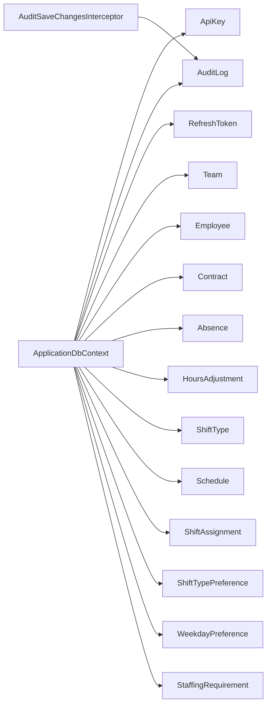

<!-- generated by docwizz: edits are overwritten -->
# src/ShiftPlanner.Infrastructure/Persistence

Layer **infrastructure** · project `ShiftPlanner.Infrastructure`

Project navigation: [ShiftPlanner.Infrastructure](../projects/ShiftPlanner-Infrastructure-51f58a3062c0.md)

## Overview 🤖

Manages database persistence and auditing for shift planning.

**Responsibilities.** Handles database operations and logs changes for auditing.

**Usage.** Used by API controllers and middleware for data persistence and auditing.

_AI draft from the facts on this page; review it, then write the module's documentation yourself._

## Key components

| Component | Kind | Used by | Summary |
|---|---|---|---|
| [ApplicationDbContext](#applicationdbcontext) | class | 12 |  |
| [ApplicationUser](#applicationuser) | class | 0 |  |
| [AuditSaveChangesInterceptor](#auditsavechangesinterceptor) | class | 0 | Builds AuditLog rows from the DbContext's change tracker on every save (readme.md §23/§1, "Änderungen nachvollziehbar speichern"). This used to be a SaveChangesAsync override on `ApplicationDbContext` itself, which had two problems: EF Core has four SaveChanges entry points (SaveChanges(), SaveChanges(bool), SaveChangesAsync(CancellationToken), SaveChangesAsync(bool, CancellationToken)) and a plain override only intercepts the one overload it declares — any caller reaching a different one (notably the sync SaveChanges()) silently skipped the audit write; and it mixed persistence with audit business logic and raw `ClaimsPrincipal` access in the same class as the entity model. A `SaveChangesInterceptor` fixes both: its `SavingChanges`/`SavingChangesAsync` pair is EF Core's single funnel for all four SaveChanges paths, and it lives outside the DbContext entirely. |

## External systems

- PostgreSQL (database, detected) — used by `ApplicationDbContext`

See [system context](../views/context.md).

## Flows through this module

- `DELETE /api/absences/{id:guid}`: AbsencesController → ApplicationDbContext → PostgreSQL
- `GET /api/absences/{id:guid}`: AbsencesController → ApplicationDbContext → PostgreSQL
- `PUT /api/absences/{id:guid}`: AbsencesController → ApplicationDbContext → PostgreSQL
- `DELETE /api/assignments/{id:guid}`: SchedulesController → ApplicationDbContext → PostgreSQL
- `PUT /api/assignments/{id:guid}`: SchedulesController → ApplicationDbContext, WorkingTimeCalculator → PostgreSQL
- `DELETE /api/contracts/{id:guid}`: ContractsController → ApplicationDbContext → PostgreSQL
- `GET /api/contracts/{id:guid}`: ContractsController → ApplicationDbContext → PostgreSQL
- `PUT /api/contracts/{id:guid}`: ContractsController → ApplicationDbContext, Contract → PostgreSQL
- … 50 more in [API](../api.md#flows) and [frontend](../frontend.md#flows)

## Architecture observations

- 1 member has cyclomatic complexity ≥ 15 (many paths to test and explain): `AuditSaveChangesInterceptor.BuildAuditLogs(ChangeTracker)` (16)
- `ApplicationDbContext` depends on 14 other components — high coupling, possibly several responsibilities

## Dependencies

Depends on: [src/ShiftPlanner.Domain/Common](src-ShiftPlanner.Domain-Common.md), [src/ShiftPlanner.Domain/Contracts](src-ShiftPlanner.Domain-Contracts.md), [src/ShiftPlanner.Domain/Employees](src-ShiftPlanner.Domain-Employees.md), [src/ShiftPlanner.Domain/Scheduling](src-ShiftPlanner.Domain-Scheduling.md)

Used by: [src/ShiftPlanner.Api/Controllers](src-ShiftPlanner.Api-Controllers.md), [src/ShiftPlanner.Api/Middleware](src-ShiftPlanner.Api-Middleware.md)

## Components

### ApplicationDbContext

_class_ · [ApplicationDbContext.cs](../../src/ShiftPlanner.Infrastructure/Persistence/ApplicationDbContext.cs#L17)

_Reached from:_ [`GET /api/absences/{id:guid}`](../api.md#flows), [`PUT /api/absences/{id:guid}`](../api.md#flows), [`DELETE /api/absences/{id:guid}`](../api.md#flows), [`PUT /api/assignments/{id:guid}`](../api.md#flows), [`DELETE /api/assignments/{id:guid}`](../api.md#flows), [`GET /api/contracts/{id:guid}`](../api.md#flows), [`PUT /api/contracts/{id:guid}`](../api.md#flows), [`DELETE /api/contracts/{id:guid}`](../api.md#flows), +50 more

| Member | Summary | Derived from code | Complexity |
|---|---|---|---|
| [`OnModelCreating(ModelBuilder)`](../../src/ShiftPlanner.Infrastructure/Persistence/ApplicationDbContext.cs#L36) |  |  | 1 |

### ApplicationUser

_class_ · [ApplicationUser.cs](../../src/ShiftPlanner.Infrastructure/Persistence/ApplicationUser.cs#L6)

_Linked tests:_ `IntegrationTestFixture.CreateStaffUserAsync` — test code that uses it, not coverage

### AuditSaveChangesInterceptor

_class_ · [AuditSaveChangesInterceptor.cs](../../src/ShiftPlanner.Infrastructure/Persistence/AuditSaveChangesInterceptor.cs#L27)

Builds AuditLog rows from the DbContext's change tracker on every save (readme.md §23/§1, "Änderungen nachvollziehbar speichern"). This used to be a SaveChangesAsync override on `ApplicationDbContext` itself, which had two problems: EF Core has four SaveChanges entry points (SaveChanges(), SaveChanges(bool), SaveChangesAsync(CancellationToken), SaveChangesAsync(bool, CancellationToken)) and a plain override only intercepts the one overload it declares — any caller reaching a different one (notably the sync SaveChanges()) silently skipped the audit write; and it mixed persistence with audit business logic and raw `ClaimsPrincipal` access in the same class as the entity model. A `SaveChangesInterceptor` fixes both: its `SavingChanges`/`SavingChangesAsync` pair is EF Core's single funnel for all four SaveChanges paths, and it lives outside the DbContext entirely.

| Member | Summary | Derived from code | Complexity |
|---|---|---|---|
| [`SavingChanges(DbContextEventData, InterceptionResult<int>)`](../../src/ShiftPlanner.Infrastructure/Persistence/AuditSaveChangesInterceptor.cs#L39) |  |  | 1 |
| [`SavingChangesAsync(DbContextEventData, InterceptionResult<int>, System.Threading.CancellationToken)`](../../src/ShiftPlanner.Infrastructure/Persistence/AuditSaveChangesInterceptor.cs#L45) |  |  | 1 |

---
_Generated from 23 symbols in [src/ShiftPlanner.Infrastructure/Persistence/ApplicationDbContext.cs](../../src/ShiftPlanner.Infrastructure/Persistence/ApplicationDbContext.cs), [src/ShiftPlanner.Infrastructure/Persistence/ApplicationUser.cs](../../src/ShiftPlanner.Infrastructure/Persistence/ApplicationUser.cs), [src/ShiftPlanner.Infrastructure/Persistence/AuditSaveChangesInterceptor.cs](../../src/ShiftPlanner.Infrastructure/Persistence/AuditSaveChangesInterceptor.cs) (commit `11abf0b`, profile `default`). Sections marked _fact_ are read from the code, _inferred_ come from heuristics, 🤖 marks AI drafts._
