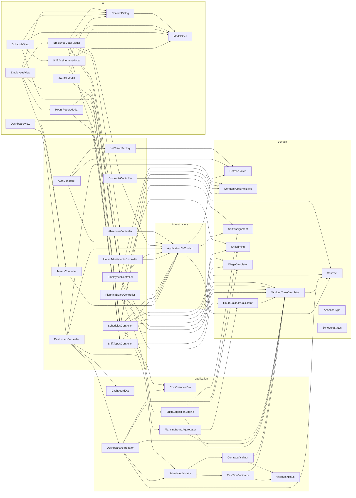

<!-- generated by docwizz: edits are overwritten -->
# Components

Top-level building blocks by layer and the dependencies between them (the 40 most connected; every module page has the full picture).

| Component | Kind | Layer | Depends on | Used by | Summary |
|---|---|---|---|---|---|
| [AbsencesController](../modules/src-ShiftPlanner.Api-Controllers.md#absencescontroller) | class | api | Absence, ApplicationDbContext | EmployeeDetailModal |  |
| [AuthController](../modules/src-ShiftPlanner.Api-Controllers.md#authcontroller) | class | api | AccessTokenResponse, ApplicationDbContext, JwtTokenFactory, RefreshToken |  |  |
| [ContractsController](../modules/src-ShiftPlanner.Api-Controllers.md#contractscontroller) | class | api | ApplicationDbContext, Contract | EmployeeDetailModal |  |
| [DashboardController](../modules/src-ShiftPlanner.Api-Controllers.md#dashboardcontroller) | class | api | ApplicationDbContext, CostOverviewDto, DashboardAggregator, DashboardDto, DashboardKpisDto, GermanPublicHolidays | DashboardView |  |
| [EmployeesController](../modules/src-ShiftPlanner.Api-Controllers.md#employeescontroller) | class | api | ApplicationDbContext, Employee, GermanPublicHolidays, HoursAdjustmentDto, HoursBalanceCalculator, HoursReportDayDto, HoursReportDto, HoursReportShiftDto, ShiftTypeDto, ShiftTypePreference, ShiftTypePreferenceDto, WeekdayPreference, WeekdayPreferenceDto, WorkingTimeCalculator | EmployeeDetailModal, EmployeesView, HoursReportModal |  |
| [HoursAdjustmentsController](../modules/src-ShiftPlanner.Api-Controllers.md#hoursadjustmentscontroller) | class | api | ApplicationDbContext, HoursAdjustment | EmployeeDetailModal |  |
| [JwtTokenFactory](../modules/src-ShiftPlanner.Api-Authentication.md#jwttokenfactory) | class | api | RefreshToken, RefreshTokenValidationResult | AuthController |  |
| [PlanningBoardController](../modules/src-ShiftPlanner.Api-Controllers.md#planningboardcontroller) | class | api | AbsenceDto, ApplicationDbContext, GermanPublicHolidays, PlanningBoardAggregator, PlanningBoardDto, PlanningBoardEmployeeDto, ShiftAssignmentDto, ShiftTiming, WageCalculator, WorkingTimeCalculator |  |  |
| [SchedulesController](../modules/src-ShiftPlanner.Api-Controllers.md#schedulescontroller) | class | api | ApplicationDbContext, AutoFillProposalDto, Contract, CopyMonthResponse, GermanPublicHolidays, Schedule, ScheduleDetailDto, ScheduleValidator, SchedulingContext, ShiftAssignment, ShiftAssignmentDto, ShiftSuggestionDto, ShiftSuggestionEngine, ShiftTiming, WageCalculator, WorkingTimeCalculator | AutoFillModal, ScheduleView, ShiftAssignmentModal, ShiftSuggestionModal |  |
| [ShiftTypesController](../modules/src-ShiftPlanner.Api-Controllers.md#shifttypescontroller) | class | api | ApplicationDbContext, ShiftType, ShiftTypeDto, WorkingTimeCalculator | DashboardView, EmployeeDetailModal, HoursReportModal, ShiftTypeDetailModal, StammdatenView |  |
| [TeamsController](../modules/src-ShiftPlanner.Api-Controllers.md#teamscontroller) | class | api | ApplicationDbContext, Team, TeamDto | DashboardView, EmployeesView, SettingsView, StammdatenView |  |
| [ContractValidator](../modules/src-ShiftPlanner.Application-Validation.md#contractvalidator) | class | application | ValidationIssue, WorkingTimeCalculator | ScheduleValidator |  |
| [CostOverviewDto](../modules/src-ShiftPlanner.Application-Dashboard.md#costoverviewdto) | record | application | CostBreakdownDto | DashboardController, DashboardDto |  |
| [DashboardAggregator](../modules/src-ShiftPlanner.Application-Dashboard.md#dashboardaggregator) | class | application | Contract, CostBreakdownDto, CoverageDayDto, EmployeeUtilizationDto, PainPointDto, PlanningStatusDto, ScheduleRefDto, ScheduleValidator, ShiftTiming, UtilizationDto, WageCalculator, WorkingTimeCalculator | DashboardController |  |
| [DashboardDto](../modules/src-ShiftPlanner.Application-Dashboard.md#dashboarddto) | record | application | CostOverviewDto, DashboardKpisDto, PlanningStatusDto, UtilizationDto | DashboardController |  |
| [PlanningBoardAggregator](../modules/src-ShiftPlanner.Application-Planning.md#planningboardaggregator) | class | application | HoursBalanceCalculator, PlanningBoardEmployeeStats, WorkingTimeCalculator | PlanningBoardController |  |
| [RestTimeValidator](../modules/src-ShiftPlanner.Application-Validation.md#resttimevalidator) | class | application | ValidationIssue, WorkingTimeCalculator | ScheduleValidator |  |
| [ScheduleValidator](../modules/src-ShiftPlanner.Application-Validation.md#schedulevalidator) | class | application | AbsenceValidator, BreakMinutesValidator, ConsecutiveDaysValidator, ContractValidator, EligibilityValidator, RestTimeValidator, ShiftOverlapValidator, StaffingValidator, ValidationResult | DashboardAggregator, SchedulesController |  |
| [ShiftSuggestionEngine](../modules/src-ShiftPlanner.Application-Suggestions.md#shiftsuggestionengine) | class | application | AutoFillProposal, RuleOutcome, ShiftAssignment, ShiftSuggestion, WorkingTimeCalculator | SchedulesController |  |
| [ValidationIssue](../modules/src-ShiftPlanner.Application-Validation.md#validationissue) | record | application | ValidationIssueCode | AbsenceValidator, BreakMinutesValidator, ConsecutiveDaysValidator, ContractValidator, EligibilityValidator, RestTimeValidator, ShiftOverlapValidator, StaffingValidator |  |
| [AbsenceType](../modules/src-ShiftPlanner.Domain-Employees.md#absencetype) | enum | domain |  | AbsenceDto, CreateAbsenceRequest, UpdateAbsenceRequest |  |
| [Contract](../modules/src-ShiftPlanner.Domain-Contracts.md#contract) | class | domain |  | ApplicationDbContext, ContractsController, DashboardAggregator, SchedulesController, WorkingTimeCalculator |  |
| [GermanPublicHolidays](../modules/src-ShiftPlanner.Domain-Scheduling.md#germanpublicholidays) | class | domain | PublicHoliday | DashboardController, EmployeesController, PlanningBoardController, PublicHolidaysController, SchedulesController |  |
| [HoursBalanceCalculator](../modules/src-ShiftPlanner.Domain-Scheduling.md#hoursbalancecalculator) | class | domain | WorkingTimeCalculator | EmployeesController, PlanningBoardAggregator |  |
| [RefreshToken](../modules/src-ShiftPlanner.Domain-Common.md#refreshtoken) | class | domain |  | ApplicationDbContext, AuthController, JwtTokenFactory, RefreshTokenValidationResult |  |
| [ScheduleStatus](../modules/src-ShiftPlanner.Domain-Scheduling.md#schedulestatus) | enum | domain |  | ScheduleDetailDto, ScheduleDto, ScheduleRefDto |  |
| [ShiftAssignment](../modules/src-ShiftPlanner.Domain-Scheduling.md#shiftassignment) | class | domain |  | ApplicationDbContext, SchedulesController, ShiftSuggestionEngine |  |
| [ShiftTiming](../modules/src-ShiftPlanner.Domain-Scheduling.md#shifttiming) | record | domain |  | DashboardAggregator, PlanningBoardController, SchedulesController |  |
| [WageCalculator](../modules/src-ShiftPlanner.Domain-Scheduling.md#wagecalculator) | class | domain | LaborCostBreakdown | DashboardAggregator, PlanningBoardController, SchedulesController |  |
| [WorkingTimeCalculator](../modules/src-ShiftPlanner.Domain-Scheduling.md#workingtimecalculator) | class | domain | Contract | ContractValidator, DashboardAggregator, EmployeesController, HoursBalanceCalculator, PlanningBoardAggregator, PlanningBoardController, RestTimeValidator, SchedulesController, ShiftSuggestionEngine, ShiftTypesController |  |
| [ApplicationDbContext](../modules/src-ShiftPlanner.Infrastructure-Persistence.md#applicationdbcontext) | class | infrastructure | Absence, ApiKey, AuditLog, Contract, Employee, HoursAdjustment, RefreshToken, Schedule, ShiftAssignment, ShiftType, ShiftTypePreference, StaffingRequirement, Team, WeekdayPreference | AbsencesController, ApiKeyAuthenticationHandler, AuthController, ContractsController, DashboardController, EmployeesController, HoursAdjustmentsController, PlanningBoardController, SchedulesController, ShiftTypesController, StaffingRequirementsController, TeamsController |  |
| [AutoFillModal](../modules/frontend-src-views-Schedule.md#autofillmodal) | component | ui | ModalShell, SchedulesController | MonthOverviewView | Dropped rows are tracked by index rather than spliced out of `proposals` — keeps the "N vorgeschlagen, M verworfen" summary stable while the manager reviews. |
| [ConfirmDialog](../modules/frontend-src-components.md#confirmdialog) | component | ui | ModalShell | EmployeeDetailModal, EmployeesView, ScheduleView, ShiftAssignmentModal |  |
| [DashboardView](../modules/frontend-src-views-Dashboard.md#dashboardview) | component | ui | DashboardController, ShiftTypesController, TeamsController |  | issue #56: regular/night/Sunday/holiday cost breakdown restored from the dashboard mockup's trimmed scope — mapped onto WageCalculator's actual surcharge types rather than a literal "overtime" cost bucket, since there's no separate overtime pay rate anywhere in this app. |
| [EmployeeDetailModal](../modules/frontend-src-views-Employees.md#employeedetailmodal) | component | ui | AbsencesController, ConfirmDialog, ContractsController, EmployeesController, HoursAdjustmentsController, ModalShell, ShiftTypesController | EmployeesView | issue #165: HoursAdjustment writes are AdminWrite-only server-side (a manual correction to a computed balance, stricter than the ManagerWrite Absence/Contract use) — gate the create/delete controls the same way client-side; the list itself stays visible to any signed-in Staff user (ApiRead), same read/write split the backend enforces. |
| [EmployeesView](../modules/frontend-src-views-Employees.md#employeesview) | component | ui | ConfirmDialog, EmployeeDetailModal, EmployeesController, HoursReportModal, TeamsController |  | Set only after a plain delete 409s because the employee still has shifts assigned — offers a second, more explicit confirmation for actually removing the employee *and* that history (e.g. leftover test/demo data nobody wants to keep), rather than requiring the shifts to be removed one by one or the employee kept around deactivated. |
| [HoursReportModal](../modules/frontend-src-views-Employees.md#hoursreportmodal) | component | ui | EmployeesController, HoursReportPrintSheet, ShiftTypesController | EmployeesView | issue #165: on-screen month picker for the printable "Monatsbericht" — fetches GET /employees/{id}/hours-report?from=&to= for the chosen month and hands it to HoursReportPrintSheet, then triggers window.print(). Deliberately not built on ModalShell: this needs precise control over what's print:hidden vs. what prints (the picker itself must vanish on print, the report sheet must not), which ModalShell's shared overlay doesn't expose. |
| [ModalShell](../modules/frontend-src-components.md#modalshell) | component | ui |  | AutoFillModal, ConfirmDialog, EmployeeDetailModal, HelpModal, ScheduleView, ShiftAssignmentModal, ShiftSuggestionModal, ShiftTypeDetailModal | A tap that opens this modal (e.g. an assignment chip on a touch device) is followed by the browser's synthetic "click" compatibility event at the same coordinates — which, once the backdrop exists, lands squarely on it and would immediately close what the tap just opened. Ignore backdrop clicks in the brief window right after mount so only a real outside tap closes the modal. |
| [ScheduleView](../modules/frontend-src-views-Schedule.md#scheduleview) | component | ui | ConfirmDialog, EmployeeSidebar, ModalShell, PlanningGrid, PlanningToolbar, SchedulePrintSheet, SchedulesController, ShiftAssignmentModal, ShiftPalette, ShiftPlanningGrid, ShiftSuggestionModal, ValidationSummary |  | issue #73: this file is orchestration only now — every DTO/date-math/formatting helper, data-loading concern, drag-and-drop mechanic, and mutation call that used to live here directly has moved into the composables/components imported above. Behavior is unchanged; see each file's own header comment for what it owns. issue #74: this view is week-scoped — the route's `:date` param is any date within the displayed week (MonthOverviewView.vue always passes the week's first visible day). `Schedule` itself stays month-scoped server-side (usePlanningBoard's `days`/`currentSchedule` are unchanged), only the *displayed* grid columns narrow to one week here. |
| [ShiftAssignmentModal](../modules/frontend-src-views-Schedule.md#shiftassignmentmodal) | component | ui | ConfirmDialog, ModalShell, SchedulesController | ScheduleView | issue #156's optimistic-concurrency 409 always carries this exact backend message — used to tell it apart from every other reason PUT/DELETE .../assignments/{id} can 409 (e.g. the Schedule having been Archived in the meantime), which need their own real message shown instead of this one's "someone else changed it, reload" wording. |
