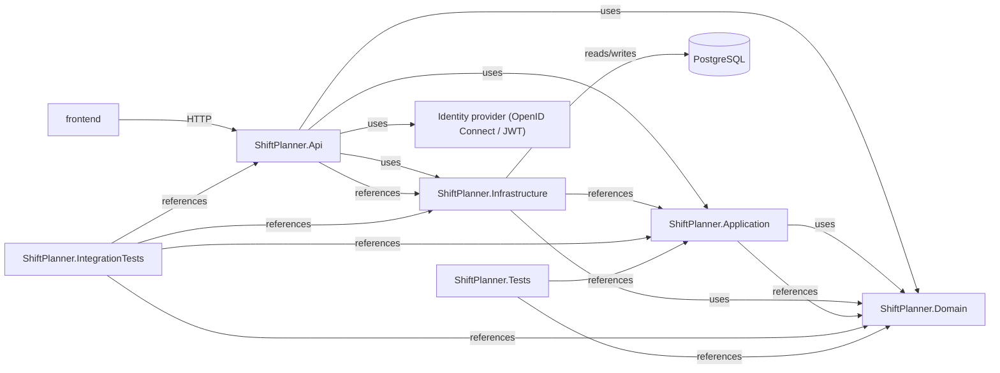

<!-- generated by docwizz: edits are overwritten -->
# Containers

Separately built/deployed units (projects) and how they talk to each other.

| Container | Kind | Source files | Packages |
|---|---|---|---|
| [frontend](../projects/frontend-da6498268e99.md) | npm | 47 | @lucide/vue, @tailwindcss/vite, @types/node, @vitejs/plugin-vue, @vue/eslint-config-prettier, @vue/eslint-config-typescript, @vue/tsconfig, axios, eslint, eslint-plugin-sonarjs, eslint-plugin-vue, jscpd, pinia, prettier, tailwindcss, typescript, vite, vue, vue-router, vue-tsc |
| [ShiftPlanner.Api](../projects/ShiftPlanner-Api-b964678aa746.md) | dotnet, Microsoft.NET.Sdk.Web, net10.0, executable | 18 | Microsoft.AspNetCore.Authentication.JwtBearer, Microsoft.AspNetCore.Identity.EntityFrameworkCore, Microsoft.EntityFrameworkCore.Design, Swashbuckle.AspNetCore |
| [ShiftPlanner.Application](../projects/ShiftPlanner-Application-bbdb4cab28c5.md) | dotnet, Microsoft.NET.Sdk, net10.0, library | 14 | — |
| [ShiftPlanner.Domain](../projects/ShiftPlanner-Domain-f2a83529199c.md) | dotnet, Microsoft.NET.Sdk, net10.0, library | 24 | — |
| [ShiftPlanner.Infrastructure](../projects/ShiftPlanner-Infrastructure-51f58a3062c0.md) | dotnet, Microsoft.NET.Sdk, net10.0, library | 40 | Microsoft.AspNetCore.Identity.EntityFrameworkCore, Microsoft.EntityFrameworkCore, Npgsql.EntityFrameworkCore.PostgreSQL |
