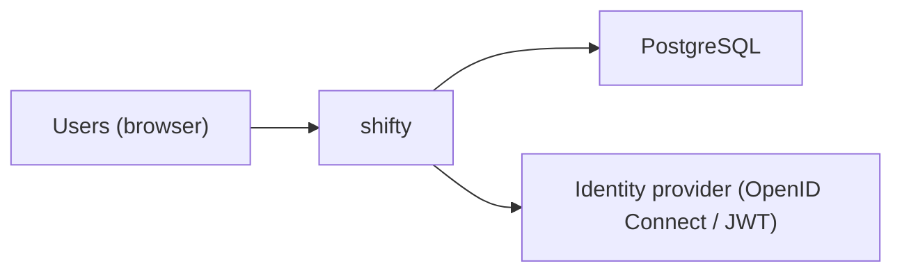

<!-- generated by docwizz: edits are overwritten -->
# System context

The system as one box: who uses it and what it relies on outside its own code.

## External systems

_Detected_: a call in the code shows it. _Inferred_: only a package reference (or a single candidate) points to it. _Unknown_: something is there, but the code doesn't say what.

| System | Kind | Certainty | Used by | Configured by | Evidence | Provisioned by |
|---|---|---|---|---|---|---|
| PostgreSQL | database | detected | ApplicationDbContext |  | [src/ShiftPlanner.Api/Program.cs:43](../../src/ShiftPlanner.Api/Program.cs#L43) |  |
| Identity provider (OpenID Connect / JWT) | identity | detected | ShiftPlanner.Api | `ConnectionStrings:Default` | [src/ShiftPlanner.Api/Program.cs:54](../../src/ShiftPlanner.Api/Program.cs#L54) |  |

## External packages

- **npm** (20): `@lucide/vue`, `@tailwindcss/vite`, `@types/node`, `@vitejs/plugin-vue`, `@vue/eslint-config-prettier`, `@vue/eslint-config-typescript`, `@vue/tsconfig`, `axios`, `eslint-plugin-sonarjs`, `eslint-plugin-vue`, `eslint`, `jscpd`, `pinia`, `prettier`, `tailwindcss`, `typescript`, `vite`, `vue-router`, `vue-tsc`, `vue`
- **nuget** (11): `Microsoft.AspNetCore.Authentication.JwtBearer`, `Microsoft.AspNetCore.Identity.EntityFrameworkCore`, `Microsoft.AspNetCore.Mvc.Testing`, `Microsoft.EntityFrameworkCore.Design`, `Microsoft.EntityFrameworkCore`, `Microsoft.NET.Test.Sdk`, `Npgsql.EntityFrameworkCore.PostgreSQL`, `Swashbuckle.AspNetCore`, `Testcontainers.PostgreSql`, `xunit.runner.visualstudio`, `xunit`

Declared versions and the manifests that declare them: [packages](packages.md).

