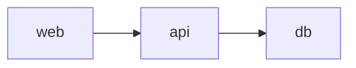

<!-- generated by docwizz: edits are overwritten -->
# Deployment

What the repository's deployment descriptors state. Environment variables are listed by name only.

## Deployable units (from project files)

- [frontend](../../frontend/package.json) — frontend (npm)
- [ShiftPlanner.Api](../../src/ShiftPlanner.Api/ShiftPlanner.Api.csproj) — ASP.NET Core web host

## Services ([docker-compose.yml](../../docker-compose.yml))

| Service | Image / build | Ports | Environment | Depends on | Volumes | Networks | Runs |
|---|---|---|---|---|---|---|---|
| [db](../../docker-compose.yml#L2) | `postgres:16-alpine` |  | POSTGRES_DB, POSTGRES_USER, POSTGRES_PASSWORD |  | pgdata:/var/lib/postgresql/data |  | PostgreSQL — used by the code (detected) |
| [api](../../docker-compose.yml#L12) | build `.` |  | ConnectionStrings__Default, Jwt__SigningKey, Jwt__Issuer, Jwt__Audience, Cors__FrontendOrigin | db |  |  | project `frontend`, project `ShiftPlanner.Api`, project `ShiftPlanner.Application`, project `ShiftPlanner.Domain`, project `ShiftPlanner.Infrastructure` |
| [web](../../docker-compose.yml#L26) | build `.` | 127.0.0.1:8090:80 |  | api |  |  | project `frontend`, project `ShiftPlanner.Api`, project `ShiftPlanner.Application`, project `ShiftPlanner.Domain`, project `ShiftPlanner.Infrastructure` |

## Container images

- [frontend/Dockerfile](../../frontend/Dockerfile): from `node:22-alpine`, `caddy:2-alpine`
- [src/ShiftPlanner.Api/Dockerfile](../../src/ShiftPlanner.Api/Dockerfile): from `mcr.microsoft.com/dotnet/sdk:10.0`, `mcr.microsoft.com/dotnet/aspnet:10.0`; exposes 8080

## Other descriptors

- [.github/workflows/build.yml](../../.github/workflows/build.yml)
- [.github/workflows/deploy.yml](../../.github/workflows/deploy.yml)
- [.github/workflows/diagnose-host.yml](../../.github/workflows/diagnose-host.yml)

## Configuration

Environments with configuration files in the repository: default ([src/ShiftPlanner.Api/appsettings.json](../../src/ShiftPlanner.Api/appsettings.json)), Development ([src/ShiftPlanner.Api/appsettings.Development.json](../../src/ShiftPlanner.Api/appsettings.Development.json)). Values are not shown — they may be secrets — except the host of a URL.

| Key | Defined for | Points to | Read by | Status |
|---|---|---|---|---|
| [`ConnectionStrings:Default`](../../src/ShiftPlanner.Api/appsettings.json#L10) | default, Development |  | ShiftPlanner.Api | detected: defined and read |
| [`Cors:FrontendOrigin`](../../src/ShiftPlanner.Api/appsettings.json#L18) | default, Development | localhost (Development) | ShiftPlanner.Api | detected: defined and read |
| [`SeedUser:Email`](../../src/ShiftPlanner.Api/Program.cs#L176) |  |  | ShiftPlanner.Api | unknown: read, but no repository file defines it (environment variable, secret store or a default) |
| [`SeedUser:Password`](../../src/ShiftPlanner.Api/Program.cs#L178) |  |  | ShiftPlanner.Api | unknown: read, but no repository file defines it (environment variable, secret store or a default) |
| [`SeedUser:Role`](../../src/ShiftPlanner.Api/Program.cs#L180) |  |  | ShiftPlanner.Api | unknown: read, but no repository file defines it (environment variable, secret store or a default) |
| [`AllowedHosts`](../../src/ShiftPlanner.Api/appsettings.json#L8) | default | | | read by the framework |
| `Jwt:*` (3 keys) | default, Development | | | defined, not read by scanned code |
| `Logging:*` (2 keys) | default | | | read by the framework |

## Not derivable from the repository

- which environments exist and where they are hosted, beyond the configuration files and descriptors above
- values of secrets and of environment variables set outside the repository
- scaling, availability and network topology not declared in the descriptors
- who operates the system and how it is released

_None of this can be read from the code. Write it in `architecture/deployment.md` next to these docs; docwizz links it and never overwrites it._

